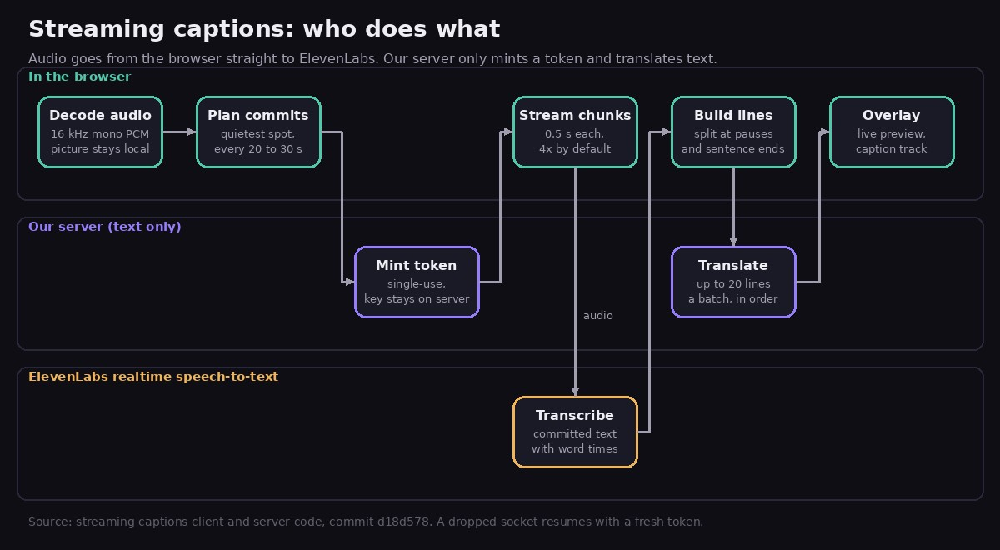
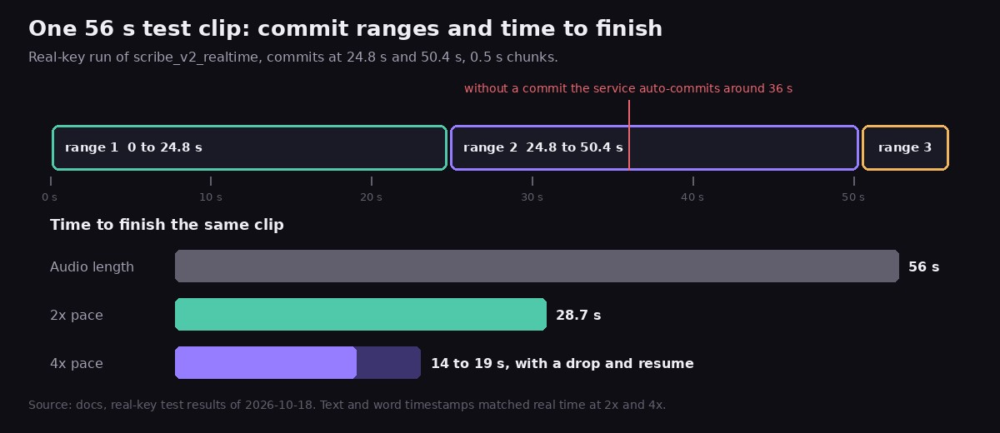
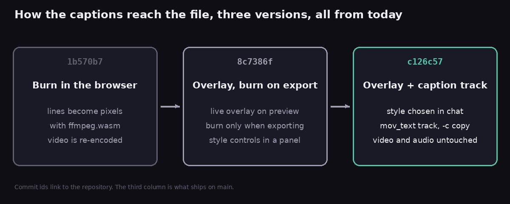
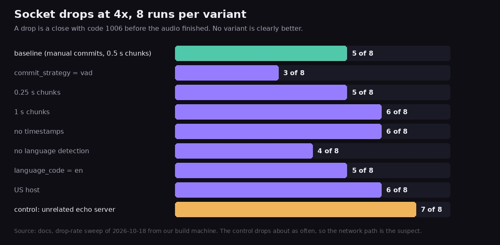

Type "add captions in Chinese" into the [FinalCap](https://grepawk.com/) editor and the video gets bilingual captions: the spoken line on top, the translation under it, drawn over the preview. This post explains how those bilingual captions are built today. The audio streams from the browser to ElevenLabs realtime speech-to-text, a Grok model translates the text, and Export adds a caption track to the file without re-encoding the video.

All of it landed in the FinalCap repository on 2026-10-18, so the post names the commit that introduced each piece. Code references are to main at `d18d578`. For the editor itself, see [plain-English ffmpeg edits](https://grepawk.com/blog/finalcap-plain-english-ffmpeg-edits) and [ffmpeg WebAssembly with threads](https://grepawk.com/blog/finalcap-ffmpeg-wasm-threads).

## How bilingual captions get built from a live stream

The picture never leaves the browser. Only the audio goes out, and it goes straight to the speech service instead of through our server.



The flow, from `streamingCaptions.js` in the browser code and its server counterpart, first added in commit `1b570b7`:

1. The browser decodes the clip's audio to 16 kHz mono PCM.
2. It plans where to cut the audio into ranges (next section).
3. Just before connecting, it asks our server for a single-use token. The ElevenLabs key stays on the server. The browser gets a token that works for 15 minutes.
4. It opens a WebSocket to ElevenLabs and sends the audio in 0.5 second chunks. The model is `scribe_v2_realtime`, with word timestamps on.
5. Each committed segment comes back as text with word times and becomes caption lines.
6. Lines go to our server in batches of up to 20 for translation, in order, while later audio is still streaming.

Why split it this way? The server never sees the audio, and translation is a stateless call on text, so a server restart does not lose the transcript or the lines already made. The older upload flow kept jobs in server memory, and a deploy could drop one. That flow still handles songs, because it looks up published lyrics to fix misheard words. It is also the fallback when streaming cannot start at all, and the app asks before it uploads the audio unless cloud captions are switched on.

Asking for captions starts the stream with no extra prompt. The [privacy page](https://grepawk.com/legal/privacy.html) says that the audio goes to ElevenLabs and that ElevenLabs may keep it under its own policy.

## Cutting the audio at quiet spots

ElevenLabs can commit a segment on request, which closes the current stretch of audio and returns its transcript with timestamps. FinalCap uses manual commits and chooses the cut points itself. `planCommitPoints` looks 20 to 30 seconds ahead and picks the quietest 50 ms window in that span, snapped to a 0.1 second grid. If a stretch is digital silence, it cuts in the middle of the run.

Cutting where nobody is talking is meant to keep a word from being split across two ranges. It also keeps the plan in charge. In the real-key test, without a commit the service auto-committed around 36 seconds, so ranges would stop lining up with the plan. A planned commit every 20 to 30 seconds avoids that.



A range is also the unit of retry. If a socket dies, the client starts again from the first range that has no transcript, not from the top.

## Sending audio faster than real time

The client sends chunks at a pace set by `STREAM_PACE_DEFAULT`, which is 4 (commit `835917b`). That means 4 seconds of audio per second of wall clock. A browser flag, `fc.streamPace`, can set it from 0.5 to 4, and 1 is real time.

Faster than real time matters because the audio is already on the device. A clip does not have to be spoken again to be transcribed. The real-key test in the docs checked what that does to quality, using a clip of about 56 seconds with 11 sentences:

- At 2x and 4x the service accepted every chunk, and the text and timestamps matched the real-time run.
- The clip finished in 28.7 seconds at 2x and in 14 to 19 seconds at 4x. The 4x run included a dropped socket and a resume.
- Of the sentence starts the model transcribed verbatim, 8 of 8 landed within 0.05 to 0.14 seconds of the true start, with a mean offset of +0.09 seconds.

The progress number is built from the same facts. It sits at 5 percent once the audio is decoded and the plan is made. After that, half of the bar is audio sent and half is audio that is both transcribed and translated, capped at 99. It reaches 100 when the captions are attached to the video.

## Building two-line captions

ElevenLabs returns words with start and end times. `buildLines` turns them into lines that fit on screen:

- A line breaks at a pause longer than 1.2 seconds, after a sentence end once the line is long enough, or before it grows past about 42 Latin characters or 18 CJK characters. When it has to break mid-sentence, it prefers the last comma or clause end.
- A line's time comes from its first and last word.
- A line stays on screen for at least 0.8 seconds, but never runs into the next line.

Each batch sent for translation carries the text of the previous 2 lines as context, so a sentence split across two lines can still be translated as one thought. The translation call is fixed to plain speech on the server: no song lookup and no web search. When a translation only repeats the original, the overlay draws the line once.

## Choosing the look in chat

The captions are drawn over the preview from the video's current time. The look is chosen in the chat, not in a panel. The web assistant asks once, "Which font and where should the captions go? Default is Noto Sans CJK SC Bold, bottom, 20% up." If you already said what you want, or say "default" or "just do it", it skips the question.

The tool accepts two fonts, Noto Sans CJK SC and Inter (Latin only), because those are the two the browser overlay can draw. Sizes are small, default, large and extra large, at 0.75, 1, 1.4 and 1.8 times the default. Position is bottom, middle or top. An unknown value falls back to the default, so a style request never fails the run (`resolveCaptionStyle`).

## A caption track instead of burned pixels

The first version burned the lines into the video in the browser. That needs a full re-encode, and a font. Over one day the design moved twice, as the three commits below show.



- `1b570b7`: captions burned in with ffmpeg.wasm.
- `8c7386f`: a live overlay on the preview, with the burn only on export.
- `c126c57`: Export adds a caption track and copies the streams. The burn export and the style panel were removed.

Export now runs one ffmpeg command in the browser, built by `buildMuxSoftSubsArgs`:

```sh
ffmpeg -i in.mp4 -i captions.srt \
  -map 0:v:0 -map 0:a? -map 1:0 \
  -c copy -c:s mov_text \
  -metadata:s:s:0 language=zho -disposition:s:0 default \
  -movflags +faststart out.mp4
```

The video and audio are the original bytes, so there is no re-encode and no font to ship. The track holds both lines, carries the target language as an ISO 639-2 code, and is the default track. Only the first video stream and the audio are mapped, because the extra data streams a phone adds cannot live in an MP4.

`mov_text` is the embedded caption format Apple's players read. Per the docs, QuickTime Player on macOS and the native iOS and macOS player list it in the captions menu, and the viewer turns it on. The docs also say the iOS Photos app does not offer embedded tracks, based on the sources we found, and that this was not tested on a physical iPhone. A video saved only to Photos may show no captions there.

Not every file can hold a `mov_text` track. It needs an mp4, m4v or mov file with H.264, HEVC or MPEG-4 video and AAC, MP3 or ALAC audio (or none). For anything else, such as webm, VP9 or Opus, the same Export button saves an SRT file and says so in one line. The mux test ran against ffmpeg 4.4 and the FFmpeg 5.1 WebAssembly core: one `mov_text` stream, the language tag, both lines, streams copied (`caption-mux.test.js`).

On phones, Export builds a file and offers the share sheet, which includes Save Video (`88d15e3`).

## Staying alive on a phone

Streaming over a WebSocket on a phone means the connection will sometimes fail. The client treats that as normal:

- A stall watchdog notices 20 seconds with no sign of life. A stuck stream is restarted through the resume path below, and if nothing is streaming at all, the run stops with a clear message and a Retry.
- After a drop, the client resumes by itself up to 3 times per session, waiting 0.5, 1.5 and 3 seconds. Each resume uses a fresh token for the same job and streams from the start of the first unfinished range (`36d33a1`).
- If that budget runs out and some captions are done, a prompt offers Continue or Cancel. Continue grants 3 more resumes, and the finished lines are kept.
- A translation call retries up to 3 times, after 1.5 and then 4 seconds. If the tab is hidden when the network fails, it waits for the tab to come back and tries again at once.
- When the tab returns and the socket is closed or has been silent for 8 seconds, it is replaced immediately. The page also asks for a screen wake lock while streaming.

The reason for all this is in the sweep below. Drops came up in real-key tests at every pace, so the design assumes them.



The sweep changed one thing at a time: chunk size, timestamps, language detection, the host, and the commit strategy. No variant was clearly better. An unrelated WebSocket echo server dropped in 7 of 8 runs, about as often as ElevenLabs did, which points at the network path from the test machine and not at the request. The defaults stayed as they were (commit `0764704`).

The sweep used a plain WebSocket client from the build machine, not a browser. The docs list what is still unchecked: these drops have not been measured in real Safari and Chrome on a consumer network, and the maximum session length and the token's first-use window are open questions. Treat the 4x default as a product choice that the resume logic is built to support, not as a proven network result.

## Edits and reloads

The caption lines travel with the video as an edit track. Edits that keep the timeline, such as resize, crop, colour and volume changes, keep the captions. A trim shifts the lines exactly and drops the ones that fall outside. Any other edit, such as speed changes or transitions, clears the overlay and the chat says why. The earlier clip keeps its captions, so Undo brings them back (`carryTrackOnEdit`).

The finished lines are saved as text in the browser's local storage, up to 8 videos, under a fingerprint of the video file. Add the same video again after a reload and the app says it restored the captions you made.

The audio limit for this flow is 10 minutes. Longer clips get a message to try one under 10 minutes.

## Try it

Open [FinalCap](https://grepawk.com/), add a clip with speech in it, and ask for captions in the language you want.
