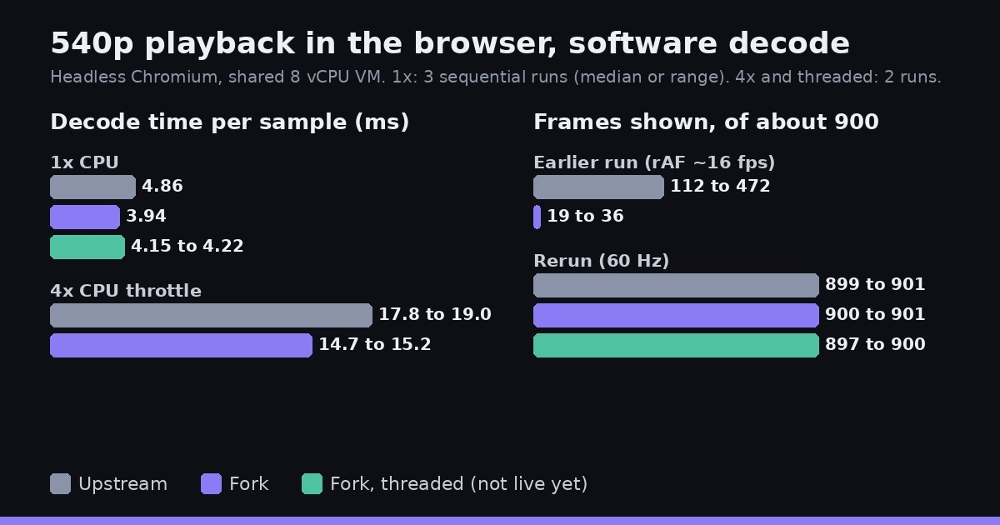

Earlier today we [benchmarked our filmcraft fork](https://grepawk.com/blog/filmcraft-wasm-simd-yuv-benchmark) against upstream and ended with an open question: in one playback recording, the fork showed far fewer frames. We reran everything on the latest fork (`2086529`) against the same upstream commit (`cee1feb`). This post covers the new numbers, what happened to that frame drop, and a first look at a threaded WebAssembly build of the editor.

**Try it live:** the fork's web build runs at [grepawk.com/filmcraft](https://grepawk.com/filmcraft/), right in your browser.

## The frame drop did not come back

The rerun plays a 960 by 540 clip at 30 fps in headless Chromium and reads the app's own counters for frames shown and decode time. Over 30 seconds about 900 frames are due.

Three runs each, one after the other:

| | Upstream | Fork |
| --- | --- | --- |
| Frames shown | 901, 901, 899 | 901, 901, 900 |
| Frames dropped | 0, 0, 0 | 0, 0, 1 |
| Decode per sample | 4.76 to 5.02 ms | 3.80 to 3.98 ms |

Both builds now show essentially every frame, and the browser draws at a steady 60 Hz. Running both at the same time, the way the earlier recording did, gives the same picture: 897 to 901 frames shown for each build.

The code that sets the fork's per-frame budget has not changed since the earlier run, so nothing was fixed. That session most likely had a slow environment: the page was drawing at about 16 frames per second for both builds then, against 60 now. We could not recreate those conditions, so we cannot say whether the budget's 4 ms floor makes things worse when the browser draws that slowly. With the CPU throttled 4 times, both builds drop almost every frame in the same way, so there is no fork-only penalty there.

The fork decodes each sample about 18% faster: 3.9 against 4.9 ms when run one after the other, 4.8 against 5.9 ms when run together, and about 15 against 18 ms at 4 times throttle.

## Frame conversion still holds up

The YUV to RGBA conversion benchmark (one 1080p frame, WebAssembly under Node, 7 runs per build this time instead of 9) gives:

| Build | 4:2:0 | 4:4:4 |
| --- | --- | --- |
| Upstream, as shipped (no SIMD) | 72.3 ms | 74.2 ms |
| Upstream with SIMD turned on | 70.8 ms | 73.4 ms |
| Fork | 59.2 ms | 62.5 ms |

Against upstream with SIMD turned on, the fork is about 16% faster for 4:2:0 and about 15% for 4:4:4. Against upstream as shipped it is about 18% and 16%. The first run measured about 20% and 12%; the ranges overlap, and no conversion code changed in between. Output checksums are identical across builds.

## A steadier UI, now without the long tasks

The UI benchmark plays a 1080p clip that neither build can decode in time on software decode, so it measures how smooth the app's UI loop is, not video playback. The browser draws at about 30 Hz in this setup.

| | Fork, earlier | Fork, rerun | Upstream, rerun |
| --- | --- | --- | --- |
| Long tasks at 1x CPU | 45, 3590 ms total | 7, 446 ms total | 8, 424 ms total |
| UI frames per second at 1x | 30.8 | 29.7 | 29.6 |
| Frames over 33 ms at 1x | 22% | 40.2% | 24.3% |
| UI frames per second at 4x | 28.1 | 27.4 | 19.7 |
| Frames over 33 ms at 4x | 28.8% | 26.4% | 81.3% |

At normal speed the fork's spike of long tasks is gone and now matches upstream, and its worst frames are shorter too (slowest 66.7 ms, against 150.1 before). Its share of frames over 33 ms went up in this run, to 40.2% against upstream's 24.3%. Under 4 times CPU throttle the fork keeps its clear lead: about 27 UI frames per second against 20, and 26% of frames over 33 ms against 81%.

## A threaded WebAssembly build

The fork can now also build a threaded version of the web app, where worker threads share memory with the page. The loader picks it only when the page is cross-origin isolated, which is what makes shared memory available, and falls back to the single-threaded build otherwise. On the 540p clip it showed 897 and 900 frames at 4.15 to 4.22 ms per sample, about the same as the single-threaded fork, with no measurable gain on a clip this small. It needed one small build fix to link, which is not committed yet.

The threaded build is not live yet. The demo at [grepawk.com/filmcraft](https://grepawk.com/filmcraft/) runs the single-threaded build.

## Caveats

All of this ran in headless Chromium with software rendering and no GPU, on a shared 8 vCPU virtual machine, so other load can shift the numbers. Real browsers on real hardware will behave differently, decoding in particular.

The full method and raw numbers are in the fork's [playback](https://github.com/yishengjiang99/filmcraft/blob/main/docs/benchmarks/playback.md), [frame conversion](https://github.com/yishengjiang99/filmcraft/blob/main/docs/benchmarks/fork-vs-upstream.md) and [UI jank](https://github.com/yishengjiang99/filmcraft/blob/main/docs/benchmarks/jank.md) notes. For the FFmpeg engine behind [FinalCap](https://grepawk.com/), see [Making FFmpeg in the browser use every core](https://grepawk.com/blog/finalcap-ffmpeg-wasm-threads).
