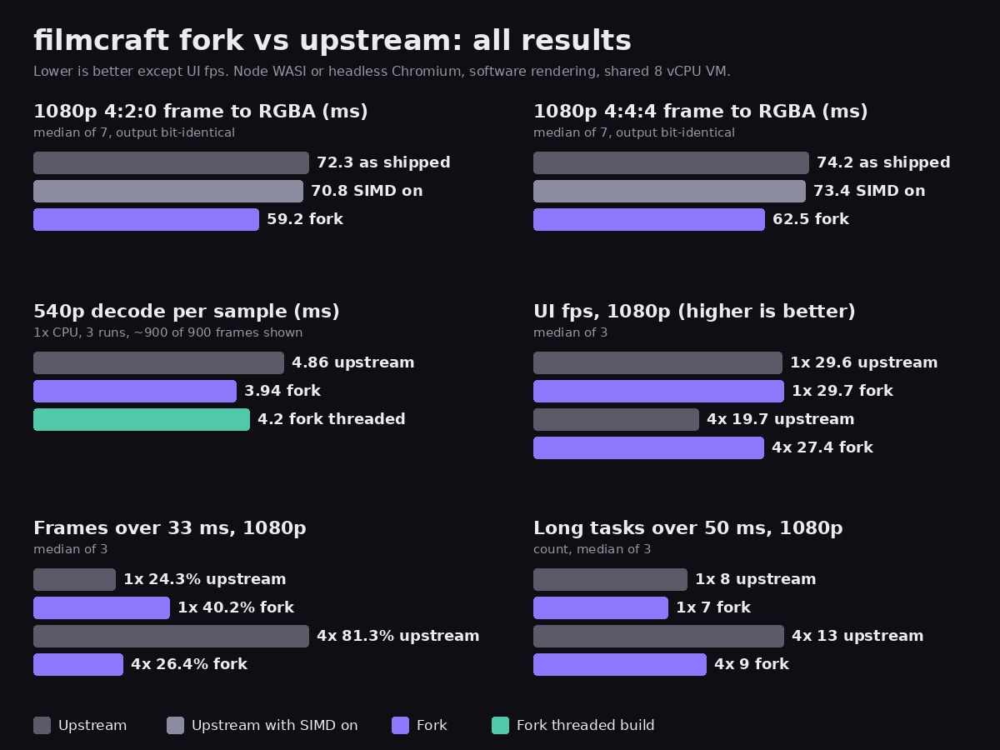

filmcraft is an open source video editor written in Rust that also runs in the browser as WebAssembly. Our fork adds a few performance changes to the WebAssembly build. This post sums up what they gain, where each gain comes from, and where the results are mixed.

## The results in short

| test | upstream | fork |
| --- | --- | --- |
| 1080p 4:2:0 frame to RGBA, ms | 72.3 | 59.2 (about 18% faster) |
| 1080p 4:4:4 frame to RGBA, ms | 74.2 | 62.5 (about 16% faster) |
| 540p playback, frames shown | about 900 of 900 | about 900 of 900 |
| 540p decode per sample, ms | 4.9 | 3.9 |
| 1080p UI fps at 4x CPU throttle | 19.7 | 27.4 |
| 1080p frames over 33 ms at 4x | 81.3% | 26.4% |

The upstream conversion numbers are for upstream as it ships, without SIMD.

## Where the WebAssembly gains come from

Two changes speed up turning a decoded YUV frame into RGBA pixels for display.

- **WebAssembly SIMD.** The fork turns on `simd128` for web builds, so the browser can work on several values in one instruction.
- **A 4-pixel kernel.** The fork adds a version of the YUV to RGBA row conversion that handles 4 pixels per step with `f32x4` vectors from the `wide` crate. It is compiled only for WebAssembly and for tests.

The kernel does most of the work. Upstream built with SIMD on takes 70.8 ms for a 1080p 4:2:0 frame, so SIMD alone saves little. The kernel brings it to 59.2 ms. For 4:4:4 the steps are 74.2, 73.4 and 62.5 ms. Each figure is the median of 7 runs.

The output is bit-identical: a checksum of every pixel matches across all builds. The native build does not use this code, and its times did not change (about 4.4 to 4.6 ms per frame in both).

## Playback and decode

On a 960 by 540 clip with the browser's software decoder, both builds showed about 900 of 900 frames over 30 seconds at a steady 60 Hz. The fork took 3.9 ms per decoded sample against 4.9 ms for upstream, about 18% less. When both builds ran at the same time on a busier machine, the times were 4.8 against 5.9 ms. The benchmark notes say this matches the SIMD conversion result. They do not trace the decode time to one change.

## The adaptive render budget under load

The second change is in how much work the app does per screen frame. Upstream gives the frame pump a fixed budget. The fork works it out while playing: the predicted frame time, minus the last UI pass, minus 2 ms, kept between 4 and 24 ms. When frames get expensive, the app does less per frame and the interface stays responsive.

This shows up under a 4x CPU throttle on a 1080p clip. The fork held 27.4 UI frames per second against 19.7 for upstream, and 26.4% of its frames took over 33 ms against 81.3%. It also had fewer long tasks over 50 ms (9 against 13). Its worst frames were still slow: about 100 ms at p99 and 200 ms at the maximum.

At normal speed the picture is mixed. Both builds ran at about 30 UI frames per second, and the fork had slightly fewer long tasks (7 against 8). But 40.2% of the fork's frames took over 33 ms, against 24.3% for upstream. In this 1080p test the software decoder also dropped about 97% of video frames in both builds, so it measures how the app interface paces, not smooth video.

## The threaded build is live

The threaded WebAssembly build is now available at [grepawk.com/filmcraft](https://grepawk.com/filmcraft/). The page is cross-origin isolated, loads the threaded files from `mt/`, and falls back to the single-threaded build when the browser cannot run threads. We have not measured a speedup from threads. On our test machine it played 897 to 900 of about 900 frames at 4.2 ms per decoded sample, close to the single-threaded fork.

## Limits of these numbers

- The browser tests used headless Chromium with software rendering and no GPU. Real browsers on real hardware will differ, decoding most of all.
- Everything ran on a shared 8 vCPU virtual machine, with 3 runs per browser test and 7 per conversion test. The spread between runs is visible in the raw data.
- 120 Hz displays, bundle size and startup time were not tested.

The method and raw numbers are in the fork's [conversion notes](https://github.com/yishengjiang99/filmcraft/blob/main/docs/benchmarks/fork-vs-upstream.md), [jank notes](https://github.com/yishengjiang99/filmcraft/blob/main/docs/benchmarks/jank.md) and [playback notes](https://github.com/yishengjiang99/filmcraft/blob/main/docs/benchmarks/playback.md). For more on video in the browser, see [Making FFmpeg in the browser use every core](https://grepawk.com/blog/finalcap-ffmpeg-wasm-threads), the engine behind [FinalCap](https://grepawk.com/).
