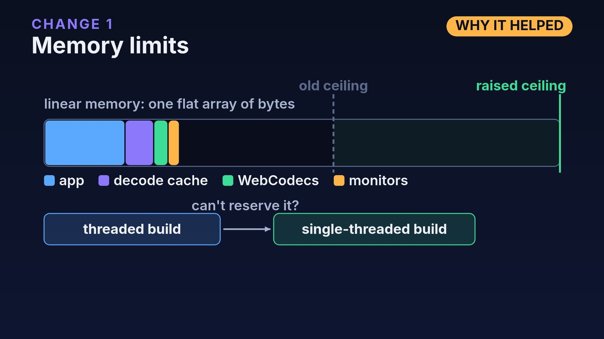
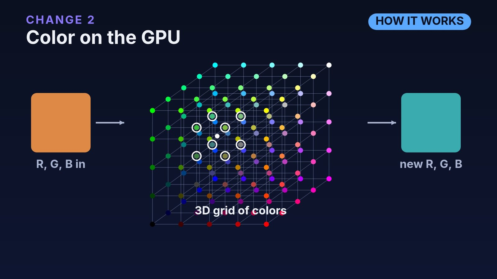
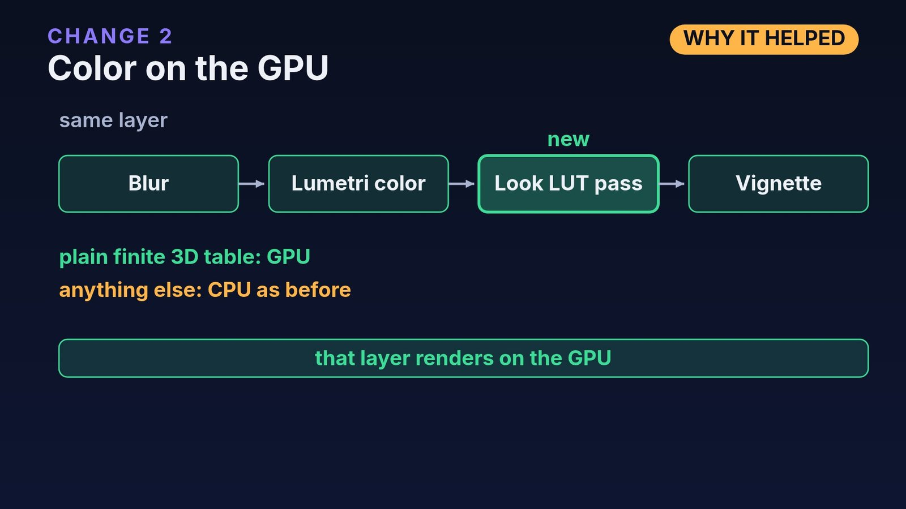
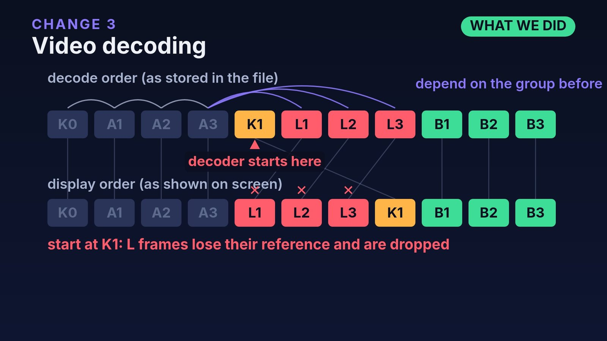
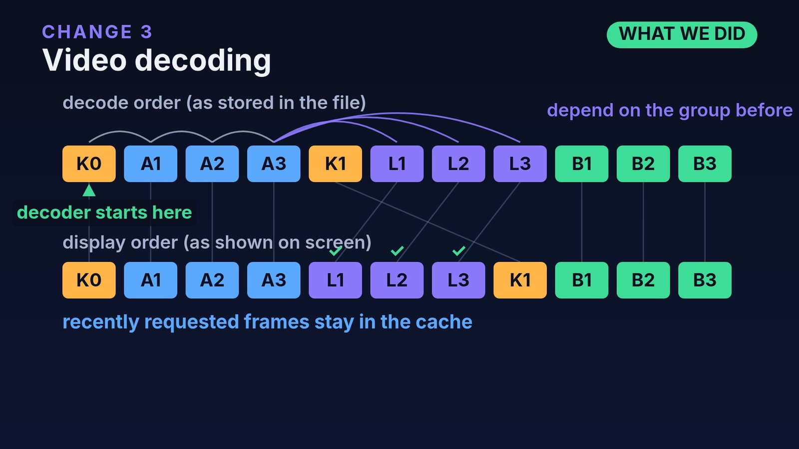
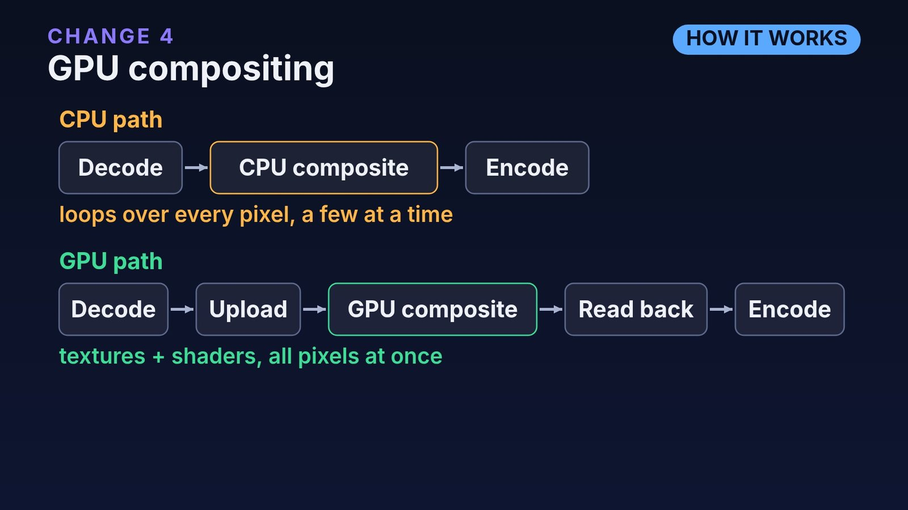
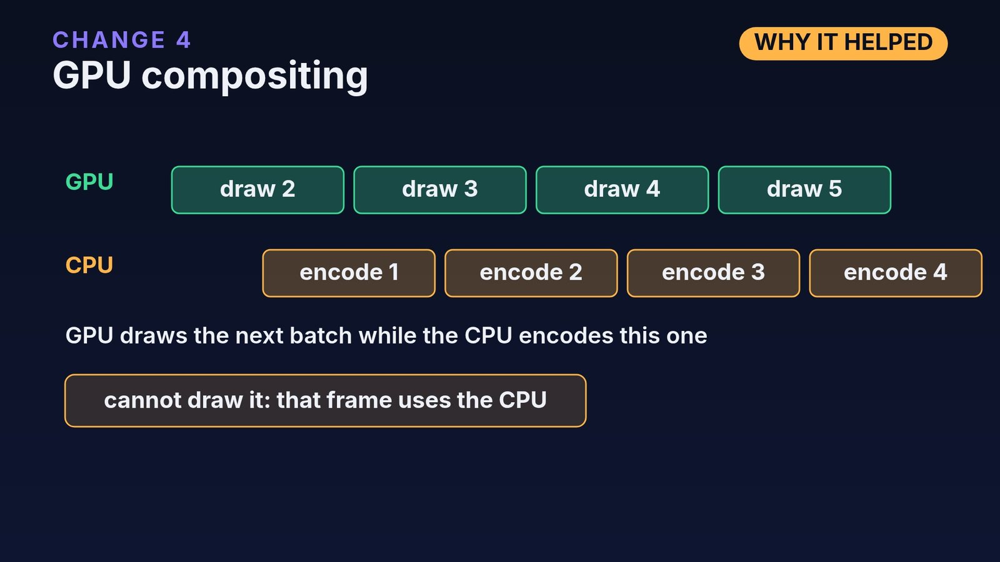

This post explains the filmcraft optimization work behind our browser export. [filmcraft](https://github.com/storytold/filmcraft) is an open source video editor written in Rust that also runs in a web page, and our [fork](https://github.com/yishengjiang99/filmcraft) of it runs live at [grepawk.com/filmcraft](https://grepawk.com/filmcraft/). The fork now exports on the GPU, and a 4K project that used to crash or crawl finishes quickly. Below, each change is explained the same way: how the technology works, what we did, and why it helped. The timed, repeated benchmark runs are now done, and the [results](#timed-results) follow the explanations. The newest change, color conversion on the GPU, has its own section.

```video
src: filmcraft-web-export-explained.mp4
poster: filmcraft-export-explainer-poster.jpg
title: How filmcraft export got fast in the browser (about 2.5 minutes)
caption: Diagrams for the four changes, with footage of the live build (headless Chrome, sped up). The full transcript is at the end of the post.
duration: PT2M33S
```

The video covers the first four changes below, with diagrams. It was made before the timed runs and the GPU color conversion. The editor footage in it is the live web build, recorded in headless Chrome and sped up.

## What changed in the filmcraft optimization

| Change | What we did | Effect on the 4K test project |
| --- | --- | --- |
| Memory limits | Smaller caches while an export runs, and a larger ceiling for the threaded build | The export no longer runs out of memory |
| Color on the GPU | The Look LUT runs as its own GPU pass | The whole 4K layer stays on the GPU |
| Video decoding | WebCodecs starts one key frame earlier for open GOP video | The export gets every frame it asks for |
| GPU compositing | Asynchronous read-back, so the page never waits for the GPU | Every frame is composited on the GPU |
| Color conversion on the GPU | A compute shader turns each frame into the encoder's YUV format before read-back | 2.4 times faster again, and the editor stays responsive |

How to read this: every number in this post comes from timed, repeated runs on one Apple M4 Pro in Chrome 155, and every output was checked against a reference render. The [timed results](#timed-results) section has the method and the caveats. The fork's [web export notes](https://github.com/yishengjiang99/filmcraft/blob/main/docs/benchmarks/web-export.md) record every run.

## Memory limits: lean caches and a bigger WebAssembly ceiling



### How it works

WebAssembly code runs in linear memory: one flat array of bytes that the module can grow, but only up to a maximum. The threaded build uses shared memory, which must declare that maximum when it is linked. When the browser cannot grow memory any further, an allocation fails and the export stops. A 32-bit module addresses memory with 32-bit numbers, so its ceiling can be no higher than that.

The editor keeps decoded frames in three caches: a shared decode cache, a WebCodecs cache for each source, and the monitors' frame cache. They are sized for playback and scrubbing, where the same frames are read again and again. A 4K frame is large, so those caches take a big share of the heap.

### What we did

An export reads each frame once, in order, so it does not need those caches. The new `filmcraft_media::lean` module (`crates/media/src/lean.rs`) holds a guard object. The stepped export job that runs in the browser creates one when it starts. While a guard exists, the three caches check it and keep only what a one-pass export needs: the decode cache keeps a decoder's run-ahead instead of a whole group of pictures, the WebCodecs cache keeps its lookahead plus a few frames, and the monitors keep a smaller budget of frames. When the job ends, whether it finishes, fails or is cancelled, the guard is dropped and the caches return to their playback sizes. Guards nest, and native exports never take one, so they are unchanged.

We also raised the threaded build's maximum memory to the most a 32-bit module can address. A browser that cannot reserve that much fails the threaded start, and the page falls back to the single-threaded build.

### Why it helped

The 4K test project ran past the old ceiling and stopped. With lean caches the export keeps its peak memory well below it, and the larger ceiling leaves room for 4K intermediate images. Scrubbing is not affected, because the caches grow back to their normal size when the export is over.

## Color on the GPU: the Look LUT as its own pass



### How it works

A LUT is a look-up table. A 3D LUT is a cube of colors with the same number of entries on each side. The red, green and blue of a pixel pick a point inside the cube, and the table returns the graded color. A pixel almost never lands exactly on an entry, so the result is blended from the nearest ones. filmcraft uses tetrahedral interpolation: it splits the cell around the point into tetrahedra and blends four of the eight corners.

Every pixel can be graded without looking at any other pixel. A GPU is built for that: it runs the same small program, a shader, on many pixels at once. A CPU works through pixels a few at a time.

The exporter plans each frame layer by layer. If any effect in a layer cannot run on the GPU, the planner draws the whole layer on the CPU.

### What we did

The project's Look LUT used to count as not GPU capable. The GPU crate already had a tested 3D LUT shader, so we gave the LUT its own pass in the GPU effect stage (`crates/gpu/src/fx.wgsl`, `crates/render/src/gpufx.rs`). The table sits in a storage buffer and the shader applies it with the same tetrahedral math as the CPU's `Lut3d::apply`. The pass runs at the same point where the CPU applies a Look LUT, after the rest of the Lumetri effect.

The GPU only takes plain tables: no 1D shaper, a grid size within the stage's limit, finite values and a usable domain. Anything else still falls back to the CPU as before. Tests compare the two paths, and they differ only at floating point rounding level. The CPU version of the effect gives bit-identical results to the function it came from.



### Why it helped

Before, the Look LUT sent the 4K background layer, with its blur, Lumetri color and vignette, to the CPU, and each frame took seconds. With the LUT as a GPU pass, that layer stays on the GPU, and every frame of the 4K test project is composited there.

## Video decoding: WebCodecs, key frames and open GOP



### How it works

WebCodecs gives a page the browser's own video decoder. The page feeds it compressed chunks in decode order, which is the order they are stored in the file, and it returns frames in display order, which is the order they are shown.

Most frames are stored as changes from other frames, so a decoder can only start at a key frame, which is stored whole. To show one frame, the decoder starts at a key frame before it and runs forward.

The two orders differ when frames are predicted from frames that are shown later. In an open GOP, which x265 and iPhone HEVC produce, a key frame is followed in the file by a few leading pictures. They are shown before the key frame, and they are predicted from the group before it. Here is a small example, with K for key frames and L for leading pictures:

```
decode order:   K0 A1 A2 A3 K1 L1 L2 L3 B1 B2 B3
display order:  K0 A1 A2 A3 L1 L2 L3 K1 B1 B2 B3
```

If decoding starts at K1, the decoder has no frames from before it. L1, L2 and L3 cannot be rebuilt, so the decoder drops them.

### What we did

The WebCodecs source used to restart at the key frame at or before the frame it needed. For a leading picture, that key frame is K1, and the frame never came out. The source now compares presentation times: if the requested frame is shown before its key frame, it steps back one more key frame (`apps/filmcraft-web/src/webcodecs.rs`). That matches what our other decoders already do in `filmcraft_codecs`.



We also changed how the cache trims itself. It drops the frames farthest from the latest request, and an export and a scrubbed monitor can ask for frames far apart on the same source. Frames asked for recently are now kept (`filmcraft_media::cache::evict_far`, with a bound on how many extra frames that can hold), so the two do not evict each other's frames.

### Why it helped

The 4K test clip is HEVC with open GOPs. Starting at the key frame meant the export waited for frames the decoder was never going to produce. Starting one key frame earlier gives the decoder the frames the leading pictures depend on, so they arrive and the export continues to the end.

## GPU compositing with asynchronous read-back



### How it works

Compositing stacks the layers, effects and transitions of a frame into one picture. On the CPU that is a loop over every pixel of every layer. On the GPU, each layer is a texture and each effect is a shader that runs on all pixels together. The finished picture is then copied back to memory for the encoder step.

A page's main thread is not allowed to wait for the GPU. WebGPU's `mapAsync`, which makes a GPU buffer readable, only completes after the page's event loop has run. So a read-back has to be asynchronous: ask for the picture, keep working, and collect it later.

### What we did

The exporter's frame renderers can now answer Ready, Pending or Declined (`crates/export`). The GPU renderer (`crates/gpu/src/async_export.rs`) submits a frame: it composites into a linear float image, copies it into one buffer of a small ring of staging buffers, requests the mapping and answers Pending. The export step yields, and a later step collects the picture. Several frames can be in flight, and the exporter prefetches the next batch before collecting the current one, so the GPU draws batch k+1 while the CPU converts and encodes batch k. Each mapped buffer is converted in bands of rows, because WebGPU copies a mapped range into WebAssembly memory first and a whole 4K frame is large.

A frame the GPU cannot draw, such as one with a transition other than a dissolve, an adjustment layer or HDR, is declined and renders on the CPU. If the GPU reports an error or a lost device, the rest of the export renders on the CPU instead of hanging.



### Why it helped

Compositing now runs across all pixels at once, the page never blocks on the GPU, and the GPU and CPU work on different batches at the same time. The editor stays responsive during an export, which was a problem when the CPU compositor held the main thread. In the 4K test project every frame is composited on the GPU.

## Color conversion on the GPU: RGB to YUV in a compute shader

### How it works

The compositor works in RGB: each pixel has a red, green and blue value, stored as 16-bit floating point numbers in linear light, which is the form blending math needs. Video encoders do not take RGB. They take YUV: Y is the brightness of each pixel, and U and V say how blue or red it is. Eyes are less sharp for color than for brightness, so the common I420 layout keeps one U and one V value for each 2 by 2 block of pixels. A frame in I420 takes 1.5 bytes per pixel. The compositor's float RGB image takes 8.

Getting from one to the other is a few steps per pixel: drop the alpha against black, apply the sRGB transfer curve to go from linear light to the values a display expects, round to 8 bits, then mix red, green and blue with the BT.709 weights into Y, U and V and scale them into the limited range that video uses (16 to 235 for Y).

### What we did

Before this change, the GPU read back the whole float RGB frame, and the CPU did every one of those steps: half floats to 32-bit floats, sRGB, then YUV. On the 4K project, the CPU conversion alone took 6.3 seconds of a 24.5 second export.

A new compute shader (`crates/gpu/src/i420.wgsl`) now does the conversion on the GPU, from the compositor's image straight into the I420 layout. Each shader invocation writes one 32-bit word, four output bytes, so no two invocations ever write the same word, and frames of any size work. The shader uses the same 4096 entry sRGB table as the CPU and rounds halves away from zero the way Rust does, not to even as WGSL's `round` would. In the unit test, the GPU's bytes are identical to the CPU's.

The browser's WebCodecs encoder takes I420 frames as they are, so the bytes go from the read-back straight into a `VideoFrame`. The exporter only turns this on when nothing changes a picture after compositing: no resize, no overlay, no video limiter, no alpha and no HDR. A frame the GPU cannot draw is still rendered on the CPU and converted there, so every frame of an export has the same form.

### Why it helped

The read-back moves 5 times less data per frame, the staging buffers hold 5 times more frames in flight, and the CPU no longer converts anything. On the short test projects the export got 2.3 to 2.7 times faster, and the page's slowest frames during export got 4 to 7 times shorter.

## Timed results

Each project is a short cut of a benchmark project, built through the editor's scripting API so every run is the same:

- P1s: 6 seconds of a plain 1080p clip.
- P2s: 12 seconds of a 1080p edit with two video tracks, cuts, a cross dissolve, Lumetri color, a title, and dialogue and music.
- P3s: 6 seconds of a 4K edit with blur, a Look LUT, vignette, a picture in picture with a scale keyframe, and titles.

Export wall time in seconds, median of 3 runs after a warmup run (the 4K CPU compositor runs were single runs, at about 17 minutes each):

| Stage | P1s | P2s | P3s |
| --- | --- | --- | --- |
| Before: built-in software encoder, CPU compositing | 23.6 | 168.2 | 1118.0 |
| Browser hardware encoder (WebCodecs) | 7.1 | 133.8 | 1003.4 |
| GPU compositing | 5.76 | 12.83 | 24.51 |
| Color conversion on the GPU | 2.54 | 4.80 | 10.09 |
| Speedup over before | 9.3x | 35x | 111x |

The 4K figure on the hardware encoder row is the CPU compositor measured in the same build as the last row.

What the numbers show:

- The hardware encoder removed the encode cost (about 100 ms per 1080p frame), which was most of a plain clip's export. On edits with effects, CPU compositing then took 96 percent of the time.
- GPU compositing removed that. On the 1080p edit it is 10 times faster than the CPU compositor in the same build.
- GPU color conversion removed the last big CPU step. Both 1080p projects now export more than twice as fast as they play.
- The page's 95th percentile frame time while exporting, with the timeline being scrubbed, went from 309 ms to 16 ms on P1s, and from 5.3 seconds to 91 ms on the 4K project. Peak WebAssembly memory on the 4K project went from 1.9 GiB to 655 MiB.
- Quality held: Y-PSNR against the reference render is 46 to 51 dB on the GPU path, and every output passed the checks for frame count, audio sync and stream errors.

Caveats: these are short cuts of the projects, on one machine. The last row was timed on a newer Chrome 155 patch release than the rows above it, because the browser updated itself in between. The 1080p edit's first runs varied by up to 20 percent before settling.

## A fail-fast benchmark script

The export benchmark script that checks all of this now stops quickly when something goes wrong. Every page call has a time limit, a crash or WebAssembly trap ends the run at once, and a stall check ends a run whose frame count stops moving and records the decoder and exporter state. A failed run keeps its last progress samples, and cache sizes are recorded during the export. The script itself is covered in [how we learned to trust our browser video export](https://grepawk.com/blog/how-we-learned-to-trust-our-browser-video-export).

## What's still in progress

These come from the fork's [handoff notes](https://github.com/yishengjiang99/filmcraft/blob/main/docs/export-optimize-gpu-handoff.md). None of it is finished, and there are no dates.

- The full length projects: the 60 second edit, the 20 second 4K project and the hour long export, which tests streaming and memory.
- Responsiveness on heavy projects: export steps still draw a batch of several frames, so on the 4K project the page's slow frames are 91 ms. Batch sizes based on measured step time are next.
- More GPU coverage. Effects such as the Lumetri input LUT, curves, color wheels, HSL secondary and sharpen still send a layer to the CPU, and so do some transitions.
- Step length. A frame whose plan still has a CPU layer costs time inside an export step, so the prefetch batch needs a cap based on measured cost.
- Streaming output with backpressure, and moving export off the main thread.
- Zero-copy hand-off to the encoder is not started. With the frame now read back as I420, the read-back is no longer the obvious cost, so it gets measured first.

For earlier posts on the fork, see [what the fork gains in WebAssembly](https://grepawk.com/blog/filmcraft-fork-webassembly-speedups) and the [YUV conversion benchmark](https://grepawk.com/blog/filmcraft-wasm-simd-yuv-benchmark). To edit video in the browser yourself, see [FinalCap](https://grepawk.com/) or the [live filmcraft build](https://grepawk.com/filmcraft/).

## Video transcript

filmcraft is an open source video editor that runs in a web page. Our fork exports on the GPU. Four changes make 4K export work. Each one: how it works, what we did, why it helped.

One: memory. WebAssembly uses linear memory, a flat array of bytes with a fixed ceiling. Past it, allocation fails. Caches are sized for scrubbing. An export reads each frame once, so most cached frames go unused. So the export job holds a guard. While it lives, the decode, WebCodecs and monitor caches shrink. After, they grow back. Native exports are unchanged. We also raised the threaded build's ceiling to the 32-bit maximum. If a browser cannot reserve it, it falls back to single-threaded. Memory stays under the ceiling.

Two: color. A LUT is a 3D grid of colors. A pixel's red, green and blue pick a spot, and the grid returns the new color. A GPU applies it to every pixel at once. But if any effect in a layer is unsupported, the whole layer is drawn on the CPU. Our look LUT was. We added the GPU's tested 3D LUT shader as its own pass, for plain finite tables. Now that layer renders on the GPU.

Three: decoding. WebCodecs takes frames in decode order and returns them in display order. Decoding can only start at a key frame, stored whole. Other frames are changes from earlier ones. In open GOP video, a few frames after a key frame are shown before it, and depend on the group before. Start at the key frame, and they are dropped. So the export kept waiting and restarting. Now decoding starts one key frame earlier. Recently requested frames also stay cached.

Four: compositing. On the CPU, stacking layers loops over every pixel. On the GPU, layers are textures and effects are shaders on all pixels at once. The page cannot wait for the GPU, so read-back is asynchronous: submit a frame, keep working, collect it later. So the GPU draws the next batch while the CPU encodes this one. Frames it cannot draw fall back to the CPU.

The benchmark script fails fast: time limits, instant failure on a crash, and a stall check.

Now a 4K export that used to crash or crawl finishes quickly, and the editor stays responsive. This is a single correctness run on one Apple M4 Pro, in Chrome. Repeated measurements are still to come. In progress: more effects on the GPU, and moving export off the main thread. Try it at grepawk.com/filmcraft.
