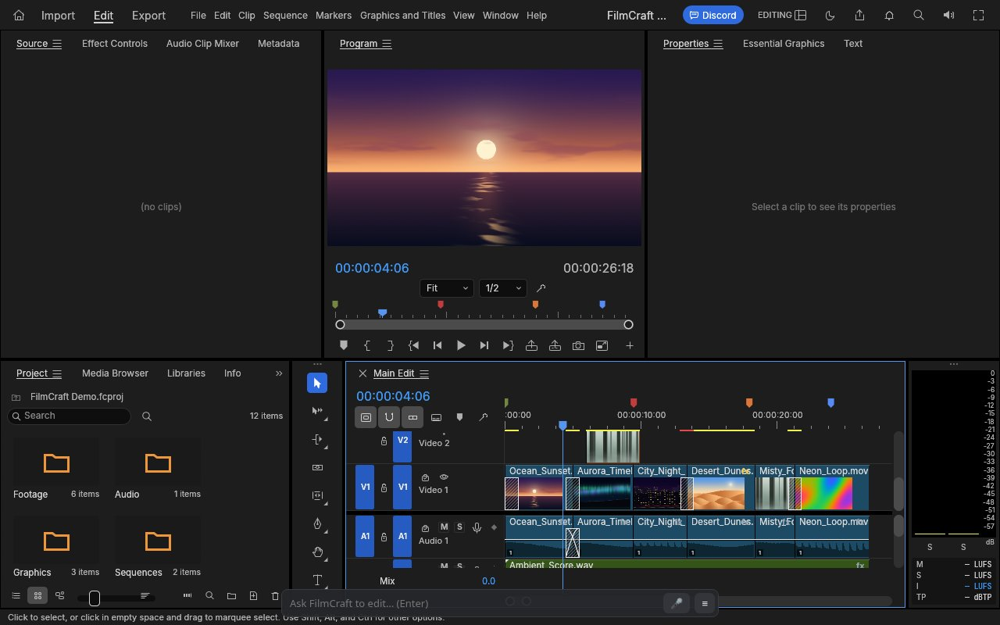
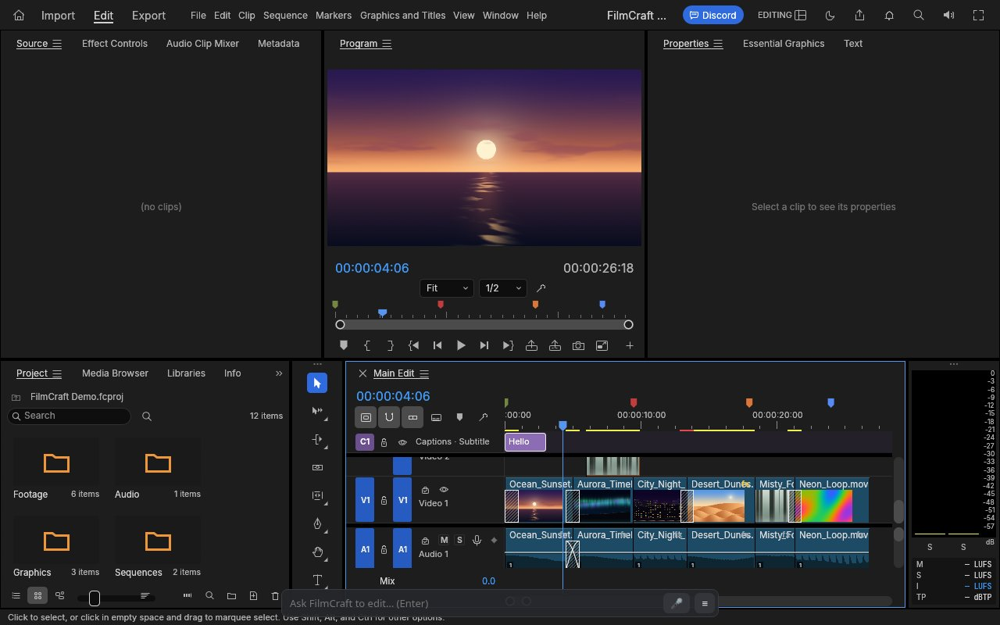
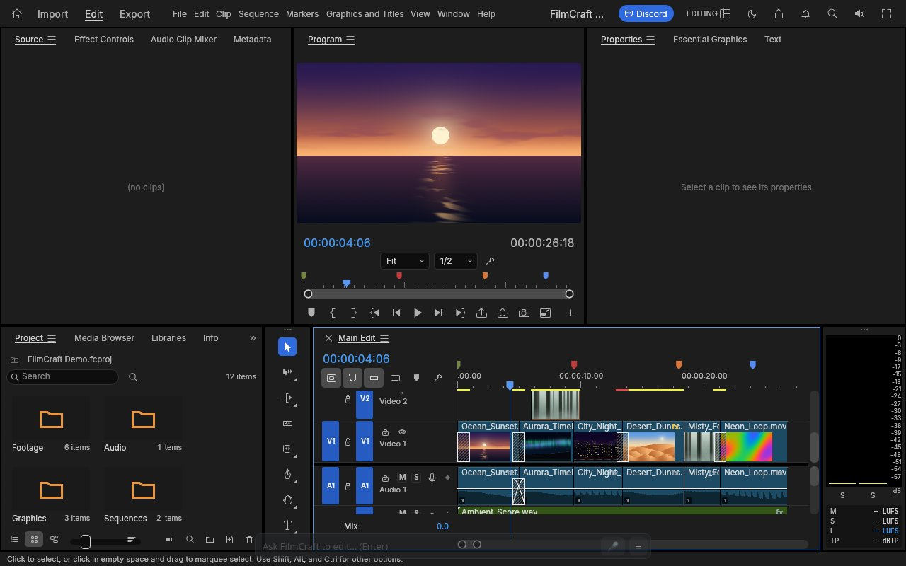

FilmCraft is an open-source video editor from the ArtCraft team, written in Rust, that also runs in the browser as WebAssembly. We forked it and put it live at [grepawk.com/filmcraft](https://grepawk.com/filmcraft/). This post is the story of how we added one thing on top: a prompt bar where you type "cut the clip at 5 seconds and add a fade" and the editor does it.



## ArtCraft made an open-source video editor

The upstream project is [storytold/filmcraft](https://github.com/storytold/filmcraft). Its README describes it as an open-source, clean-room reimplementation of a professional editing workflow, covering editing, color and sound, built in pure Rust, native on macOS, Windows and Linux, and in the browser via WebAssembly. It is licensed MIT or Apache 2.0.

The part that made our work small: upstream already treats every menu item, button and slider as a command with an id and typed parameters. Its README counts more than 650 engine commands, and the same commands are reachable from the UI, a CLI, a JSON control channel and an MCP server. FilmCraft was built for agents from the start.

## What was missing for us

Those agent hooks assume a program that already knows the command ids. In the browser build, the page exposes the same commands as `window.filmcraft.execute(id, params)` and `window.filmcraft.request(method, params)`. We wanted a person to type a sentence instead, with nothing to install.

Our fork is [yishengjiang99/filmcraft](https://github.com/yishengjiang99/filmcraft). It branches from upstream at commit cee1feb.

## A catalog the model can read

We started from FilmCraft's own API dump and kept the core commands. That gave a catalog of 666 entries, each with an id, a category, a short description and its arguments. For each request the server picks at most 40 of them by keyword, plus a small pinned set (razor, playhead, captions, transitions, export, inspect), so the prompt stays small.

## The loop

The server only plans. The browser does the work, on the same page, through `window.filmcraft`.

```
 you type a request
        |
        v
 browser takes a snapshot ----> tracks, clip ids, media, playhead
        |
        v
 server plans calls ---------> each call checked against the catalog
        |                       and against the snapshot ids
        v
 browser runs the calls
        |
   done? -- no --> new snapshot, send results back, plan again
        |
       yes
        v
 short explanation in the log
```

The snapshot is what lets the model say "clip 7" instead of guessing. The browser builds it fresh each time from the sequence, the project bin and the imported files. Times are in seconds. On a long timeline each track keeps its first and last clips and reports how many it left out.

## Checking every call

The model's output is never run as is. Each call is checked against the full catalog first.

```
 proposed call
      |
      +-- unknown command id ---------------> rejected
      +-- wrong kind or prefix -------------> repaired
      +-- required argument missing --------> rejected
      +-- clip or track not in snapshot ----> rejected
      |
      v
 call goes back to the browser to run
```

Rejections are fed back to the model so it can fix the call on the next pass. A plan can take at most 6 steps, and the browser helper stops early if any call fails.

## Why it needs more than one step

Some edits depend on the result of an earlier one. Take "cut the clip at 5 seconds and add a fade". The razor makes a new clip, and its id does not exist until the cut runs.

```
 step 1   timeline.razor at 5 s          -> run, new snapshot
 step 2   sequence.applyVideoTransition  -> cross dissolve on the new clip
          finish
```

That is the case our tests cover: a razor call, then a video transition. Other requests map to a single command. "add a caption saying Hello at the start" becomes `captions.add` with the text Hello at 0 seconds. For "export as 1080p mp4", the export command, `file.exportMedia`, takes a width, a height and a format such as h264, which is what the planner fills in.



## The prompt bar

The bar sits at the bottom of the FilmCraft page. Press Enter and it runs the loop above, then prints what it did in a small log you can show or hide. When you are not using it, the bar dims so it stays out of the way of the timeline. Add `?noagent` to the address to hide it. It also has a mic button that starts an ElevenLabs voice agent. That agent has one tool, edit_video, which runs the same loop as typing and speaks back the explanation. It is live on the page today, and it is new, so expect it to change.



## Try it

Open [grepawk.com/filmcraft](https://grepawk.com/filmcraft/), import a clip and type a request in the bar. For how the fork got fast enough to edit in a tab, see [What our filmcraft fork gains in WebAssembly](https://grepawk.com/blog/filmcraft-fork-webassembly-speedups). Credit for the editor itself goes to the ArtCraft team and [storytold/filmcraft](https://github.com/storytold/filmcraft).
