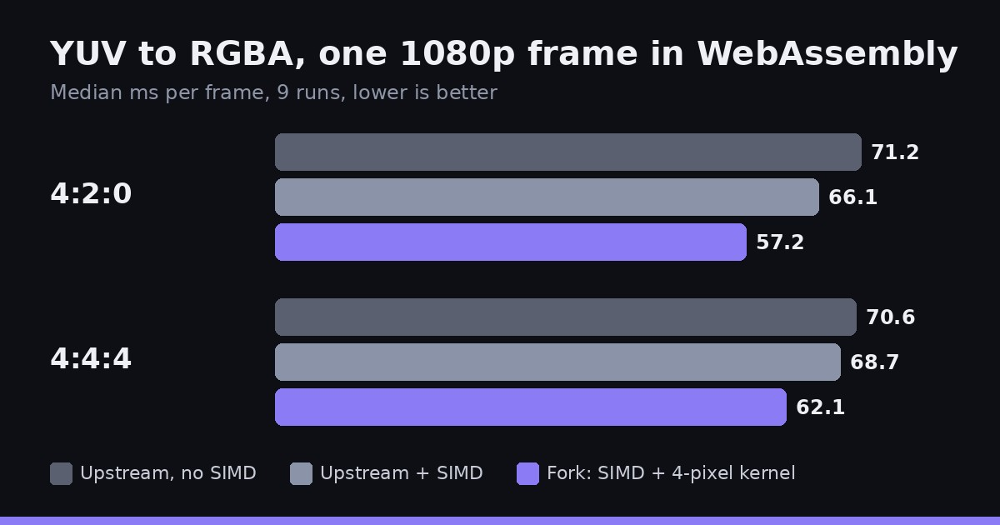

[filmcraft](https://github.com/storytold/filmcraft) is an open source video editor written in Rust that also runs in the browser through WebAssembly. We keep a [fork](https://github.com/yishengjiang99/filmcraft) of it. Every video frame it shows has to go from YUV, the format video is stored in, to RGBA, the format the screen draws. This post shows how much faster the fork makes that step in WebAssembly, and where the speed comes from.

## What changed

Two things, both for the web build only:

- **WebAssembly SIMD is on.** The web build now compiles with `+simd128` and runs `wasm-opt --enable-simd`. Upstream's web build does not.
- **A 4-pixel conversion kernel.** A new version of the YUV to RGBA row conversion works on four pixels at once, using four-lane float vectors from the `wide` crate. It is compiled only for WebAssembly (and for tests), so native builds keep the original code.

## The results

The benchmark builds one 1920 by 1080 frame (Rec.709, limited range, 8-bit) from a fixed seed and converts it to RGBA. Each variant runs 9 times; the numbers are the median milliseconds per frame. WebAssembly runs single-threaded under Node, on an 8 vCPU Intel Xeon virtual machine.

| Build | 4:2:0 | 4:4:4 |
| --- | --- | --- |
| Upstream, as shipped (no SIMD) | 71.2 ms | 70.6 ms |
| Upstream with SIMD turned on | 66.1 ms | 68.7 ms |
| Fork (SIMD and the 4-pixel kernel) | 57.2 ms | 62.1 ms |

Compared with upstream as shipped, the fork is about 20% faster for 4:2:0 video and about 12% faster for 4:4:4.

## Where the speed comes from

Building upstream with SIMD turned on, and changing nothing else, splits the gain in two:

- Turning on SIMD by itself gives about 3 to 7%.
- The 4-pixel kernel adds about 13% for 4:2:0 and about 10% for 4:4:4 on top of that.

The 4:4:4 runs vary more, and their ranges overlap a little, so treat that gain as rougher.

## Same pixels, same native speed

A checksum of every output frame is identical across all five builds, so the faster path produces exactly the same pixels. Native builds run at about 4.3 to 4.5 ms per frame, with or without the fork; the ranges overlap, as expected, since the new kernel is not compiled for native.

## What was not measured

These numbers cover frame conversion only. The fork also makes the web player adapt how much work it does per frame while playing, but that needs a real browser and display, so it is not in this benchmark. Bundle size and startup time were not measured either.

The full method and raw numbers are in the [benchmark notes](https://github.com/yishengjiang99/filmcraft/blob/main/docs/benchmarks/fork-vs-upstream.md).
