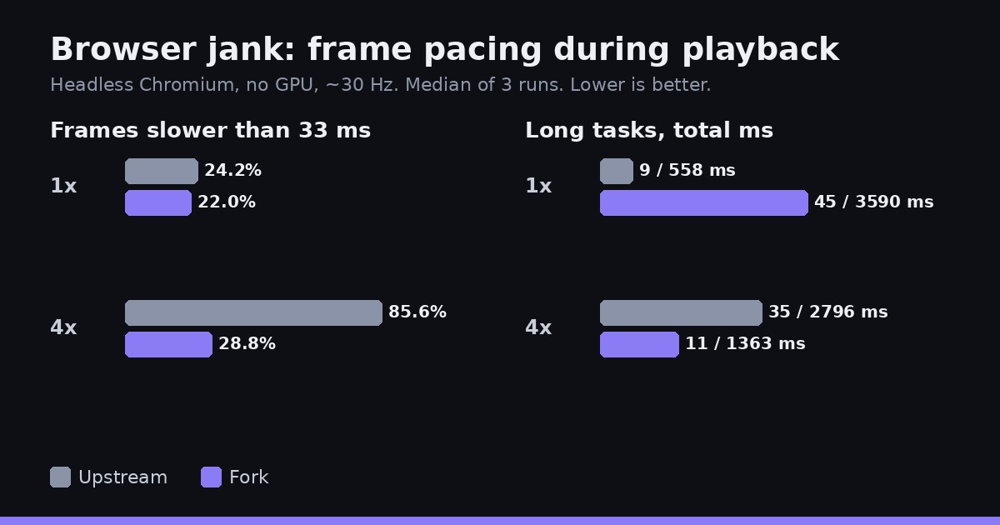

[filmcraft](https://github.com/storytold/filmcraft) is an open source video editor written in Rust. Upstream already builds it to WebAssembly so it runs in the browser. Our [fork](https://github.com/yishengjiang99/filmcraft) changes how that WebAssembly build does its work: it uses WebAssembly SIMD (`simd128`) for the step that turns each video frame from YUV, the format video is stored in, into RGBA, the format the screen draws. This post covers what that does to frame conversion, how the app's UI holds up in a browser, and a playback result that a later rerun did not reproduce.

**Try it live:** the fork's web build runs at [grepawk.com/filmcraft](https://grepawk.com/filmcraft/), right in your browser.

## Faster WebAssembly frame conversion

Two changes, both for the web build only:

- **WebAssembly SIMD is on.** The web build now compiles with `+simd128` and runs `wasm-opt --enable-simd`. Upstream's web build does not.
- **A 4-pixel conversion kernel.** A new version of the YUV to RGBA row conversion works on four pixels at once, using four-lane float vectors from the `wide` crate. It is compiled only for WebAssembly (and for tests), so native builds keep the original code.

The benchmark builds one 1920 by 1080 frame (Rec.709, limited range, 8-bit) from a fixed seed and converts it to RGBA. Each variant runs 9 times; the numbers are the median milliseconds per frame. WebAssembly runs single-threaded under Node, on an 8 vCPU Intel Xeon virtual machine.

| Build | 4:2:0 | 4:4:4 |
| --- | --- | --- |
| Upstream, as shipped (no SIMD) | 71.2 ms | 70.6 ms |
| Upstream with SIMD turned on | 66.1 ms | 68.7 ms |
| Fork (SIMD and the 4-pixel kernel) | 57.2 ms | 62.1 ms |

Compared with upstream as shipped, the fork is about 20% faster for 4:2:0 video and about 12% faster for 4:4:4. Turning on SIMD by itself gives about 3 to 7%. The 4-pixel kernel adds about 13% for 4:2:0 and about 10% for 4:4:4 on top of that. The 4:4:4 runs vary more, so treat that gain as rougher.

A checksum of every output frame is identical across all five builds, so the faster path produces exactly the same pixels. Native builds run at about 4.3 to 4.5 ms per frame with or without the fork, as expected, since the new kernel is not compiled for native.

## How smooth is the UI in a browser

The fork also makes the web player adapt how much work it does per frame while playing. It plans each pass from the expected frame interval, minus the time the last UI pass took, minus 2 ms, kept between 4 and 24 ms. To see what that does, a second benchmark plays the same 25 second 1080p clip in both web builds and records frame pacing: 3 runs of 20 seconds each, at normal CPU speed and with the CPU throttled 4 times.

Read these numbers with care. They come from headless Chromium in a Linux virtual machine with no GPU, where the browser draws at about 30 Hz instead of 60. Neither build actually decoded the 1080p clip there (well under one decoded frame per second), so this measures how smooth the app's UI loop is, not video playback.

Normal CPU speed (medians of 3 runs):

| | Upstream | Fork |
| --- | --- | --- |
| 95th percentile frame | 50 ms | 66.7 ms |
| 99th percentile frame | 66.7 ms | 116.6 ms |
| Slowest frame | 83.3 ms | 150.1 ms |
| Frames slower than 33 ms | 24.2% | 22% |
| Long tasks (over 50 ms) | 9, 558 ms total | 45, 3590 ms total |

CPU throttled 4 times:

| | Upstream | Fork |
| --- | --- | --- |
| UI frames per second | 18.6 | 28.1 |
| Frames slower than 33 ms | 85.6% | 28.8% |
| Long tasks (over 50 ms) | 35, 2796 ms total | 11, 1363 ms total |

At normal speed the result is mixed. The fork has slightly fewer slow frames, but its worst frames are worse and it runs many more long tasks on the main thread. Under load the fork is much steadier: it keeps about 28 frames per second while upstream drops to under 19, and far fewer of its frames are slow. That fits the adaptive budget shedding work when frames get expensive. Both builds still have long tails at 4 times throttle.

## Playback: the frame drop did not reproduce

A separate 28 second playback recording (960 by 540, software rendering, on a busy virtual machine) first showed the fork decoding each sample a little faster, 5.4 to 6.0 ms against 6.0 to 7.1 ms, but showing far fewer frames: 19 to 36 of about 845, against 112 to 472 for upstream.

A rerun did not reproduce the drop. Both builds showed about 900 of about 900 frames, and the fork still decoded faster. The budget code had not changed, so the first recording most likely reflects that session's machine, where the page drew at only about 16 frames per second for both builds.

## What was not measured

Bundle size and startup time were not measured, and 120 Hz displays were not tested. The fork's later threaded WebAssembly build is not in these numbers either.

The full method and raw numbers are in the [frame conversion notes](https://github.com/yishengjiang99/filmcraft/blob/main/docs/benchmarks/fork-vs-upstream.md) and the [browser jank notes](https://github.com/yishengjiang99/filmcraft/blob/main/docs/benchmarks/jank.md). For more on running video tools in the browser, see [Making FFmpeg in the browser use every core](https://grepawk.com/blog/finalcap-ffmpeg-wasm-threads), which covers the FFmpeg engine behind [FinalCap](https://grepawk.com/).
