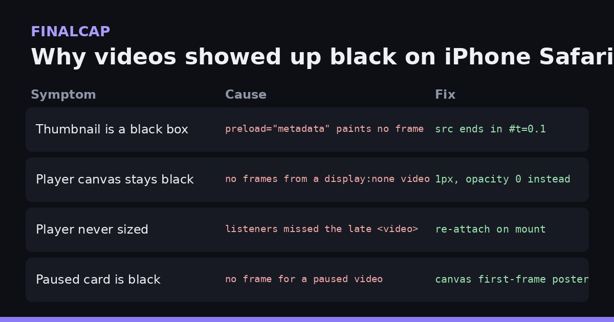

FinalCap is a chat-to-edit video editor that runs in the browser at [grepawk.com](https://grepawk.com/). You attach a video, type what you want, and FFmpeg does the edit on your device. On iPhone Safari, video previews showed up as black boxes. The fixes went live on grepawk.com this week. None of the causes were in our FFmpeg code. They were all about how WebKit decides when to draw a video frame.



## The thumbnail that never painted

The video card used a plain `<video preload="metadata">`. Desktop browsers show the first frame. iPhone Safari loads only the metadata, so the card was a black box with a duration.

The fix is a media fragment on the source URL:

```js
src={videoUrl && !videoUrl.includes('#') ? `${videoUrl}#t=0.1` : videoUrl}
```

`#t=0.1` asks the browser to start at 0.1 seconds, and Safari decodes and shows that frame.

## The hidden video behind the canvas

The player draws frames onto a canvas with `drawImage()`, reading them from a source `<video>` that the user never sees. That video was set to `display: none`. WebKit does not decode frames for a `display: none` video, so every `drawImage()` call painted black.

The fix keeps the video in the layout but invisible: 1 pixel square, opacity 0, no pointer events. WebKit still decodes it, and the canvas gets real frames.

## The player that never got its listeners

A redesign changed the card to show a thumbnail first. The player's `<video>` now mounts only after you tap the thumbnail, and again after you collapse and reopen it. The code that sizes and draws the canvas ran once, before that element existed. The result was an empty 300 by 150 canvas, the default size. The fix re-runs that setup whenever the player's video element appears.

## A poster for paused cards

A paused video on iPhone Safari can still show black. So each card now makes its own poster. It loads the video in a detached, muted element, seeks to 0.1 seconds, draws the frame to a small canvas (up to 480 pixels wide) and saves it as a JPEG. If the sampled pixels are all zero, the frame was not decoded yet, so it waits and tries again rather than saving a black poster.

## The keyboard and the chat box

While testing on iPhone we also fixed the composer. It now stays pinned to the bottom of the visible screen when the keyboard opens, using the browser's visual viewport size. It stays one row tall until your text wraps, grows to at most five rows, and closes the keyboard after you send.

## Try it

Open [grepawk.com](https://grepawk.com/) in Safari on your iPhone, attach a clip and ask for an edit.
