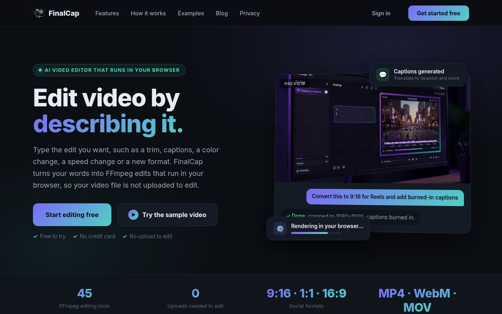
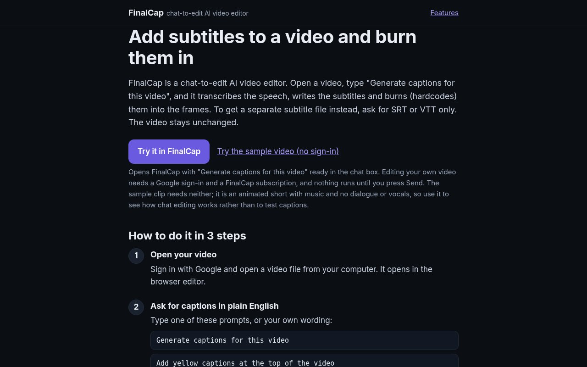

FinalCap is a video editor with a chat box instead of a timeline. You open a video and type what you want: "trim the first five seconds", "make it 9:16 for Reels", "add yellow captions at the top". This post explains what happens between the sentence and the edited file.



## The model picks a tool, it does not write video

Every edit FinalCap can make is a typed tool with a fixed set of parameters. There are more than 40 of them: resize, crop, rotate, flip, trim, change speed, add text, transitions between clips, brightness, hue, saturation and contrast, format conversion, and a long list of audio filters such as fades, equalizer, compressor, noise gate, echo and silence removal.

When you send a message, a Grok model on our server reads it together with the list of tools and answers with a tool call. For "make it 9:16 for Reels" that is the aspect ratio preset tool with `9:16`, which maps to 1080 by 1920. The model only chooses the operation and fills in the parameters. It never touches your video.

That split keeps the model away from your file. It can only ask for operations the app already knows how to run, with parameters the tool accepts.

## FFmpeg runs in your browser

The tool call comes back to the browser, which runs it with FFmpeg compiled to WebAssembly (ffmpeg.wasm). Your video is not uploaded to edit it. The result appears in the chat as a new clip you can play, keep editing or download.

Some requests do not fit any typed tool. For those, the model can propose one FFmpeg command. The browser checks it against the filters and encoders that its FFmpeg build actually contains and rejects anything it cannot run, so the command either works or fails loudly.

If a step really cannot run in the browser, FinalCap asks before it uploads anything to do it on the server. The default answer is no.

## Subtitles from the speech in your video

"Generate captions for this video" calls the captions tool. FinalCap extracts the audio and transcribes it with Whisper, an open speech recognition model, running inside the browser. It uses WebGPU when the browser has it and WebAssembly otherwise. The model downloads once and is cached after that. The audio is not uploaded for this step.

The transcript becomes SRT and VTT subtitle files. By default FinalCap burns the captions into the frames with FFmpeg, again in the browser, and offers the SRT as a download. You can also ask for the files only and leave the video unchanged. Other options you can say in the prompt:

- Style: default, white text on a black box, or yellow text.
- Position: bottom or top of the frame.
- Language: detected automatically, or named in the prompt if detection picks the wrong one.

Captioning a video a second time replaces the earlier captions instead of stacking a new set on top.

## Translated and lyric captions

Ask for "captions translated to Spanish" and FinalCap transcribes on your device as above, then sends only the caption text to the server to translate it. The burned-in result has two lines: the translation on top and the original below. Lines where the translation would only repeat the original are dropped.

Songs are harder than speech, so lyric captions work differently. After you agree, the audio track (never the video) is uploaded so the server can transcribe the vocals, identify the song and fix misheard lyrics against the published words. Each line then gets a translation underneath, and the two-line captions are burned in in your browser.

## Also on iPhone

A FinalCap app for iPhone is in App Store review. This short promo shows the same idea on the phone: you type the edit and see the result in the preview.

```video
src: finalcap-promo-v4.mp4
poster: promo-poster.jpg
title: FinalCap for iPhone promo
caption: FinalCap for iPhone, now in App Store review (21 seconds).
```

## Try it

FinalCap runs in a desktop browser. Editing your own video needs a Google sign-in and a subscription, and the sample clip works without either.



 The guides cover each caption feature step by step: [add subtitles](https://grepawk.com/add-subtitles), [translate subtitles](https://grepawk.com/translate-subtitles) and [add lyrics to a video](https://grepawk.com/add-lyrics-to-video).
