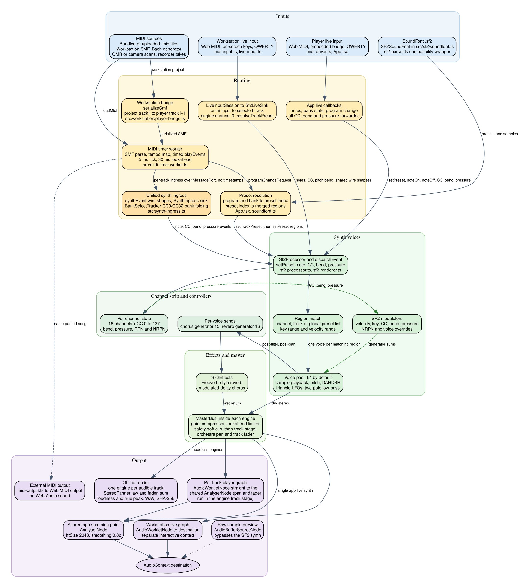

[GBK](https://compose.grepawk.com) is a browser music workstation with its own SoundFont synth. This post walks through its audio and event path: where MIDI events come from, how the player worker times them, and how they reach the synth.

The chart is drawn from `docs/audio-path.dot` in the GBK repo. Dashed green edges are controller and modulator influence inside the engine.

## One player path for the audio and event path

Songs and workstation projects share one player path. Bundled files, uploaded `.mid` or `.midi` files, Bach generator output, sheet music scans and recorder takes all become SMF bytes. They all enter the player load path in `src/midireader.tsx`.

The workstation has no second playback engine. Its state is serialized by `serializeSmf(...)` and handed to the player by `src/workstation/player-bridge.ts`. Project track `i` maps to player track `i + 1`. Player track 0 is the conductor track.

## Event sources

Sheet music has two producers. When the homr models are available, the sheet camera uses homr OMR. Otherwise it uses the built-in reader. Both return SMF bytes.

The recorder turns a recorded take into a format 0 SMF at 480 PPQ and 120 BPM.

## Parsing in a worker

`parseMidiBuffer(...)` runs in `src/midi-timer.worker.ts`. It parses each track, builds one global tempo map and converts ticks to seconds. SMPTE time division is rejected.

CC0 and CC32 are tracked per channel. `BankSelectTracker` folds them into the bank of the next program event. It is the one bank folding code that every adapter shares, including the raw MIDI handler. Other note, CC, program, pitch bend and pressure events keep their MIDI channel.

## Timing and dispatch

Playback runs `setInterval(runTick, 5)` with a 30 ms lookahead. Events go to the `MessagePort` for their player track through `SynthIngress`, which defines the note, CC, bend, pressure and preset wire shapes in one place.

Events carry no audio timestamp. The worklet applies each event when it arrives. So live file playback is not sample-accurate. The offline renderer is frame-accurate.

## Program changes

A program event does not pick worklet regions directly, unless a track override is active. The worker pauses that track, sends `programChangeRequest` to the main thread, and waits. The main thread resolves program and bank to a preset, gets its regions, and returns `setTrackPreset`. The worker then forwards `setPreset` with the regions to the track port.

## Pause, stop and seek

Pause, stop and seek call `stopNotes()`. It sends a note-off for every active channel and note pair. Then it sends CC64 = 0 and CC66 = 0 on every channel the track uses, so pedal-held voices do not hang.

Play and seek rebuild controller state with `controllerStateAt(...)`. It sends CC121 on each used channel, then the mix base CC7, CC10 and CC11, RPN and NRPN events in order, the last value of each other CC, and the last pitch bend and pressure values. CC120, CC121 and CC123 from the file are not refired.

## Try it

Open [GBK](https://compose.grepawk.com) and play a MIDI file or a workstation project. For the synth side, read [how the GBK SoundFont renderer turns MIDI into sound](https://grepawk.com/blog/gbk-sf2-renderer).
