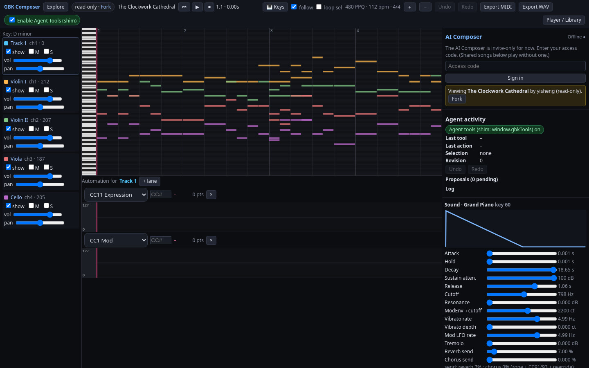
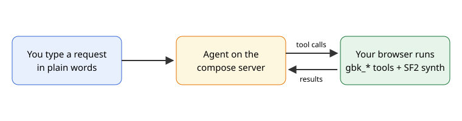
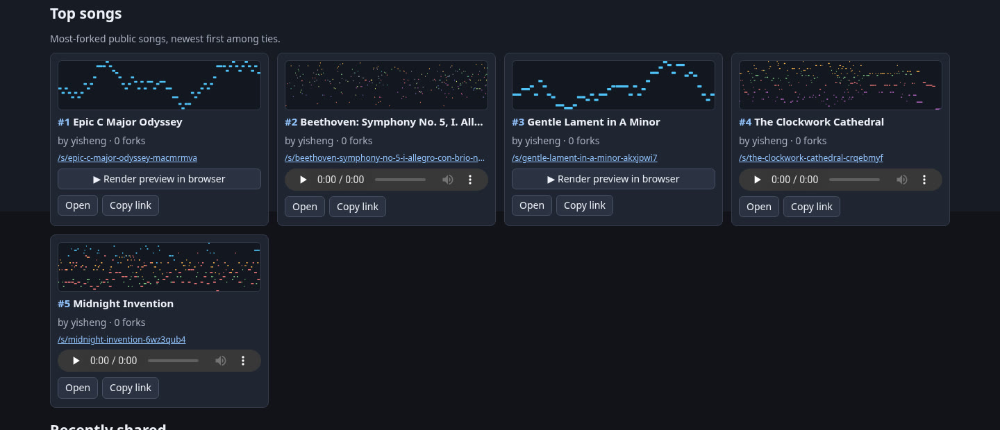
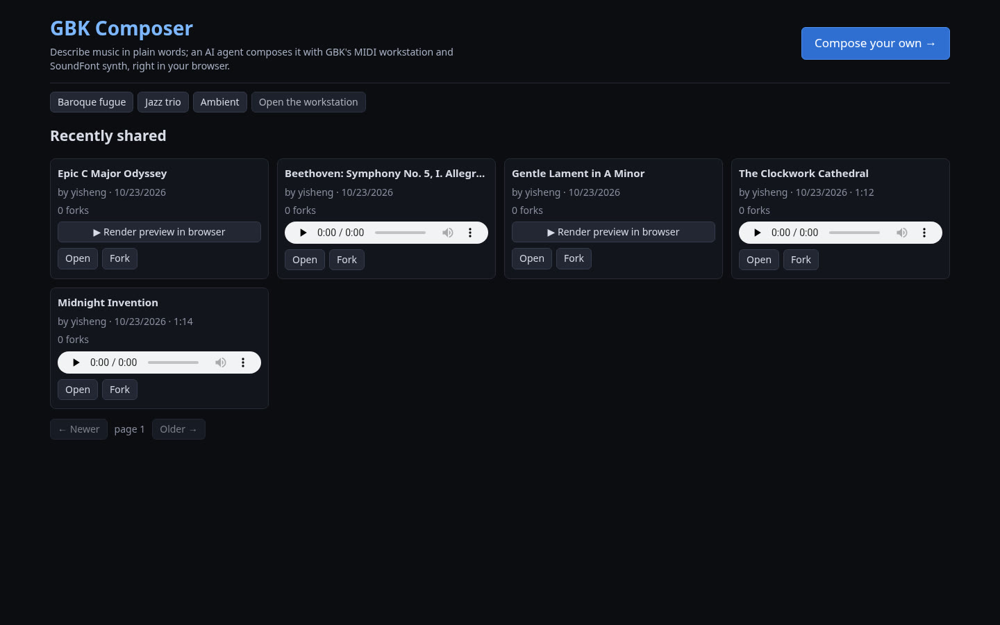

[The Clockwork Cathedral](https://compose.grepawk.com/s/the-clockwork-cathedral-crqebmyf) is a piece in D minor for two violins, viola and cello, composed by my AI agent with GBK's WebMCP tools. You can open it, play it and fork it from that link, no account needed. It is one of the first songs on [compose.grepawk.com](https://compose.grepawk.com), the GBK Composer, an AI music composer that launched today. This post walks through how the Composer works and what shipped with it.



```video
src: compose-launch.mp4
poster: compose-launch-poster.jpg
title: GBK Composer launch
caption: GBK Composer in 60 seconds: explore, play, edit in the studio, fork, and compose with the AI.
```

## How the AI music composer works

An [earlier post](https://grepawk.com/blog/gbk-webmcp-music-workstation-tools) covered GBK's `gbk_*` tools, the set of actions an agent can use to create a project, write notes, pick instruments and render audio. Until today you needed your own agent to drive them.

Now the agent runs on the compose server. The browser stays the instrument. When the agent wants to add a track or render a WAV, it sends the tool call to your open tab, the tab runs it with the in-browser SF2 synth, and the result goes back to the agent. The notes and the sound never leave the workstation you are looking at.



Composing is invite-only for now: the Composer panel asks for an access code. To get one, DM [@yishengjiang on X](https://x.com/yishengjiang). Shared songs play without a code, and anyone can open them.

## Explore, then compose your own

The home page is Explore, a list of recently shared songs. Each card shows the title, who made it, the date, the fork count and a player, with Open and Fork buttons. A "Compose your own" button at the top takes you to the Composer prompt, and the full workstation is one click away. Above the latest songs, a Top songs list ranks public songs by forks, and each card draws the song's piano roll so you can see its shape before you press play.





Songs the agent makes save themselves as private entries in My songs while you work. Nothing goes public until you choose Publish. When you do, it suggests a title written by the AI, and you can edit it before you confirm.

## Share links you can read

A shared song gets a link built from its name plus a short id, so it says what it is:

- [The Clockwork Cathedral](https://compose.grepawk.com/s/the-clockwork-cathedral-crqebmyf)

Two more to try:

- [Midnight Invention](https://compose.grepawk.com/s/midnight-invention-6wz3qub4)
- [Beethoven: Symphony No. 5, I. Allegro con brio](https://compose.grepawk.com/s/beethoven-symphony-no-5-i-allegro-con-brio-nev4k6uc)

If a song is renamed, older links still resolve and the page swaps in the current name. A link opens the song read-only as a new local project in the workstation. Press Fork to make your own copy to change; the fork remembers which song it came from. Owners can unshare or delete what they posted.

## Play along on a keyboard

The workstation now has a Keys button that opens two octaves of on-screen piano keys. You can click them, play from the computer keyboard (A to K for the notes, Z and X to change octave), or plug in a MIDI keyboard through Web MIDI. The keys play the selected track's instrument, so if you pick the flute track you hear a flute, and switching tracks or changing the program switches the sound right away. Arm record while the transport plays and your notes, sustain pedal and pitch bends land on that track as one undoable take.

## Songs as videos

Songs can also be published as a 1080p scrolling piano roll video with an MP3, MIDI file and poster, collected in a song gallery. Midnight Invention is the first one in it.

Smaller fixes went in alongside: reverb sends are now audible, renders default to one loudness target for the whole file, the Sound panel uses the same SoundFont as renders, auto-pan is now opt-in, and the track volume fader works the same live and in renders.

## Try it

Open [compose.grepawk.com](https://compose.grepawk.com), play a song from Explore, and fork one to make it yours. To compose your own, DM [@yishengjiang on X](https://x.com/yishengjiang) for an access code.
