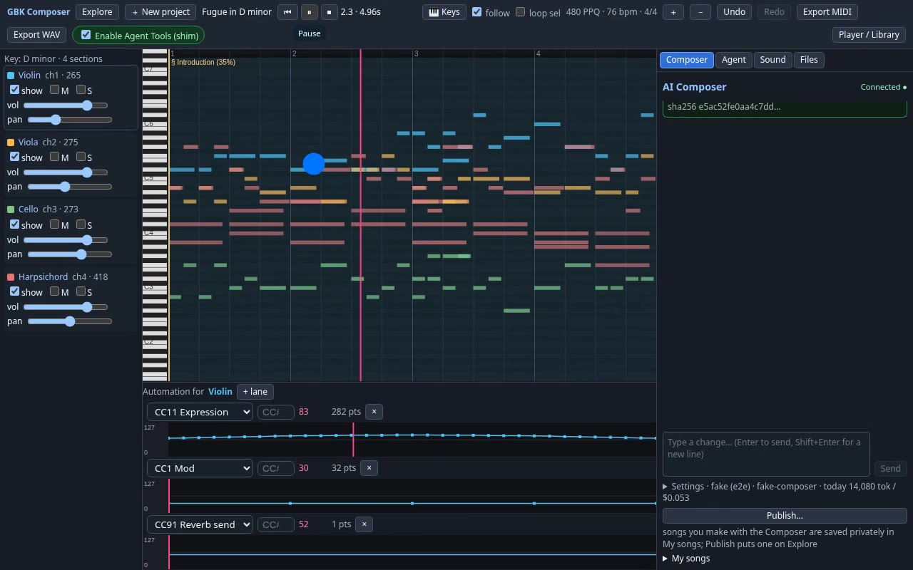
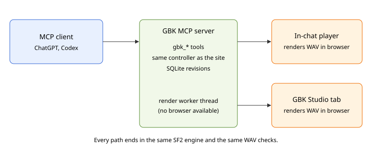

On Saturday, [GBK](https://compose.grepawk.com/) became a remote MCP server. The composer's `gbk_*` tools, which an agent could once call only from inside an open GBK page through WebMCP, now answer any client that speaks the Model Context Protocol. An MCP client can create a piece in a style, edit one passage at a time, show it in a player, and render a WAV and a MIDI file, with no GBK account. ChatGPT is one such client. To show what the tools can do, an AI agent wrote five new songs with them, linked just below. This post then covers what the server exposes, the hard question of the day (where does the audio get made?), and how we tested it.

The 50 second video below shows the composer agent in GBK Studio calling these same tools on one prompt: it creates a fugue, assigns instruments, writes CC11 dynamics, renders the WAV in the browser and plays it.

```video
src: gbk-mcp-server-demo-vo.mp4
poster: demo-poster.jpg
title: GBK composer tools writing and rendering a fugue
caption: One prompt becomes a four voice D minor fugue, rendered to WAV in the browser.
captions: demo.vtt
duration: PT50S
```



## Hear what it makes

All five songs below were composed by an AI agent through GBK's tools. Each song had its own worker, and the five ran at the same time. Every one plays on its share page, no sign-in needed.

1. [Pocket Full of Thunder](https://compose.grepawk.com/s/pocket-full-of-thunder-7crbyqb5): funk in E minor (Dorian), 104 BPM, slap bass up front with clavinet, brass and drums.
2. [Two-Five Lantern](https://compose.grepawk.com/s/two-five-lantern-hppnhqg7): swing jazz quartet in F major, 168 BPM, walking upright bass with its own chorus, piano comping, vibraphone lead, ride cymbal drums.
3. [Neon Overpass](https://compose.grepawk.com/s/neon-overpass-2gpnxs2b): synthwave in A minor, 118 BPM, octave synth bass, warm pad, saw lead, expression sweeps through the build and drop.
4. [Lanterns on Still Water](https://compose.grepawk.com/s/lanterns-on-still-water-cahawqjf): impressionist chamber piece in D Dorian, 76 BPM, harp, flute, clarinet, French horn and celesta, no bass.
5. [Concrete Overture](https://compose.grepawk.com/s/concrete-overture-p6x8na8y): orchestral hip-hop in C minor, 92 BPM, piano stabs, staccato and pizzicato strings, trombone, tuba, horns, timpani, with contrabass and cello driving the low end.

## From WebMCP tools to an MCP server

In the [Clockwork Cathedral post](https://grepawk.com/blog/gbk-webmcp-clockwork-cathedral) an agent wrote a fugue by calling GBK's tools in a browser tab. The new server reuses the same tool registry, the same workstation controller, the same project model and the same SoundFont renderer. Nothing was rewritten for MCP.

The split of work is simple. The model in the chat supplies the musical ideas. GBK supplies exact, repeatable operations: create a piece in a style, add a walking bass, double a line at the octave, draw a CC11 crescendo. MCP calls never run the website's own LLM agent, so a chat user does not spend the site's model budget.

The public tools are:

| Tool | What it does |
| --- | --- |
| `gbk_get_capabilities` | styles, instruments and limits (read only) |
| `gbk_create_composition`, `gbk_edit_composition` | build and change a piece |
| `gbk_get_composition`, `gbk_list_compositions` | read pieces back |
| `gbk_render_composition`, `gbk_get_render_status`, `gbk_cancel_render`, `gbk_get_artifacts` | make WAV and MIDI files |
| `gbk_show_composition_ui` | the in-chat player |
| `gbk_open_workstation`, `gbk_publish_composition` | open in GBK Studio, or share only when asked |
| `gbk_delete_composition`, `gbk_claim_composition` | delete a guest piece, or move it into an account |

Every edit saves a full revision. An edit has to name the revision it expects, and a stale one is refused with the current number, so two chats cannot quietly overwrite each other.

## No account needed

The plugin declares no auth. Creating a piece returns an edit key and a separate read key, and every later tool takes the key. The composition id alone opens nothing, and a read key cannot edit, render or publish. Signing in with Google or GitHub over OAuth is optional; a signed-in user can claim a guest piece into their library with its edit key.

Guest use has firm limits: pieces up to 180 seconds and 64 bars, 20 renders per project per day, and artifact files deleted after a retention window.

## Where does the audio get made?

This was the question that changed three times in one day.



The first server, committed late in the morning, rendered on the server. About an hour later we removed that: renders were sent over the existing browser bridge to the user's open GBK Studio tab, which rendered the WAV and uploaded it in chunks. The server checked the SHA-256, the WAV header and the renderer's own validation before it published anything.

That exposed a bug in the Studio. The WAV render ran a pure JavaScript engine loop on the page's main thread, about 3x realtime on a desktop and far slower on an iPhone, with playback and UI on the same thread. The server gave up after 120 seconds, and Stop never told the tab to abort. The fix moved all synthesis into an `OfflineAudioContext` with one SoundFont AudioWorklet node per track, added real progress, stall and timeout watchdogs, and made Stop cancel. Render tools now get an 11 minute server deadline.

A Studio tab is a lot to ask of someone in a chat, though. So the in-chat player got its own Render button. It loads a small render bundle, the worklet and the SoundFont from GBK, renders the piece inside the client's sandboxed frame, plays it from an audio buffer, and uploads it to the same checked path so the download links work. We tested that bundle in a mock host sandbox with a strict content security policy in Chromium and WebKit.

That still left clients with no browser at all, like Codex. So in the afternoon server rendering came back, in a better form: a worker thread pool running the app's own renderer, so the server's event loop never blocks. It returns a 44.1 kHz stereo WAV and a Standard MIDI file as short-lived signed links, never as bytes in the chat. It is bounded on purpose: one worker, a queue of 8, one render in flight per owner, 180 seconds of music for guests and 300 for accounts, and a 180 second timeout after which the worker is replaced.

## Testing whether the model picks GBK

A tool the model never calls is useless, and a tool it calls for everything is worse. We wrote 42 test prompts in four groups (explicit requests, follow ups, prompts that should not use GBK, and borderline ones) and ran them with tool calling against the live tool list plus decoy tools such as web search and image generation. This is a stand-in for how a real MCP client picks tools, not a measurement inside any one client.

| Metric | Result |
| --- | --- |
| Recall on prompts that need GBK | 100% (22/22) |
| First tool correct | 100% (22/22) |
| False positives on prompts that do not | 8.3% (1/12) |

The one miss was "What chords are in a ii-V-I progression in C major?", which reached for `gbk_get_capabilities`. Two earlier runs the same day had 3 and 4 false positives out of 12, all from that same tool on theory or lyrics questions, so the honest range is 8 to 33% until more runs are averaged.

## Try it

Start at [compose.grepawk.com](https://compose.grepawk.com/). The starter prompt "Write a 24-bar jazz piece in F major at 140 BPM, add a walking bass, then let me render and play it in the chat" exercises create, edit, the player and the render in one go.
