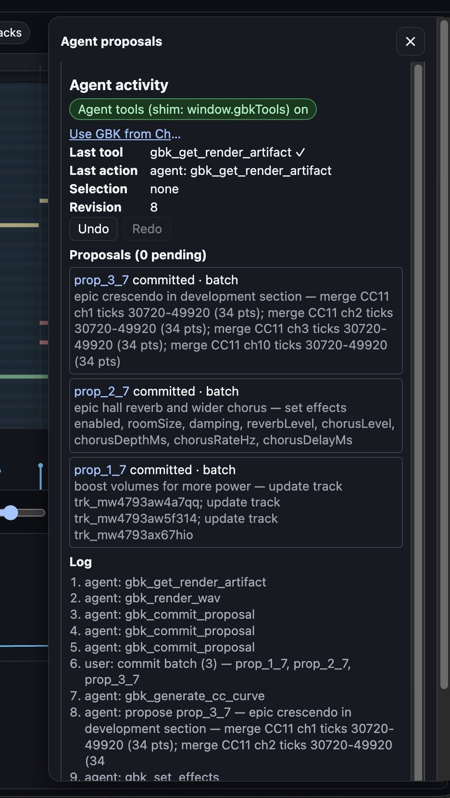

[GBK](https://compose.grepawk.com/) is a browser music workstation with its own SoundFont synth. Its `gbk_*` tools let an MCP client, or an agent running in GBK Studio, read a project, stage edits and render a WAV. This post looks at one Studio session that started from a short prompt: make a song more epic. The Agent proposals panel shows the tools the agent called, and the three changes the user accepted.

The tools in this session ran in the page through the `window.gbkTools` shim, which GBK uses when the browser has no WebMCP API. Those workstation tools are described in [WebMCP in a music app](https://grepawk.com/blog/gbk-webmcp-music-workstation-tools). A remote MCP client talks to the composer server instead; that path is in [GBK's composer tools are now an MCP server](https://grepawk.com/blog/gbk-composer-mcp-server).

The prompt, from the post that shared this panel, was "Make this song more epic."

The panel lists three committed proposals, all based on revision 7, then accepted together as a batch. After that accept, the project is at revision 8, with no proposals pending. The activity log then shows `gbk_render_wav` and a successful `gbk_get_render_artifact`.

## Three edits that make a song more epic

The agent did not rewrite the notes. It changed the mix, the room and the dynamics.

**Louder tracks.** The first proposal, titled "boost volumes for more power," updates three tracks through `gbk_propose_track_patch`. That tool can change a track's mix defaults, including volume on a 0 to 127 scale. Volume is a post-engine fader, `(v/100)^2`, applied live and in renders, on top of any authored CC7. The panel does not show the new volume values, only that three tracks were updated.

**A larger room and a wider chorus.** The second proposal, titled "epic hall reverb and wider chorus," is a `gbk_set_effects` call. It turned effects on and set `roomSize`, `damping`, `reverbLevel`, `chorusLevel`, `chorusDepthMs`, `chorusRateHz` and `chorusDelayMs`. The screenshot does not include the numeric values.

Those parameters are global. The reverb is Freeverb-style: eight lowpass-feedback combs and four allpasses. `roomSize` (0 to 1) sets comb feedback to `0.7 + 0.28 * size`. The chorus is two quadrature-modulated delay lines. Defaults are room size 0.5, damping 0.5, reverb level 0.5, chorus level 0.7, depth 4 ms, rate 0.6 Hz and delay 12 ms.

How much of each voice reaches that room is separate: the zone's reverb and chorus sends, plus CC91 and CC93, or a `gbk_propose_voice_patch`. This session did not show a send or voice-patch edit. A closer look at those controllers, and at global effects in published songs, is in [MIDI CC and SoundFont details in songs from the GBK composer](https://grepawk.com/blog/gbk-songs-midi-cc-and-soundfonts).

**A crescendo in the development section.** The third proposal comes from `gbk_generate_cc_curve`. It merges CC11 (Expression, which is audible in the SoundFont engine) onto channels 1, 2, 3 and 10, over ticks 30720 to 49920, with 34 points on each channel. The agent's label for that span is "epic crescendo in development section."

`gbk_generate_cc_curve` can draw a crescendo, decrescendo, swell, linear, smoothstep or exponential shape, or explicit points. The panel names the shape only through that "crescendo" label, and it does not list the start or end values.

The curve was applied in merge mode. Existing CC11 points stay, except those that share a tick with a new point in that range. New projects default to a PPQ of 480. At that PPQ, tick 30720 is quarter-note beat 64 and tick 49920 is beat 104, a span of 40 beats. In 4/4, that is the start of bar 17 through the start of bar 27. Channel numbers in the proposal summary are one-based. Channel 10 is the General MIDI drum channel.

## From proposals to a WAV

Each of those tools stages a proposal. The project does not change until the user accepts. In this session the user accepted all three as one batch, logged as `commit batch (3)`. `gbk_commit_proposal` is the tool path for the same step, and it still needs that Accept in the panel. Undo stays available after the commit.

The agent then called `gbk_render_wav` and `gbk_get_render_artifact`. The last tool in the panel is the artifact read, marked successful. The render uses the same SoundFont engine as playback, described in [How the GBK SoundFont renderer turns MIDI into sound](https://grepawk.com/blog/gbk-sf2-renderer).

## Try it

Open [compose.grepawk.com](https://compose.grepawk.com/), load a project in Studio and turn on agent tools. An MCP client can also connect to the composer server and ask for the same kind of mix, room and CC11 work on a piece, then render a WAV.
