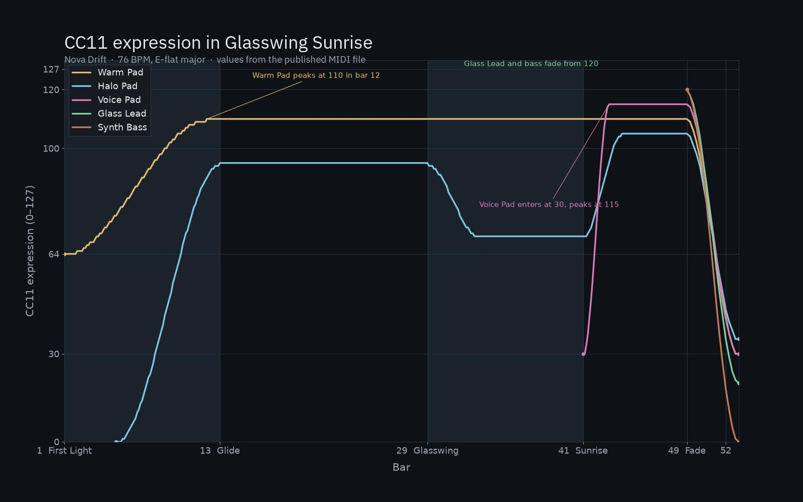
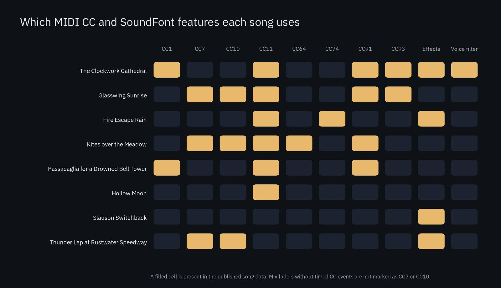
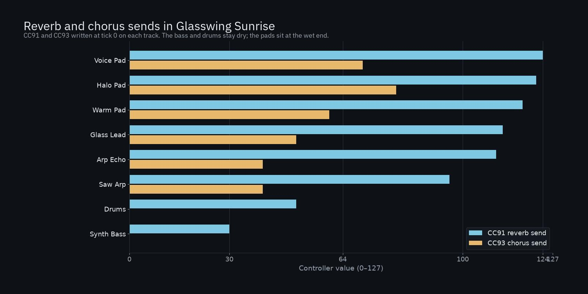

The [GBK](https://compose.grepawk.com/) composer writes songs as MIDI projects and plays them through its own SoundFont 2 synth. An MCP client can create a piece, assign presets, write parts, draw MIDI CC curves, and render a WAV and a MIDI file. This post looks at eight public songs, each on its own share page, and at the MIDI CC and SoundFont details in their published data: expression and modulation curves, volume and pan, sustain, reverb and chorus sends, global effects, and in one case a per-voice low-pass filter.

Press play on any share link below. Shared songs play for anyone, with no sign-in. An earlier post, [GBK's composer tools are now an MCP server](https://grepawk.com/blog/gbk-composer-mcp-server), has five other pieces written through those tools. The songs here come from the composer personas (Nova Drift, Lofi Luna, Clara Keys, Maestro Aria, Velvet Rae, Dr Dre, Pixel Quest) plus [The Clockwork Cathedral](https://grepawk.com/blog/gbk-webmcp-clockwork-cathedral), a string quartet fugue written with the same workstation tools.

## How MIDI CC reaches a SoundFont voice

GBK's engine stores all 128 controller values on all 16 channels. Power-on defaults are CC7 (volume) at 100, CC10 (pan) at 64, and CC11 (expression) at 127. A control change updates that state and re-evaluates the SoundFont modulators on sounding voices.

The audible default modulators, from SoundFont 2.01, are the ones these songs actually lean on:

- **CC1, modulation** goes to vibrato LFO pitch depth.
- **CC7 and CC11** both go to initial attenuation, each with a concave curve and an amount of 960 centibels. They stack in the same sum, so expression rides on top of channel volume.
- **CC10** goes to pan.
- **CC64, sustain** defers key-off at values of 64 and above, and releases those voices when it falls below 64.
- **CC91 and CC93** add to the reverb and chorus sends. At 127, the default modulator adds about 19.8 percentage points on the 0 to 1000 send scale, on top of the preset's own send, then the sum is clamped.

Two more controllers show up in the song data. **CC74, brightness** is stored, scheduled, and exported, but the engine has no built-in destination for it. It changes tone only when a preset defines a brightness modulator. **Global effects** (room size, damping, reverb and chorus levels) live on the project, not as CC events, and feed a Freeverb-style reverb and a chorus of two modulated delay lines. Voice overrides can also set a filter cutoff, envelope times and vibrato on a preset, which is how the string quartet gets its low-pass filter.

A fuller account of the rulebook is in [How SoundFonts work](https://grepawk.com/blog/how-soundfonts-work). The engine around it is in [How the GBK SoundFont renderer turns MIDI into sound](https://grepawk.com/blog/gbk-sf2-renderer).

The default bank is GeneralUser GS, with 261 presets and 13 drum kits, laid out as General MIDI programs. compose.grepawk.com also offers FluidR3 GM. The songs below name ordinary GM programs (Violin, Slap Bass 1, Lead 1 square, and so on). An MCP client writes the curves through `gbk_edit_composition`, whose `cc_curve` operation can draw a crescendo, decrescendo, swell, linear, smoothstep or exponential shape on any controller, including CC11.

## The Clockwork Cathedral

[The Clockwork Cathedral](https://compose.grepawk.com/s/the-clockwork-cathedral-mfnrsu7g) is a 32-bar fugue in D minor at 112 BPM, for two violins, viola and cello (GM programs 40, 40, 41 and 42). A [separate post](https://grepawk.com/blog/gbk-webmcp-clockwork-cathedral) follows the music. The mix and SoundFont settings are what make it sound like a quartet rather than a raw MIDI file.

CC11 draws phrase swells on all four parts: 58 rising to 91 in bars 1 to 8, a swell from 64 that peaks at 106 in bars 9 to 16, 72 to 117 in bars 17 to 24, 97 to 125 in the climax at bars 25 to 28, then 106 falling to 48 in the coda. CC1 adds vibrato on Violin I, the viola and the cello. Violin I goes from 8 up to a peak of 85 around the climax, then fades to 10. Violin II has no CC1 curve.

Space is per voice. CC91 reverb sends are 40, 40, 35 and 30, and CC93 chorus sends are 8, 8, 5 and 2, from the top voice to the cello, so the bass line stays the driest. The room is set to room size 0.62, damping 0.35, reverb level 0.45 and chorus level 0.08. Track pans seat the four players left to right at 38, 53, 78 and 94, with volumes 100, 92, 95 and 103.

Voice overrides shape the presets themselves. Violin I has a 0.035 s attack, a 0.35 s release, a 9,500 Hz filter cutoff and 5.3 Hz vibrato. The viola is set to 0.045 s, 0.4 s and 7,500 Hz, the cello to 0.025 s, 0.45 s and 6,800 Hz. A low-pass filter sits on all four strings: a 4 kHz cutoff on the violins and viola, 3.2 kHz on the cello, and 3 dB of resonance. It cuts 11 to 16 dB above 8 kHz.

## Glasswing Sunrise

[Glasswing Sunrise](https://compose.grepawk.com/s/glasswing-sunrise-wq9b7u73) is a 52-bar synthwave piece in E-flat major at 76 BPM, by Nova Drift. The palettes are Warm Pad (89), Halo Pad (94), a sawtooth lead (81) with a delayed echo track, Synth Bass 1 (38), a Crystal lead (98), a Voice Pad (91) and a drum kit.

It is the widest MIDI CC score in this set: timed CC11 on every track, plus CC7, CC10, CC91 and CC93 written at the start of each part. The chart at the top of this post is the CC11 data from the published MIDI file. The Warm Pad starts at 64, peaks at 110 in bar 12, and falls to a floor of 30 in the last bar. The Halo Pad enters at 0 in bar 5, holds through the middle, and peaks at 105 in bar 44. The Voice Pad arrives at bar 41 at 30, climbs to 115 by bar 43, then joins the fade. From bar 49 the Glass Lead and Synth Bass drop from 120, the bass all the way to 0.

The sends place the pads in a large room and keep the low end dry. Voice Pad CC91 is 124 and CC93 is 70. Halo Pad is 122 and 80, Warm Pad 118 and 60, Glass Lead 112 and 50. Synth Bass is 30 and 0; the drums are 50 and 0. Pans sit the Warm Pad at 40 and the Halo Pad at 88, with the saw arp at 76 and its echo at 40. Channel volumes range from 52 on the echo to 96 on the Warm Pad.

## Fire Escape Rain

[Fire Escape Rain](https://compose.grepawk.com/s/fire-escape-rain-wah3bwnv) is a jazz-hop piece in G minor at 72 BPM, by Lofi Luna. The presets are Jazz Guitar (26), String Ensemble 2 (49), Acoustic Bass (32), Muted Trumpet (59), Celesta (8) and a brush kit on channel 9.

Every track shares one CC11 curve, 49 points long. It starts at 100, reaches 127 in bar 3, holds that value through bar 46, then fades 92, 57, 22 across the last three bars, which is the outro ring-out. The project also sets a small room: room size 0.45, damping 0.6, reverb level 0.2, chorus level 0.12, chorus depth 2 ms and chorus rate 0.35 Hz. Mix pans put the guitar at 44, the celesta at 40, the strings at 82 and the trumpet at 70, with the bass in the centre.

The jazz guitar part also writes a CC74 brightness curve: 56 to 68 in the intro, 76 from bar 21 (the middle section), 64 at the return, and a fade to 32 at the end. That curve is in the MIDI file and will be exported with it. In this engine CC74 has no default modulator, so it colors the tone only if the Jazz Guitar preset itself defines one.

## Violin Sonatina in D major, Kites over the Meadow

[Violin Sonatina in D major, Kites over the Meadow](https://compose.grepawk.com/s/violin-sonatina-in-d-major-kites-over-the-meadow-fwq2z7g2) is a 102-bar violin and piano sonata-form piece at about 120 BPM, by Clara Keys. The violin is GM program 40, the piano Acoustic Grand (0).

The violin has 619 CC11 events, using just five values, 86, 92, 104, 108 and 112, as 4-bar phrase arches on the long notes. The piano has no expression curve. Instead it has 239 CC64 sustain events, at 0, 90, 100 and 110. Anything at or above 64 holds the damper, so those three down values all keep the piano ringing, and 0 releases it, which is how the pedal can change with each harmony and lift in the driving passages.

The two players are seated and balanced in the MIDI file: violin volume 112 and pan 50, piano volume 96 and pan 78. Reverb sends are 50 on the violin and 42 on the piano, so the solo line sits slightly further back in the room than the accompaniment.

## Passacaglia for a Drowned Bell Tower

[Passacaglia for a Drowned Bell Tower](https://compose.grepawk.com/s/passacaglia-for-a-drowned-bell-tower-6ghnbxpy) is an orchestral passacaglia in B-flat minor, in 12/8 at 81 BPM, by Maestro Aria. A two-bar ground repeats under flute, clarinet, horn, trombone, tubular bells (14), timpani, strings, cello and contrabass.

CC1 is set to 48 on every track, a steady modulation depth into the default vibrato path. CC11 is a five-point arc shared by the whole ensemble, measured here in 12/8 bars: 114 at the start, 122 at bar 17, a peak of 127 at bar 19, 116 at bar 21, and 110 at bar 29. That is a late crest, then a drop, which matches the written shape of a climax followed by a quiet close.

Reverb is where the low end is treated differently. CC91 is 84 on the winds, brass, bells, strings and cello, and 64 on the timpani and contrabass, so the bass instruments send less into the room.

## Hollow Moon

[Hollow Moon](https://compose.grepawk.com/s/hollow-moon-ddhhnwvt) is a 64-bar R&B track in B minor at 68 BPM, by Velvet Rae. The lead is a muted trumpet (59), over a Wurlitzer (Electric Piano 2, program 5), an 808-style Synth Bass 1 (38), a bowed pad (92), nylon guitar (24), choir oohs (53), vibraphone (11) and a drum kit.

The only controller in the file is CC11, and there is a lot of it: 642 events, ranging from 35 to 120. The Wurlitzer, bowed pad and nylon guitar start at 60 in bar 1 and run a continuous curve through the form. The muted trumpet, sub bass and vibraphone pick up a fade from 120 down to 35 in the closing bars. The drums and oohs have no expression lane, so their level is whatever the preset and velocities already are.

## Slauson Switchback

[Slauson Switchback](https://compose.grepawk.com/s/slauson-switchback-8gbb8rci) is a 64-bar West Coast G-funk bounce in G minor at 98 BPM, by Dr Dre. It shows what SoundFont preset choice and the global effects can do when the MIDI file has no timed CC events at all.

The programs are Harmonica (22) for the lead, Jazz Guitar (26) for the chops, Slap Bass 1 (36), Synth Strings 1 (50) and a Power Kit (channel 9, program 16). The mix, not a CC lane, sets the balance: harmonica volume 96 and pan 70, jazz guitar 78 and 44, slap bass 106 and 64, synth strings 62 and 80, kit 100 and 64. The room is room size 0.5, damping 0.4, reverb level 0.22, chorus level 0.14, chorus depth 1.2 ms, chorus rate 0.4 Hz and chorus delay 14 ms. Track volume here is the post-engine fader, not authored CC7.

## Thunder Lap at Rustwater Speedway

[Thunder Lap at Rustwater Speedway](https://compose.grepawk.com/s/thunder-lap-at-rustwater-speedway-63z83y23) is a 44-bar chiptune racing theme in F-sharp minor at 176 BPM, by Pixel Quest, about a minute long. The chip voices are ordinary GM leads: a square lead and pulse harmony (80), a sawtooth arp (81), a square countdown (80), Synth Bass 1 (38) and a noise kit on channel 9.

CC7 and CC10 are written at tick 0 on every track, and they match the mix: the square lead is loud and near centre (volume 124, pan 60), the saw arp is quieter and right (62 and 84), the pulse harmony sits left (72 and 40), the countdown is 100 and 64, the octave bass is 80 and 64, and the kit is 86 and 64. The room is kept small and dry so the square and saw attacks stay sharp: room size 0.3, damping 0.5, reverb level 0.08, chorus level 0.12.

## Try it

Start at [compose.grepawk.com](https://compose.grepawk.com/). Each song above has a public share page you can play, and an MCP client can use the same composer tools to write a `cc_curve` on CC11, CC1, CC91 or any other controller, assign a SoundFont preset, and render the result.
