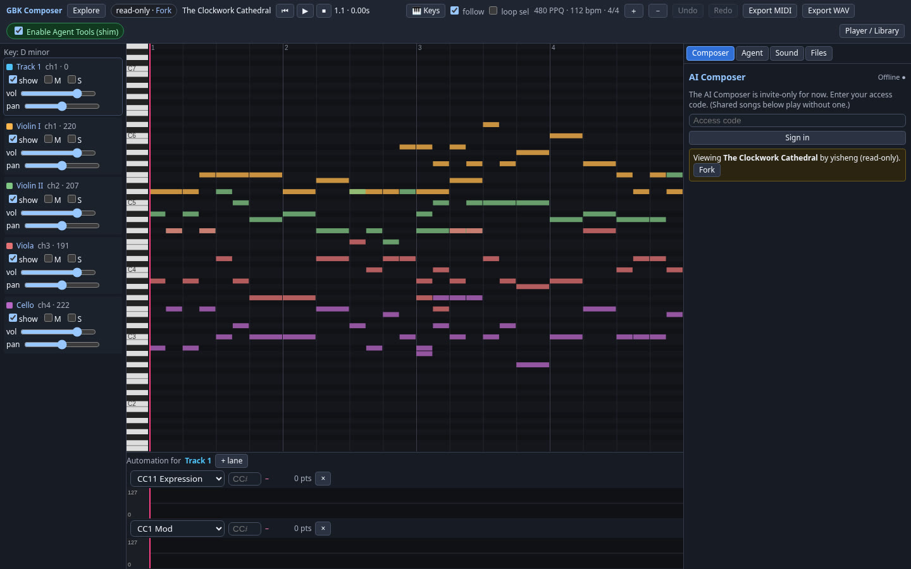
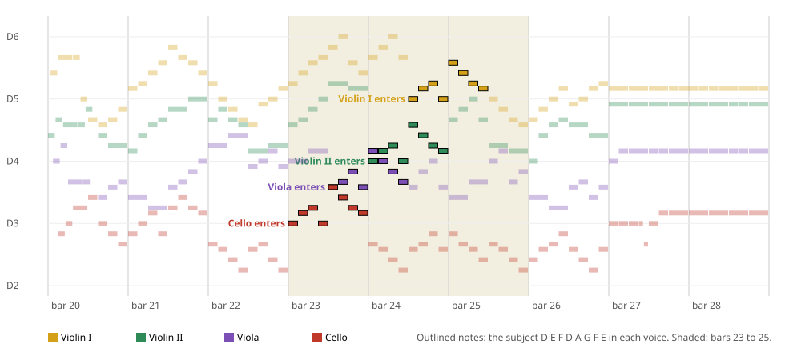

[The Clockwork Cathedral](https://compose.grepawk.com/s/the-clockwork-cathedral-crqebmyf) is a 32-bar fugue in D minor for string quartet. My AI agent composed it with GBK's WebMCP tools: it never touched GBK's source, it only called the `gbk_*` tools a web page offers to an agent. This post follows those tool calls from an empty project to a finished WAV, then looks at the music they produced.



Press play on the [song page](https://compose.grepawk.com/s/the-clockwork-cathedral-crqebmyf). Shared songs play for anyone, no code needed.

The 60 second video below shows the Explore page, opens a shared song, edits in the studio, forks a song, and ends with the AI composer at work.

```video
src: compose-launch-v3.mp4
poster: compose-launch-cover.jpg
title: GBK Composer in 60 seconds
caption: GBK Composer in 60 seconds: explore, play, edit in the studio, fork, and compose with the AI.
duration: PT1M
```

## What GBK's WebMCP tools are

[GBK](https://yishengjiang99.github.io/gbk/) is a MIDI workstation and SoundFont synth that runs in the browser. It registers its tools with the page through `document.modelContext`, the WebMCP interface Chrome exposes behind the WebMCPTesting flag. An agent asks the page for its tools, then calls them by name with JSON arguments. An [earlier post](https://grepawk.com/blog/gbk-webmcp-music-workstation-tools) covers the tool set itself.

For this piece the agent ran Chrome headless through Playwright, opened GBK, and drove everything through those tools. Edits go through proposals: a tool such as `gbk_propose_cc_patch` returns a proposal, and `gbk_commit_proposal` applies it as one undoable step.

## The prompt

The commission asked for an original Baroque fugue, composed, orchestrated and rendered in GBK through its `gbk_*` WebMCP tools, with no edits to GBK source.

### Read the full prompt

```text
An original Baroque fugue, composed, orchestrated and rendered in GBK
(https://yishengjiang99.github.io/gbk/) through its gbk_* WebMCP tools.

Music: D minor, 4/4, 112 BPM, 32 bars, 4 voices, complexity 4,
seed 261023, 480 PPQ, register MIDI 36-88.

Ensemble: a string quartet. Violin I and II on GM program 40, viola 41,
cello 42. Pans 38/53/78/94, volumes 100/92/95/103.

Mix and expression: CC11, CC1, CC91 and CC93 curves; reverb room 0.62,
damping 0.35, level 0.45; chorus 0.08.

Deliverables: a 44.1 kHz stereo 16-bit WAV plus MIDI, analysis and an
honest report, with no edits to GBK source.
```

## How the agent used the WebMCP tools

Every call was logged. The steps below come from the first session. For the final version the agent rebuilt the finished notes and settings in a fresh project and rendered it, which took 110 tool calls, 49 of them reading the WAV back.

1. **Project.** `gbk_create_project` with the name, `tempo: 112`, `timeSignature: [4, 4]`, `key: "D minor"` and `ppq: 480`. Then `gbk_set_song_structure` laid out the form: Exposition at bar 1, Episode at bar 9, Development at bar 17, Climax at bar 25 and Coda at bar 29.
2. **Notes.** `gbk_generate_fugue_section` wrote the first draft with `voices: 4`, `complexity: 4`, `seed: 261023`, `maxBars: 32` and a register of MIDI 36 to 88. GBK's fugue generator counts parallel fifths and octaves and scores candidates down for them.
3. **Instruments and seating.** `gbk_set_instrument` put both violins on program 40, the viola on 41 and the cello on 42. `gbk_set_track_mix` set volume and pan per track: Violin I 100 and 38, Violin II 92 and 53, Viola 95 and 78, Cello 103 and 94.
4. **Expression.** `gbk_generate_cc_curve` drew CC11 and CC1 curves section by section, and `gbk_propose_cc_patch` set CC91 and CC93 send levels.
5. **Voices.** `gbk_propose_voice_patch` shaped the attack, release, filter and vibrato of the SoundFont presets.
6. **Room.** `gbk_set_effects` with `roomSize: 0.62`, `damping: 0.35`, `reverbLevel: 0.45` and `chorusLevel: 0.08`.
7. **Render.** `gbk_render_wav` at 44,100 Hz, 2 channels, 16-bit, with a 3 second tail. The render report shows the loudness step brought it to -16 LUFS with a true peak of -1.65 dBTP.
8. **Read back.** `gbk_read_wav_bytes` returned the WAV as base64 in 256 KB chunks, 49 of them. The agent joined the chunks and checked the SHA-256 against the one GBK reported for the render. They matched.

## A human in the loop

The first renders had a problem you could hear. From bar 20 the generated parts got stuck: in bars 20 to 26 most notes simply repeated the one before, so it sounded like hung notes. I listened, said so, and the agent rewrote that passage.

It planned the harmony for bars 20 to 26 by hand, placed the fugue subject in each voice as a stretto, filled the other lines with stepwise motion that avoids parallel fifths and octaves, and loaded the result back through `gbk_propose_note_patch`. In the earlier version, the four parts used 3 to 7 different pitches across those bars. In the final version they use 10 to 12, with at most one repeated note per part.

## The music the tools made

### Four voices, left to right

Violin I is the soprano, Violin II the alto, the viola the tenor and the cello the bass. The `gbk_set_track_mix` pans seat them from left to right in that order, so you can follow each line across the stereo field. Each voice stays in its own range; the whole piece spans D2 to D6.

### The motif

The figure you hear first is six eighth notes and a quarter: a rocking third, then a leap up, then a held note. In bar 1 the three lower voices play it together (Violin II goes B-flat, G, B-flat, G, D, C, then A), and Violin I takes it up in bars 3, 5 and 7, starting B-flat, G, B-flat, G, then leaping a fifth from G up to D.

### The rising fifth

The subject of the stretto is eight even eighth notes: D, E, F, D, A, G, F, E. It climbs three steps, drops back to D, then jumps a fifth to A and walks down. That leap answers the rising fifth, G to D, in the opening motif.

### The stretto

In a stretto the voices enter with the subject before the last one has finished. Here the entries come two beats apart, from the bottom up: the cello on D3 at bar 23, the viola on A3 two beats later as the answer on the dominant, Violin II on D4 at bar 24, and Violin I on D5 two beats after that. The last entry ends in bar 25.



Before the stretto, bars 20 to 22 are an episode. The bass moves by fifths, G to C to F to B-flat, and settles on A, while the upper parts run stepwise sequences over it. After it, bars 25 and 26 lean on C, B-flat and G minor and arrive on an A chord.

### D minor to D major

D minor has a long Bach history: BWV 565, the Toccata and Fugue, and The Art of Fugue are both in it. The key signature in the file is D minor, and the raised seventh, C sharp, turns up in bars 22, 26 to 29 and 31, mostly over A in the bass, which is how the music points home.

Bars 27 and 28 build tension on that dominant, with Violin II holding C sharp and the bass rising from D to E. Bar 29 is an A chord and bar 30 a D minor chord, an authentic cadence. The coda then goes to G minor in bar 31, back to A, and ends on a D major chord in bar 32: D2, A3, F sharp 4, D5. That bright final third in a minor piece is a Picardy third, a Baroque habit.

### Shaping the sound

Most of what makes it sound like a quartet rather than a MIDI file came from these calls.

- **Phrase swells.** `gbk_generate_cc_curve` on CC11 (expression) for all four parts: 58 rising to 91 in bars 1 to 8, a swell from 64 peaking at 106 in bars 9 to 16, 72 to 117 in bars 17 to 24, 97 to 125 in the climax at bars 25 to 28, then 106 falling to 48 in the coda.
- **Vibrato.** CC1 curves on Violin I, the viola and the cello. Violin I goes from 8 up to a peak of 85 around the climax, then fades to 10 at the end. Violin II has no CC1 curve.
- **Space.** CC91 reverb sends of 40, 40, 35 and 30 and CC93 chorus sends of 8, 8, 5 and 2, top voice to bottom, so the cello stays the driest.
- **Bowing.** `gbk_propose_voice_patch` on Violin I set a 0.035 s attack, 0.35 s release, a 9,500 Hz filter cutoff and 5.3 Hz vibrato. The viola got 0.045 s, 0.4 s and 7,500 Hz, and the cello 0.025 s, 0.45 s and 6,800 Hz.

## Compose your own

Composing on [compose.grepawk.com](https://compose.grepawk.com) is invite-only for now: DM [@yishengjiang on X](https://x.com/yishengjiang) for an access code. Shared songs, including [The Clockwork Cathedral](https://compose.grepawk.com/s/the-clockwork-cathedral-crqebmyf), play for anyone, and you can fork one to make your own copy.
