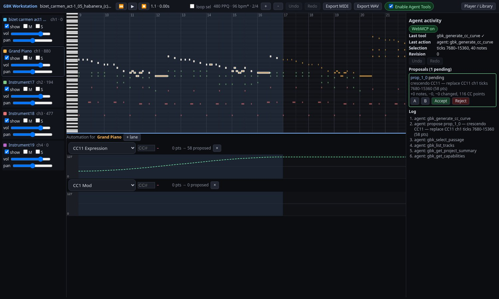
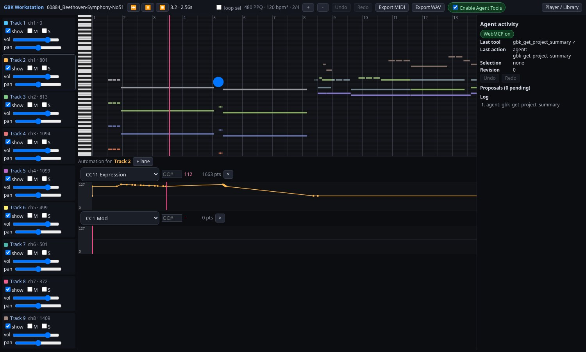
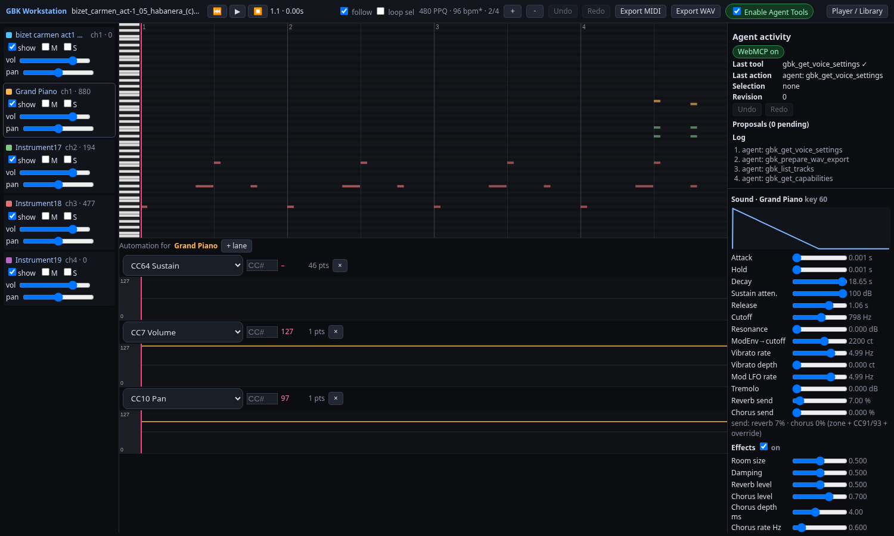
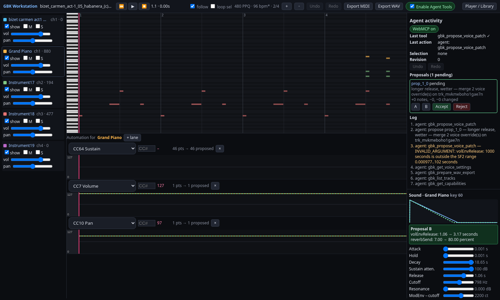
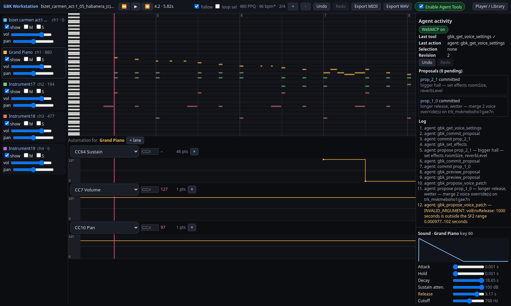
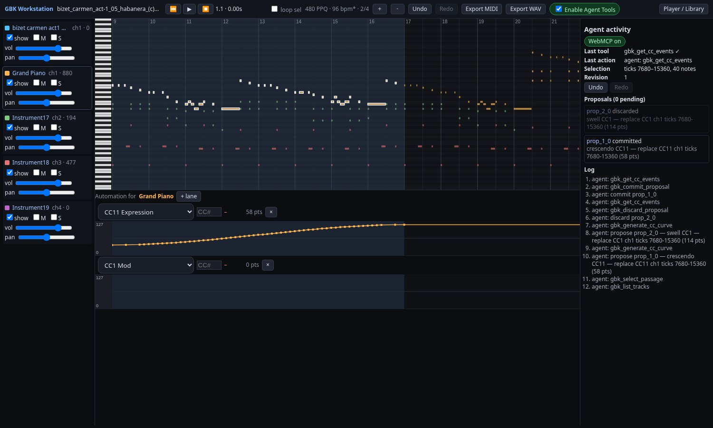
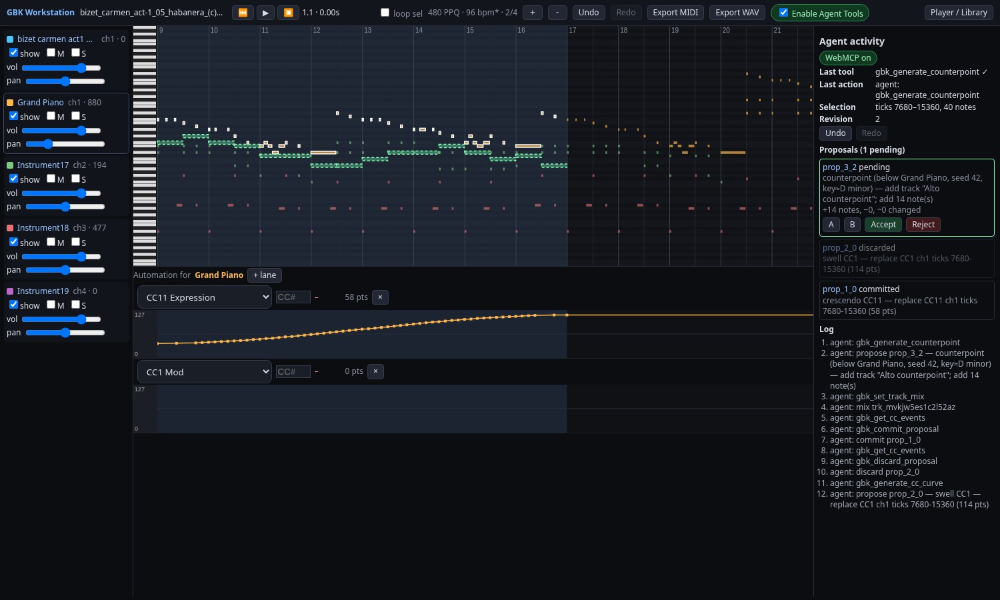
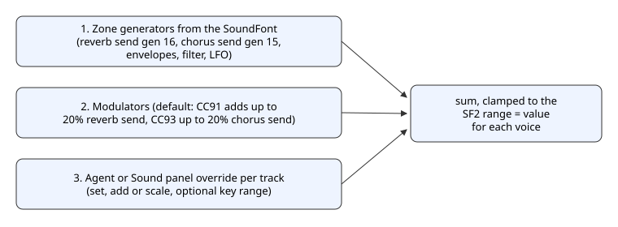

[GBK](https://yishengjiang99.github.io/gbk/) is a MIDI workstation in the browser, and it now speaks WebMCP. An AI agent running in Chrome can read a song, draw a crescendo or a modulation swell, write a counterpoint line, and tune a track's sound: a longer release, a darker filter, more reverb. You hear every change A/B through the real synth, then Accept, Reject or undo.



## What WebMCP is

WebMCP lets a web page offer tools to an AI agent in the browser. The page calls `document.modelContext.registerTool` with a name, a JSON schema and a function, and the agent can list and call those tools. There is no server and no bridge process. The tools run in the page, with the page's own state.

## Why it fits a local-first music app

GBK keeps everything in the browser: the SoundFont, the song, the edit history and autosave in IndexedDB. A server-side agent would need a copy of all that. With WebMCP the agent works on the song you have open, through the same code the piano roll uses, and nothing leaves the page unless you export it.



## The gbk_* tools

GBK registers 29 tools today, all with strict schemas:

- **Read and inspect (9):** `gbk_get_capabilities`, `gbk_get_project_summary`, `gbk_list_tracks`, `gbk_get_notes`, `gbk_get_cc_events`, `gbk_get_selection`, `gbk_get_transport`, `gbk_list_presets`, `gbk_analyze_passage`
- **Transport and mix (4):** `gbk_set_transport`, `gbk_set_track_mix`, `gbk_set_instrument`, `gbk_select_passage`
- **Notes, tracks and CC curves (4):** `gbk_propose_note_patch`, `gbk_propose_cc_patch`, `gbk_generate_cc_curve`, `gbk_propose_track_patch`
- **Counterpoint and fugue (2):** `gbk_generate_counterpoint`, `gbk_generate_fugue_section`, both seeded and rule based
- **Proposals and history (5):** `gbk_preview_proposal`, `gbk_commit_proposal`, `gbk_discard_proposal`, `gbk_undo`, `gbk_redo`
- **Export (2):** `gbk_prepare_midi_export`, `gbk_prepare_wav_export`, which make browser downloads only
- **Sound design (3):** `gbk_get_voice_settings`, `gbk_propose_voice_patch`, `gbk_set_effects`


## One real call

This is the crescendo from the hero image, called from GBK's own test setup on a Carmen file. The agent asks for a CC11 curve from 30 to 120 over bars 9 to 16, one point per quarter beat:

```json
{
  "trackIds": ["trk_mvklxhupachmq"],
  "controller": 11,
  "shape": "crescendo",
  "from": 30,
  "to": 120,
  "range": { "unit": "bars", "start": 9, "end": 16 },
  "density": { "unit": "beats", "step": 0.25 },
  "baseRevision": 0
}
```

The result, trimmed to the main fields:

```json
{
  "ok": true,
  "revision": 0,
  "data": {
    "proposalId": "prop_1_0",
    "range": { "startTick": 7680, "endTick": 15360 },
    "status": "pending",
    "validation": { "ok": true, "warnings": [] },
    "points": 58,
    "first": { "tick": 7680, "value": 30 },
    "last": { "tick": 15360, "value": 120 }
  },
  "warnings": []
}
```

The song is still at revision 0. The curve exists only as a pending proposal.

## Designing a sound

`gbk_get_voice_settings` reads a track's preset at a given key and velocity: every editable SoundFont setting with its zone value, its unit and whether it is overridden, plus the reverb and chorus send split into zone, CC and override parts. `gbk_propose_voice_patch` stages changes to the envelopes, filter, LFOs, vibrato, tuning, pan and sends, for the whole track or a key range. `gbk_set_effects` stages the reverb room size, damping and level and the chorus settings. All three changes are proposals, like a CC curve.

The new Sound panel shows the same settings for people: an ADSR graph, sliders for envelope, filter, LFO, vibrato and sends, and the effects. Edits you make there are undoable too.



When an agent proposes a sound change, the panel draws the new envelope dashed over the current one and lists each change. Here the agent asked for a longer release (1.06 to 3.17 seconds) and more reverb send (7% to 80%). An earlier try at a 1000 second release was refused with `INVALID_ARGUMENT`, because it is outside the SoundFont range. Press A and B to hear both, then Accept or Reject.





## The approval model

Agents never edit the song directly. Every note, track, curve or sound change is a proposal, drawn as an overlay. `gbk_preview_proposal` plays it A/B. When the agent calls `gbk_commit_proposal`, GBK waits for you to press Accept, and the change becomes one undo step in the same history as your own edits. Reject drops it. If the song changed in the meantime, the commit fails with `STALE_REVISION` instead of overwriting your work.





## Try it

Open [GBK](https://yishengjiang99.github.io/gbk/). It works as a MIDI player and editor in any modern browser without WebMCP. For the agent tools, use Chrome with WebMCP turned on, through the `--enable-features=WebMCPTesting` flag or the origin trial, then flip the Enable Agent Tools switch in the workstation header. They are off by default. The code is on [GitHub](https://github.com/yishengjiang99/gbk).

## What the tools drive


A SoundFont file holds presets, which point to instruments, which are split into zones. Each zone carries generators (fixed settings such as attack time or filter cutoff) and modulators (rules that let MIDI input move those settings).

A MIDI file is imported into a project model that counts time in ticks. A worker schedules notes, CC, pitch bend and pressure and sends them to the synth on the right channel.

The agent tools and the UI both call one WorkstationController. It turns edits into proposals, plays them A/B, and applies them as one undo step on Accept.

In the AudioWorklet, each note becomes a voice built from its zone's generators and modulators. Envelopes, filter and LFO shape it, its sends feed a reverb and a chorus, and a master stage (gain, compressor, limiter, soft clip) keeps the output under full scale. WAV export runs the same engine offline, effects included.

### What the tools control today

These are the controls the agent tools expose today, and what you hear from each:

- **Volume, pan and expression (CC7, CC10, CC11).** Audible. The agent can draw curves or set a track's base mix.
- **Modulation (CC1).** Audible, through the SoundFont default modulator that adds vibrato.
- **Sustain, sostenuto and soft pedal (CC64, CC66, CC67).** Audible.
- **Pitch bend.** Audible, 14-bit, with a default range of 2 semitones that a file can change.
- **Channel and poly pressure.** Sent to the SoundFont modulators, so the result depends on the instrument.
- **Instrument (program and bank).** Audible. The agent can list the presets in the loaded SoundFont and pick one for a track.
- **Resonance and brightness (CC71, CC74).** Stored and played back, but only change the sound if the preset maps them.
- **Reverb and chorus sends (CC91, CC93).** Audible. Each adds up to 20% send on top of the zone's own send, into a built-in reverb and chorus.

Other CCs from 0 to 127 are kept, played back and exported.

### How a voice setting is built



In SoundFont 2.01 every instrument zone has its own reverb send (generator 16) and chorus send (generator 15). CC91 and CC93 do not replace these. They go through the spec's default modulators, and at full value each adds 20% on top of the zone's send. So a zone with no send stays dry at CC91=0, and a zone with a send stays wet.

An override from the agent or the Sound panel is the third layer. It sets, adds to or scales a value, and the result is clamped to the SoundFont range. Each voice then feeds the reverb or chorus bus at that level. Envelopes, filter and LFOs work the same way: the zone value, plus modulators, plus the override. GBK's tests check each case: no send stays dry, a zone send is wet at CC91=0, CC91=127 adds about 20%, and an override changes the result.

### Timed controllers now play

Before this work the MIDI worker only used bank select, so curves in a file were dropped. Now controllers, pitch bend and pressure reach the synth during playback, WAV export and MIDI out, and seeking restores the right controller state. That is what makes an agent's crescendo audible.

Some limits:

- Live playback is not sample accurate. Events can land up to about 30 ms early and snap to audio blocks of about 3 ms, though they stay in step with the notes.
- Envelope times and LFO rates in a sound change apply to new notes. Filter, pitch, pan, level and sends also update notes that are already playing.
- MIDI export keeps only part of a sound design. Additive overrides for a whole track are written as SoundFont NRPNs. Absolute or key-range overrides and the effects settings stay in the GBK project.
- The Swift engine used by the iOS apps has the same reverb and chorus but not voice overrides or effect settings yet.

### The synth underneath

Playback runs on a SoundFont engine that follows the SoundFont 2.01 specification. It is shared with [sf2player-swift](https://github.com/yishengjiang99/sf2player-swift), the Swift port our iOS apps Music Reader and EarSheet use, and a parity test keeps the two within 1e-6 of each other on every sample. A master stage with a limiter keeps dense orchestral passages from clipping.

For how Music Reader turns a photo of a score into notes, see [how Music Reader recognizes sheet music](https://grepawk.com/blog/how-music-reader-recognizes-sheet-music).
