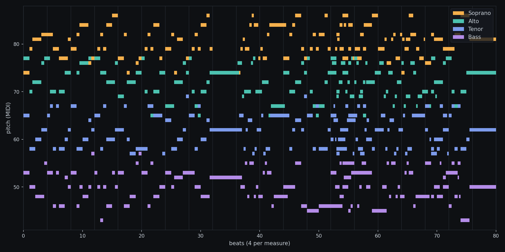
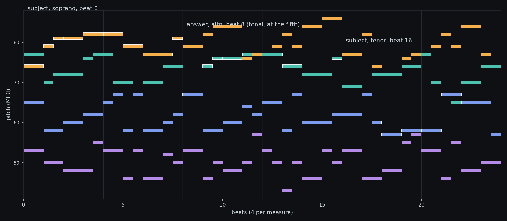

[GBK](https://compose.grepawk.com/) composes with rules, not with a trained model. When an agent asks GBK for baroque counterpoint, the notes come from a fugue generator: about 900 lines of TypeScript that build a fugue the way a composition student is taught to, then grade the result against the rules of counterpoint and keep the best attempt. The whole generator is one file, [src/bach-generator.ts](https://github.com/yishengjiang99/gbk/blob/main/src/bach-generator.ts), and it is deterministic. Give it a seed and it gives you the same fugue every time, which turns out to be exactly what an agent tool needs.

This post walks through the construction in the order the code does it: the harmonic plan, the subject, the tonal answer, the episodes, the stretto, the grading, and the repair pass. It ends with the function calls that carry a fugue from an MCP request into a composition. Every number and every note name below comes from running the generator itself, mostly on one example: D minor, four voices, medium length, complexity 3, seed 42.



## The request: twelve keys, four voices, one seed

A fugue request is a small config object. The key is one of twelve: eight major (C, G, D, A, E, F, Bb, Eb) and four minor (A, E, D, G minor). Length is short, medium or long, meaning 14, 20 or 28 measures. Voices are 3 or 4. Character is one of five: severe ricercar, compact fugue, lively fughetta, stretto-driven fugue, or toccata + fugue hybrid. Complexity runs 1 to 5 and mostly controls how long and how busy the subject is. Tempo is one of 78, 92, 108 or 126 beats per minute.

The seed drives everything. It is hashed and fed to a mulberry32 random generator, and every choice the generator makes draws from that one stream. There is no other source of randomness in the file, so a seed is a complete description of a fugue. Agents use this constantly: change the key and keep the seed, and you get a comparable fugue rather than a new roll of the dice.

## The harmonic plan comes before any notes

Before a single note exists, the generator lays out a harmonic plan, one entry per measure. Each measure gets a function, T (tonic), PD (pre-dominant), D (dominant) or CAD (cadence), and a region label. The shape is the standard one. The first four measures stay in the tonic region, measures 5 to 7 lean on the dominant, measure 8 is a cadence. Measures 9 to 11 move to the dominant region in major keys, or the relative major in minor keys. Measures 12 to 14 are marked sequence, then a medial and modulatory stretch, and the last four measures close: tonic functions, a dominant in the penultimate measure, a cadence in the final one. The character bends the plan in two places: a stretto-driven fugue renames its last stretch stretto, and the toccata hybrid marks its first two measures as a prelude.

A function is turned into chord tones by degree. T is degrees 1, 3, 5 of the scale. PD is 2, 4, 6. D is 5, 7, 2. CAD is just 5 and 1, the two pitches a cadence needs. Later, when free voices need notes and when the grader checks harmonic fit, this plan is the reference. The fugue is not harmonically free-form; it is written into a form that was decided first.

## A subject from rhythm and contour banks

The subject is assembled from two banks. The rhythm bank holds three rhythm patterns per character, in beats. A compact fugue might get [1, 0.5, 0.5, 1, 1, 1, 1]; a severe ricercar gets longer, even values; the toccata hybrid gets 32nd-note pickups. The contour bank holds five melodic shapes written as scale-degree offsets, such as [0, 2, 4, 3, 5, 4, 2, 1]. The generator picks one of each, then writes between 6 and 12 notes: the count is 6 plus the complexity, plus a random 0 to 3, clamped to that range.

Three rules keep the result singable. The subject starts on degree 1 most of the time (60 percent), otherwise on 3 or 5, at octave 5 in major keys and 4 in minor. Any leap wider than 8 semitones is replaced by a step of 2 to 5 semitones in the same direction. And the last note is forced to degree 5 or degree 2, so the subject ends open, pointing at the answer rather than closing. Every pitch is snapped to the key's scale as it is written.

The seed 42 subject in D minor comes out as ten notes over two measures: D5, G5, A5, A5, Bb5, Bb5, G5, F5, F5, A5, with durations 1, 0.5, 0.5, 1, 1, 1, 1, 1, 0.5, 0.5 beats. It is not a famous melody. It is a serviceable one, which is all a fugue subject needs to be, because the fugue is what happens to it next.

## Answers are tonal, and the countersubject is built note by note

One transform function produces every later statement of the subject. It can transpose, invert around a chosen pitch, retrograde (reverse the notes and re-time them), augment or diminish the durations, and make a tonal adjustment. The answer uses transposition up a fifth, 7 semitones, plus the tonal adjustment, and the adjustment is the interesting part. A tonal answer exists to stop the opening from modulating: dominant harmony in the subject is not simply answered with more dominant. The code's version of the rule: within the first three notes, any note that lands on the dominant pitch class after transposition is lowered a semitone and snapped back into the key, and a note a fourth above the dominant gets the same treatment. You can watch it fire in the example. A plain transposition of the subject would give the answer A, D, E, E, F, F, D, C, C, E. The answer actually written (in the alto's register) is G, D, E, E, F, F, D, C, C, E: identical except for the first note, where the dominant A was pulled down to G.

The countersubject, the line that plays against the answer, is built one note per subject note. Each note sits a consonant distance from its subject note, an offset of 3, 4, 6, 8 or 9 semitones up or down, snapped to scale, and if it lands on the subject's own pitch class it is nudged 2 semitones further. Long subject notes (a beat or more) usually split their countersubject note into two halves a step apart, which keeps the line moving. When a voice enters with the subject, the voices already present are filled with this countersubject material, adjusted by ear of a simple kind: a candidate note is shifted by 0, ±2, ±4 or ±7 semitones until it is consonant with everything else sounding, unless the note is short (half a beat or less), where a passing dissonance is allowed to stand.

## The form: exposition, episodes, middle entries, stretto

A structure planner turns the measure count into a list of events. The exposition enters one voice every two measures (every measure and a half in a stretto-driven fugue), alternating subject and answer: subject in voice 1, answer in voice 2, subject in voice 3, answer in voice 4. Each entry is placed in its voice's register by folding octaves toward a target center per voice: for four voices the centers are MIDI 79, 69, 59 and 47 (about G5, A4, B3, B2).



After the exposition come episodes and middle entries. An episode is built from the first two beats of the subject, sequenced four times at a transposition of 2 or 5 semitones up or down, with durations scaled by 0.75. That is the standard episode recipe: take a fragment, sequence it, use it to travel. Middle entries restate the subject in a new voice, and each one picks a treatment at random: plain, at the fifth, inverted, augmented (durations doubled) or diminished (halved). Any gaps left in any voice are then filled with free counterpoint drawn from the harmonic plan: chord tones for that measure's function, choosing the candidate closest to the voice's previous note.

The closing depends on the character. Compact and stretto-driven fugues end in stretto: the diminished subject enters in every voice, overlapping, one entry every half measure. The others end over a dominant pedal in the bass that steps to the tonic for the last two beats, with one more entry above it. The seed 42 piece runs 20 measures, and its own analysis (which counts measures from 0) reads: exposition entries at measures 0, 2, 4 and 6, an episode at 9, middle entries at 11, 13 and 17, a second episode at 15, and stretto entries every half measure from 16. In total the finished fugue has 608 notes: 50 subject notes, 20 answer, 156 countersubject, 144 episode, 40 stretto and 198 free counterpoint.

## Every candidate sits a counterpoint exam

Writing the notes is half the generator. The other half grades them. The grader expands the piece onto a half-beat grid, and at each step it looks at every pair of voices. It counts parallel fifths and parallel octaves (both voices moving in the same direction from one perfect interval to the same perfect interval), unisons, and voice overlaps, and it counts contrary motion, the share of steps where two voices move in opposite directions. Separately it adds a melodic penalty: leaps wider than 7 semitones cost the excess, and a leap wider than 5 followed by another leap in the same direction costs 3 more. It measures cadence strength in the last four beats (tonic notes count double, bass notes on tonic or dominant count double again), harmonic coherence (the fraction of notes whose pitch class belongs to the planned chord for their measure), and how many notes carry a subject, answer or stretto role.

The score is one line of arithmetic:

```
score = 100
  - 8 per parallel fifth
  - 10 per parallel octave
  - 1.2 per leap-penalty point
  - 5 per voice overlap
  - 0.3 per unison
  + 18 x contrary-motion share
  + 1.8 x cadence strength
  + 25 x harmonic coherence
  + 0.35 per subject-role note, capped at 70 notes
```

Before grading, a repair pass runs three times. Wherever the grid shows a parallel fifth or octave, it tries shifting the lower voice's note by -2, +2, -1, +1, +3 or -3 semitones, re-grades the whole piece for each candidate, and keeps the first shift that improves the total. Leaps wider than 9 semitones are pulled back to 7. Repair does not always succeed, and the grader does not hide that: the score says what is left.

Then the generator does it all again. The subject, countersubject, plan and structure are fixed for a seed, but each attempt realizes the entries and fills differently, and the best-scoring attempt wins. The default is 10 attempts. On seed 42 the search is worth about 67 points: one attempt scores -53.6 (five parallel octaves, a weak cadence), three attempts reach -26.9, and the best of ten reaches +13.9, with zero parallel fifths, two parallel octaves, no voice overlaps, contrary motion in 201 of 685 moving steps, a cadence strength of 48 and harmonic coherence of 0.41. Read the number as a ranking, not a percentage. The penalties are dense in real counterpoint (254 unisons on a half-beat grid cost 76 points by themselves), so a winning score near zero is normal, and a negative score just means the grader found more faults than virtues. What matters is that the best attempt is measurably cleaner than the first one.

## What comes out: a small MIDI file

The winning piece is encoded as a Standard MIDI File, format 1, at 480 ticks per quarter note. There is one track per voice, named "Generated Bach Soprano", "Generated Bach Alto" and so on, each with an instrument name of Harpsichord and a program change to General MIDI program 6, the harpsichord. Track 1 also carries the tempo and a 4/4 time signature. Velocities are flat, 82 for note on and 64 for note off: the generator writes pitch and time, and leaves expression to the tools that arrange and play the piece. Pitches across the whole piece are clamped to MIDI 33 to 92. The seed 42 file is 5,632 bytes for its 608 notes.

## How the MCP calls it

The generator is a library. Four callers put it to work, and an agent meets two of them as MCP tools.

The direct tool is `gbk_generate_fugue_section`, defined in [src/webmcp/music-tools.ts](https://github.com/yishengjiang99/gbk/blob/main/src/webmcp/music-tools.ts#L46). Its schema accepts only what the generator supports: key (the twelve, as an enum), voices (3 or 4), length, complexity 1 to 5, a seed up to 2^31, a start bar, a bar cap, and an optional register window. The handler builds a config, calls `generateBachMidi(cfg)`, parses the returned bytes back into the project's own note model, rescales from the generator's 480 ticks per quarter to the project's resolution, optionally fits the notes into the requested register, and stages one new track per voice, named "Fugue Generated Bach Soprano" and so on, with MIDI channels assigned in order and channel 9 skipped because that is the drum channel. The result is a proposal the user can accept or reject, and it carries an honest warning: "generated material comes from GBK's rule-based Bach-style generator".

The hosted MCP server, the one ChatGPT and Codex connect to, exposes the same tool through its edit operation. When an agent calls the edit tool with a `generate_fugue_section` operation, [server/src/mcp/service.ts](https://github.com/yishengjiang99/gbk/blob/main/server/src/mcp/service.ts#L330) forwards the parameters to `gbk_generate_fugue_section` and commits the result straight into the stored composition. The in-app agent in GBK Studio uses the same tool definition through the browser-side tool layer, where the tool is registered as a mutating tool in the agent's policy table.

The third caller never mentions fugue in its tool name. `gbk_generate_arrangement` with the baroque style reaches the generator through [src/music/compose.ts](https://github.com/yishengjiang99/gbk/blob/main/src/music/compose.ts#L203): its `baroqueVoices` function picks the nearest supported key, calls `generateBachMidi` with a single attempt for speed, transposes the result into the requested key, and tiles statements of it across the requested length, transposing by a plan (tonic, dominant, submediant side, subdominant side) and aligning the fugue's own final cadence to the last bar. The arrangement layer then adds a continuo part, realized as a close-position chord per half bar from the pitch classes actually sounding in the fugue voices. The fourth caller is the app's own Bach generator page, which calls `generateBachMidi` directly from the UI with the full config, character included.

Above all of this sits the agent's own judgment, and it is worth seeing what that layer does and does not do. In [server/src/agent/prompt.ts](https://github.com/yishengjiang99/gbk/blob/main/server/src/agent/prompt.ts), the system prompt gives the model a baroque style card (fugue tempo 66 to 92, minor keys common, terraced dynamics, harpsichord continuo, concert-hall reverb) and one line of musical reasoning that names the fugue's parts: subject and answer entries, episodes, stretto near the end, cadence. The model chooses the key, the seed, the voice count and where the section goes. It does not write a single note. That division is the design: language models are good at intent and bad at parallel fifths, and the generator is the opposite.

## Why a fugue generator suits an agent

A fugue from this generator takes milliseconds, costs no model call, and can be regenerated exactly from its seed, so an agent can ask for the same fugue a semitone away and diff the two. The piece also explains itself: the generator returns an analysis list alongside the notes ("exposition: subject in voice 1 at m.0.0", "episode1: sequential episode derived from subject head at m.9.0", "closing stretto overlap in voice 3 at m.17.0"), so the agent can tell the user what it made and where. And when the result is weak, the score object says why, in numbers: how many parallels survived repair, how much contrary motion there is, how coherent the harmony stayed.

What the generator writes is notes. Turning those notes into sound, with SoundFont voices, envelopes and a master bus, is the renderer's job, covered in [How the GBK SoundFont renderer turns MIDI into sound](https://grepawk.com/blog/gbk-sf2-renderer). The companion piece, [How SoundFonts work](https://grepawk.com/blog/how-soundfonts-work), goes through the rulebook the renderer applies. Between the three of them, that is the whole path: an agent asks, a rule engine writes a fugue and grades it, and a synth plays it.
