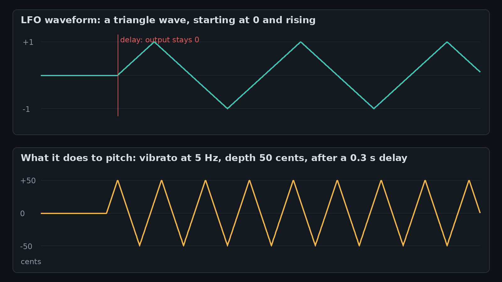
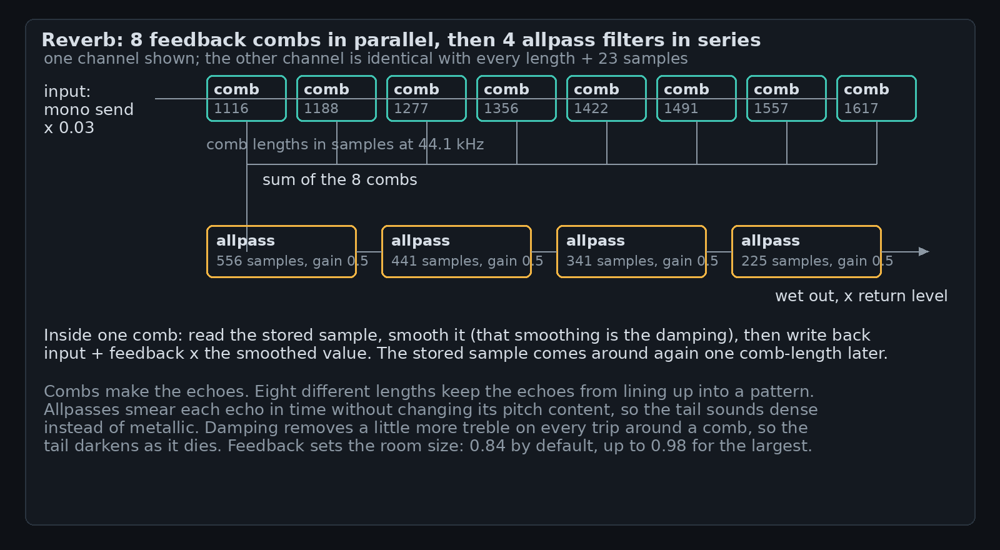

A SoundFont is two things in one file: recordings, and a rulebook for playing them. The recordings are ordinary PCM audio, usually one short sample per instrument note range. The rulebook says how a sample should be pitched, how its loudness should evolve, how bright it should be, and how much reverb it should get. Understanding how SoundFonts work is mostly a matter of understanding that rulebook, because the playback engine is a machine for applying it, one sample at a time.

This post goes through the rulebook as [GBK](https://compose.grepawk.com/)'s synth applies it: how the file is read, the volume and modulation envelopes, what an LFO is, how the lowpass filter, reverb and chorus are calculated, and how pitch is produced by resampling. A companion post, [How the GBK SoundFont renderer turns MIDI into sound](https://grepawk.com/blog/gbk-sf2-renderer), covers the engine around these rules: voices, polyphony and the master bus. Every chart below is computed with the engine's own formulas, from [its source](https://github.com/yishengjiang99/gbk/blob/main/src/sf2-renderer.ts).

## Reading the file: samples plus nine tables

An .sf2 file is a RIFF container with three lists. INFO holds text metadata. sdta holds the sample data: one long run of 16-bit PCM that every sample points into. Pdta holds nine tables with fixed record sizes, and the tables are the rulebook. Presets (phdr) point into preset zones (pbag) with their generators (pgen) and modulators (pmod). Instruments (inst) point into instrument zones (ibag, igen, imod). Sample headers (shdr, 46 bytes each) give a sample's start, end and loop points inside the PCM run, its sample rate, its original pitch, and a pitch correction in cents.

A zone is a set of generator values: numbered settings like attack time, filter cutoff, pan. Zones come in two levels. A global zone sets values for a whole instrument; local zones override them per sample. When a preset plays an instrument, the two levels merge: preset generator values are added to instrument values and clamped to each generator's legal range, and key and velocity ranges are intersected. The result is one region per sample: the sample plus its final, fully resolved settings. At load time the PCM is converted from 16-bit integers to floats by dividing by 32768, and a loop shorter than two samples is discarded, because it cannot sound like anything but a click.

Almost every number in the rulebook is logarithmic, in one of three units. Timecents measure time: seconds = 2^(timecents/1200), so 1200 timecents is a doubling and the common default of -12000 timecents is about a millisecond. Absolute cents measure pitch ratios and filter cutoff the same way, with 0 cents defined as 8.176 Hz. Centibels measure level: 10 centibels is 1 dB. Once you see that, the defaults read plainly. Envelope times default to -12000 timecents (about 1 ms), the filter cutoff defaults to 13500 cents (about 19.9 kHz, effectively open), and scale tuning defaults to 100, meaning each key step is one semitone.

## The volume envelope, in decibels

An envelope is a shape that a value follows over the life of a note. The volume envelope has six stages: delay, attack, hold, decay, sustain and release. The first chart shows one, plotted the way the engine thinks about it, in decibels. Delay is silence before anything starts. Attack climbs to full level. Hold stays there. Decay falls to the sustain level, which is where the note sits while the key is held. When the key lifts, release falls to silence and the voice ends.

Three details make this envelope behave the way it does. First, the attack is linear in amplitude, which is why it bends on a decibel plot: equal steps in amplitude are huge steps near silence and small steps near full level. Second, decay and release are not linear and not exponential curves drawn point by point. The engine tracks attenuation in centibels and increases it at a constant rate: 1000 centibels (100 dB) per decay time. The decay value in the file is therefore the time the fall would take to drop 100 dB, and the envelope stops early, at the sustain attenuation. A 3 second decay to a sustain of -24 dB takes 0.72 seconds to get there. On a decibel plot, a constant rate is a straight line, which is exactly what the chart shows. Third, sustain is stored as an attenuation, not a fraction: 240 centibels means "hold 24 dB down." Release starts from wherever the level currently is, converted back into centibels, and falls at its own constant rate until it reaches 960 centibels, 96 dB down, which the engine treats as silence.

Envelope times also track the keyboard. Hold and decay are adjusted by a per-instrument amount times (60 - key), in timecents: play above middle C and the decay shortens by that many timecents per key, play below and it lengthens. That is why high piano notes die away faster than low ones in a decent SoundFont: the instrument author dialled it in once, as a slope, instead of per note.

## The modulation envelope is a control signal, not a volume

Every voice has a second envelope with the same six stages and a different job. The modulation envelope never touches loudness directly. It outputs a plain 0 to 1 signal, and the rulebook says what that signal pushes: a number of cents of pitch (modEnvToPitch) and a number of cents of filter cutoff (modEnvToFilterFc). Each frame the engine multiplies the signal by those amounts and adds the results in. The classic use is a filter that opens as the note attacks, then settles back as the envelope decays to its sustain fraction: a brass swell, or the chirp at the front of a synth bass.

Its curves differ from the volume envelope's. The attack is convex, computed as 1 - concave(1 - x) with the standard SoundFont curve, so it leaves zero slowly and arrives at full level steeply. Decay and release are linear in the signal itself: the level drops by 1/decay per second until it reaches the sustain fraction, which is a true fraction here (0.3 in the chart), not an attenuation.

## What an LFO is

An LFO is a low-frequency oscillator: a circuit or a loop whose whole output is a slow, repeating control signal. You do not hear it as a pitch. You hear what it moves. A 5 Hz LFO wired to pitch is vibrato; wired to volume it is tremolo; wired to filter cutoff it is a wah that cycles five times a second.

In this engine each voice has two LFOs. Both are triangle waves that start at 0 and rise, both have a delay before they start (so a note can speak cleanly before vibrato fades in), and both take their frequency from an absolute-cents value clamped to 0.001 to 100 Hz. The vibrato LFO drives pitch only. The modulation LFO can drive pitch, filter cutoff and volume at once, each with its own amount from the rulebook. Depths come from generators and modulators: the standard wiring gives the mod wheel (CC1) and channel pressure control over vibrato depth, at 50 cents for full pressure. Fifty cents is a quarter tone, which is why the wobble in the chart spans a semitone peak to peak.

## The lowpass filter, calculated per voice

Each voice runs its sample through a two-pole lowpass filter, the RBJ biquad. The filter is five coefficients computed from two numbers, the cutoff frequency and Q:

- w0 = 2 * pi * cutoff / sampleRate, and alpha = sin(w0) / (2 * Q)
- b0 = (1 - cos(w0)) / 2, b1 = 1 - cos(w0), b2 = b0, each divided by (1 + alpha)
- a1 = -2 * cos(w0) / (1 + alpha), a2 = (1 - alpha) / (1 + alpha)

Each output sample is then b0 * x + z1, with the two state values updated from b1, b2, a1 and a2. That is the whole filter: five multiplications and a short memory.

The cutoff arrives in absolute cents and converts with Hz = 8.176 * 2^(cents/1200). It moves constantly: the per-frame cutoff is the base value plus the modulation envelope times its amount plus the modulation LFO times its amount, in cents. Recomputing coefficients costs a sine and a cosine, so the engine caches the hertz value and only recomputes when the cents value actually changes, which for most voices is never.

Q is given in centibels of peak gain. The engine turns it into the RBJ q through G = 10^(Q/200), then q = sqrt((G^2 + G * sqrt(G^2 - 1)) / 2), and multiplies the voice's gain by 10^(-Q/400). That last step matters: resonance adds a peak at the cutoff (24 dB of peak for the 240 centibel curve in the chart), and without compensation a resonant voice would also get louder overall. The compensation pulls the passband down by half the peak in decibels, so turning up Q changes the shape, not the volume. When Q is 0 and the cutoff sits at or above min(20 kHz, 0.45 * sampleRate), the filter is bypassed entirely and the sample passes through untouched.

## Pitch is playback speed

There is no pitch shifter in a sampler. There is a read head, and it moves at a rate. The rate for a note is:

rate = 2^(cents/1200) * (sampleRate / outputRate), where cents = (key - rootKey) * scaleTuning + coarseTune * 100 + fineTune

The root key is the pitch the sample was recorded at, taken from an override generator if present, else the sample header; the header's pitch correction is folded into fineTune when the region is built. At the root key the rate is 1 (times the sample-rate conversion) and the recording plays as recorded. Each frame, the voice reads the sample at its current position using linear interpolation between the two neighbouring samples, then advances the position by rate. A loop wraps the position back inside the loop points with a modulo.

Everything people associate with sampler sound follows from that one mechanism. Play a sample an octave up and it is twice as fast and half as long, with its harmonics and formants shifted up with it: the chipmunk effect is not an artifact, it is the definition. Vibrato, pitch bend and the modulation envelope all work by multiplying this same rate, per frame: pitchCents = vibLFO * vibAmount + modLFO * modAmount + modEnv * envAmount, and rate = baseRate * 2^(pitchCents/1200). Bend a note and you are literally speeding up and slowing down its playback, sample by sample.

## Reverb and chorus, from delay lines

Both send effects are built from delay lines: short memories that hand samples back later. A voice contributes to each effect in proportion to its send amounts, which come from the region's reverb and chorus send generators plus the standard CC91 and CC93 modulators.

The reverb is the Freeverb design. Its core is the lowpass-feedback comb: a delay line whose output is this frame's result, and whose input is the new sample plus feedback times a smoothed version of the stored one. The smoothing state updates as store = out * (1 - damping) + store * damping. Eight combs run in parallel with lengths from 1116 to 1617 samples (at 44.1 kHz; they scale with sample rate, and the second channel uses every length plus 23 for stereo width). Their lengths share no common pattern, so their echoes interleave instead of reinforcing into a flutter. The sum then passes through four allpass filters in series (556, 441, 341, 225 samples, gain 0.5; store x + 0.5 * stored, output stored - x), which smear the timing of the echoes without changing their spectrum. The combs are fed the mono sum of the send bus times 0.03, and the wet result returns scaled by the reverb level: 2.7 at the default level of 0.5. Feedback is the room size in disguise: 0.84 by default, mapped up to 0.98 for the largest room, and damping decides how fast the tail darkens, because treble loses a little more energy on every trip around a comb.

The chorus is smaller: two delay lines whose read position is not fixed. The delay is 12 ms plus 4 ms times sin(2 * pi * phase), with phase advancing at 0.6 Hz, so the read point slides between 8 and 16 ms behind the write point. A moving delay is a moving pitch, slightly sharp as the delay shortens and slightly flat as it lengthens, and mixing that against the dry note is the chorus shimmer. The read is fractional, done with the same linear interpolation as the sample reader, and the right channel runs a quarter cycle behind the left, which is what makes the movement stereo. The delayed signal returns at 0.7 of the level it was sent at.

## How SoundFonts work, in one frame

Put the pieces together and one frame of one voice looks like this. The modulation envelope and both LFOs advance one step. Pitch cents are summed from the LFOs and the envelope, and the rate is recomputed. A sample is read at the read head, interpolated, and the head advances. The filter, whose cutoff was also moved by the envelope and LFO, filters it. The volume envelope advances and multiplies it, along with the attenuation from velocity and the modulator table, the filter's Q compensation, tremolo from the modulation LFO, and the track volume. The result is panned with a linear law (left = (1 - pan) / 2, right = (1 + pan) / 2), added to the mix, and added again, scaled, to the reverb and chorus send buses. After all voices, the effects run once, the master bus runs once, and the frame is done. At 48 kHz, all of that happens 48,000 times per second, for every sounding voice, out of preallocated state with no allocation in the loop.

That is the whole instrument, really: a file of recordings, a rulebook of logarithmic numbers, and a handful of small formulas (an envelope that falls in straight decibel lines, a triangle wave, five filter coefficients, a moving read head, and two kinds of delay line) composed per sample. The format dates from the 1990s, and the reason it still sounds good is that the composition is the instrument design. Next time you load a SoundFont in [GBK](https://compose.grepawk.com/) and a piano note blooms, darkens and dies away, you know which six stages, and which straight line in decibels, you are hearing.
