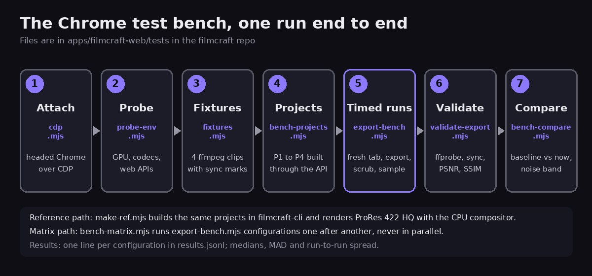
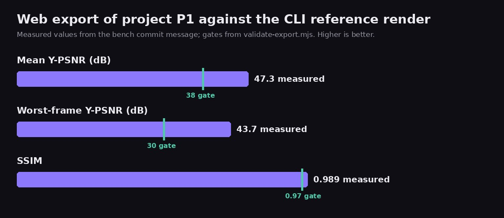

A WebAssembly app behaves differently in a real Chrome than in a headless one: the GPU, the hardware video encoders and the tab scheduler all change the numbers. This guide shows how to build a Chrome test bench that measures an app in a real, visible Chrome. The worked example is the browser export of [filmcraft](https://github.com/yishengjiang99/filmcraft), the video editor behind [FinalCap](https://grepawk.com/). You can try the app at [grepawk.com/filmcraft](https://grepawk.com/filmcraft/).

The bench was added to the repo on October 15, 2026, as the first step of a plan to speed up export in the browser. Each step below links to the file or commit that implements it. The code is dependency free: it needs Node 22 or newer, ffmpeg and ffprobe, and a build of the app served with cross-origin isolation headers.

## Step 1: point the Chrome test bench at a real Chrome

The Chrome DevTools Protocol (CDP) lets a script open tabs, click, read metrics and set download behaviour. [`cdp.mjs`](https://github.com/yishengjiang99/filmcraft/blob/dc2095381f75d5877905a143428e84b4c8c1289e/apps/filmcraft-web/tests/cdp.mjs) is a small client with no npm packages. It uses one browser-level WebSocket and one flattened session per tab, so tabs can be driven and closed independently.

It has two modes:

- `attach` connects to a Chrome you started yourself with a remote debugging port. This is the mode for benchmarks.
- `launch` starts a headless Chrome with a temporary profile. The file says it is for correctness runs only, because headless GPU and media numbers are not representative.

The [plan](https://github.com/yishengjiang99/filmcraft/blob/4a494576a6e42f15109142c7f12559ef6e6d0e8c/docs/export-optimize-gpu.md) adds two practical rules. Start the bench Chrome with its own profile directory, because Chrome 136 and newer refuses remote debugging on the default profile. And keep the bench window visible, so the tab is not throttled.

## Step 2: record the machine and the browser

Before measuring anything, write down what this Chrome can do. [`probe-env.mjs`](https://github.com/yishengjiang99/filmcraft/blob/dc2095381f75d5877905a143428e84b4c8c1289e/apps/filmcraft-web/tests/probe-env.mjs) saves an `env.json` with:

- the Chrome version and the text of `chrome://gpu`, plus the GPU and driver from `SystemInfo.getInfo`;
- the WebGPU adapter features and limits;
- a WebCodecs matrix: 16 video configurations (H.264 in three profiles at 1080p and 4K, HEVC, AV1 and VP9) tested with both `prefer-hardware` and `prefer-software`, and three audio codecs;
- which web APIs exist, such as OPFS sync handles, JSPI, `memory64`, long animation frame timing and `measureUserAgentSpecificMemory`.

The file is used later. The matrix runner skips encoder and codec combinations that `env.json` marks as unsupported, and the export bench prints a warning when the Chrome version differs from the one recorded.

## Step 3: generate fixtures that never change

Benchmarks need the same input every time. [`fixtures.mjs`](https://github.com/yishengjiang99/filmcraft/blob/dc2095381f75d5877905a143428e84b4c8c1289e/apps/filmcraft-web/tests/fixtures.mjs) makes four clips with ffmpeg:

| file | content |
| --- | --- |
| `f1080p30_h264.mp4` | 1080p, 30 fps, 60 s |
| `f4k30_hevc.mp4` | 4K, 30 fps, 20 s |
| `f720p60_vp9.webm` | 720p, 60 fps, 30 s, VP9 with Opus audio |
| `f1080p_10bit_pq.mov` | 1080p, 10-bit PQ, 10 s |

ffmpeg runs single-threaded with bit-exact flags, so the same ffmpeg build gives the same bytes, and a `manifest.json` records each file's sha256 and the ffmpeg version. The clips are not committed. They are hard-linked into the served `bench/` folder after each build.

Each clip also carries a sync marker every 5 seconds: one full-white video frame and, at the same instant, a short 2 kHz beep. The validator in step 7 uses them to measure audio and video offset in the exported file.

## Step 4: build test projects only through the app's API

Clicking is not repeatable, so [`bench-projects.mjs`](https://github.com/yishengjiang99/filmcraft/blob/7b21fd5658be055dcaf24de272ca39dbc88eb21a/apps/filmcraft-web/tests/bench-projects.mjs) builds every project through the same commands the app exposes as `window.filmcraft`. There are four:

- **P1:** one 1080p30 clip, 20 s, no effects.
- **P2:** 1080p30, 60 s, with 2 video tracks, 3 cuts, a cross-dissolve, a basic color effect on every segment, a title, and dialogue plus music with fades.
- **P3:** 4K30, 20 s, with blur, a LUT, a vignette, a picture-in-picture with a scale keyframe, and 3 titles.
- **P4:** the P1 clip looped to 60 minutes, for memory and streaming tests.

The builders check their own work, for example that the 3 cuts in P2 produce exactly 4 segments, so a silent change in the editor cannot quietly change what is measured.

## Step 5: render a reference with a different engine

To know whether a fast export is still a correct export, you need an answer to compare it with. [`make-ref.mjs`](https://github.com/yishengjiang99/filmcraft/blob/7b21fd5658be055dcaf24de272ca39dbc88eb21a/apps/filmcraft-web/tests/make-ref.mjs) builds the same projects headlessly in `filmcraft-cli`, through the same engine commands over MCP, and exports them with the CPU compositor to ProRes 422 HQ. The builders take a small `api` object with `execute`, `importMedia` and `idle`, so one project definition runs against both the browser and the CLI.

## Step 6: time each export in a fresh tab

[`export-bench.mjs`](https://github.com/yishengjiang99/filmcraft/blob/fa06ed15e5eb97a1703f08787077ffa23f61f7c4/apps/filmcraft-web/tests/export-bench.mjs) is the center of the bench. For every run it:

1. opens a new tab and clears OPFS, so no cache or stored state leaks between runs;
2. forces the tab to stay focused and active, and fails the run if `document.visibilityState` is not `visible`;
3. loads the app with `?empty&fresh&norecover`, plus `nothreads` for the single-threaded build;
4. builds the project through the API and waits for import jobs to finish;
5. starts `file.exportMedia` at a pinned bitrate (12000 kbps up to 1080p, 40000 kbps above) so every encoder path is compared at equal rate;
6. while the export runs, drags across the timeline ruler every 500 ms with CDP mouse events, because the question is not only how fast the export is but whether the editor stays usable.

It records wall time, frames per second, a real-time factor, time to first frame, frame intervals from `requestAnimationFrame`, long animation frames and long tasks, the WebAssembly heap and the JavaScript heap, export stage counters and DOM counters. Any Rust panic, unhandled rejection or WebGPU validation error in the console fails the run. To read the WebAssembly heap size, the same commit adds [`filmcraft.info().memory.wasmBytes`](https://github.com/yishengjiang99/filmcraft/commit/fa06ed15e5eb97a1703f08787077ffa23f61f7c4) to the app.

For statistics, the bench discards warmup runs (one by default), reports the median and the median absolute deviation (MAD) of each metric, and reruns up to three more times when the coefficient of variation of the wall time is above 5%. Each configuration appends one line to `results.jsonl` with the git sha, Chrome version, GPU, OS and flags.

## Step 7: check every output file

Speed numbers mean nothing if the file is wrong. [`validate-export.mjs`](https://github.com/yishengjiang99/filmcraft/blob/dc2095381f75d5877905a143428e84b4c8c1289e/apps/filmcraft-web/tests/validate-export.mjs) runs after the timed runs, so the checks never compete with a measurement for CPU. It uses ffmpeg and ffprobe only as an outside oracle and checks:

- stream layout, size, frame rate and color tags;
- an exact frame count and a duration within one frame;
- a clean decode with `-xerror`;
- audio and video sync from the flash and beep markers, within one AAC frame (1024 samples at 48 kHz, about 21.3 ms);
- PSNR and SSIM against the reference render, with gates of at least 38 dB mean, 30 dB for the worst frame and 0.97 SSIM;
- a sha256, for paths that must stay byte-identical.

The file notes that the thresholds are never to be loosened to make a run pass. The first measured result is in the [commit that added the reference renders](https://github.com/yishengjiang99/filmcraft/commit/7b21fd5658be055dcaf24de272ca39dbc88eb21a): the web export of P1 against the CLI reference scored 47.3 dB Y-PSNR, with 43.7 dB for the worst frame and an SSIM of 0.989.

## Step 8: compare against a baseline and run the matrix

Two small scripts finish the loop. [`bench-compare.mjs`](https://github.com/yishengjiang99/filmcraft/blob/fa06ed15e5eb97a1703f08787077ffa23f61f7c4/apps/filmcraft-web/tests/bench-compare.mjs) prints a table of the latest label against a baseline label or git sha: wall time, fps, UI p95, long-animation-frame blocking, peak WebAssembly memory and PSNR, each with a delta. It exits with an error when a metric that is not the target gets worse by more than a set amount (wall time over 5%, UI p95 over 10%, peak memory over 10%) and the change is larger than the combined MAD of the two runs. A failed validation also fails the comparison.

[`bench-matrix.mjs`](https://github.com/yishengjiang99/filmcraft/blob/7a02034cc8cd5f47e513a234c38d361a53e9d46d/apps/filmcraft-web/tests/bench-matrix.mjs) runs configurations one after another, never in parallel, so runs do not share the machine. The quick matrix is P2 with H.264 on the software and hardware encoders. The full matrix has 19 configurations across projects, encoders, compositors, sinks and the single-threaded and threaded builds. A `--legacy` flag lets the same bench run older code that predates the encoder and sink options.

## What the bench has produced so far

The bench is the first step: it came with no product changes, and the plan says to run the full matrix on unmodified code first and record it as the baseline. That baseline is not published yet, so this post has no export timings to report. The one measured result is the quality figure above. The plan also sets targets for later steps, such as a hardware-encoded 1080p H.264 export that is at least 4 times faster and a UI p95 of 20 ms or less during export. Those are goals, not results.

Keep these limits in mind when you copy the approach:

- A real GPU and a visible window are part of the method, so numbers from one machine do not transfer to another. That is why step 2 records the environment.
- The bench measures one app on one machine at a time. Compare runs only when the Chrome version in `env.json` matches.

The code is in the [filmcraft repo](https://github.com/yishengjiang99/filmcraft), and the plan is in [`docs/export-optimize-gpu.md`](https://github.com/yishengjiang99/filmcraft/blob/4a494576a6e42f15109142c7f12559ef6e6d0e8c/docs/export-optimize-gpu.md). For earlier benchmarks of the same fork, see [What our filmcraft fork gains in WebAssembly](https://grepawk.com/blog/filmcraft-fork-webassembly-speedups).
