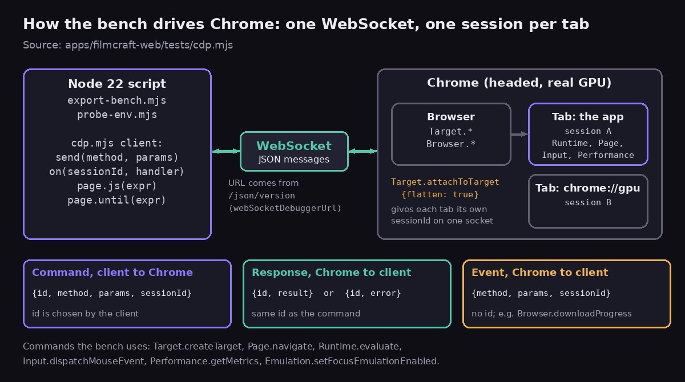
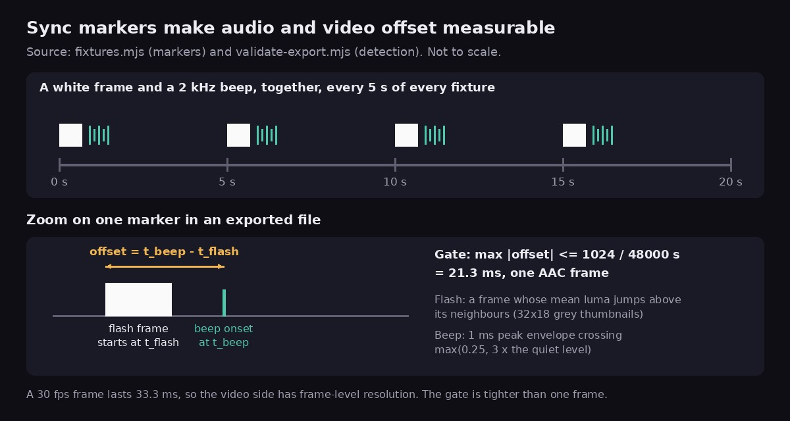
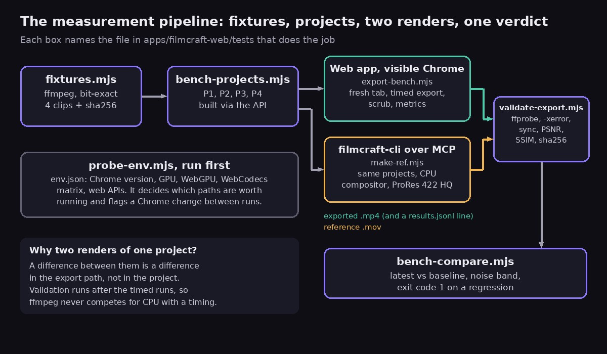
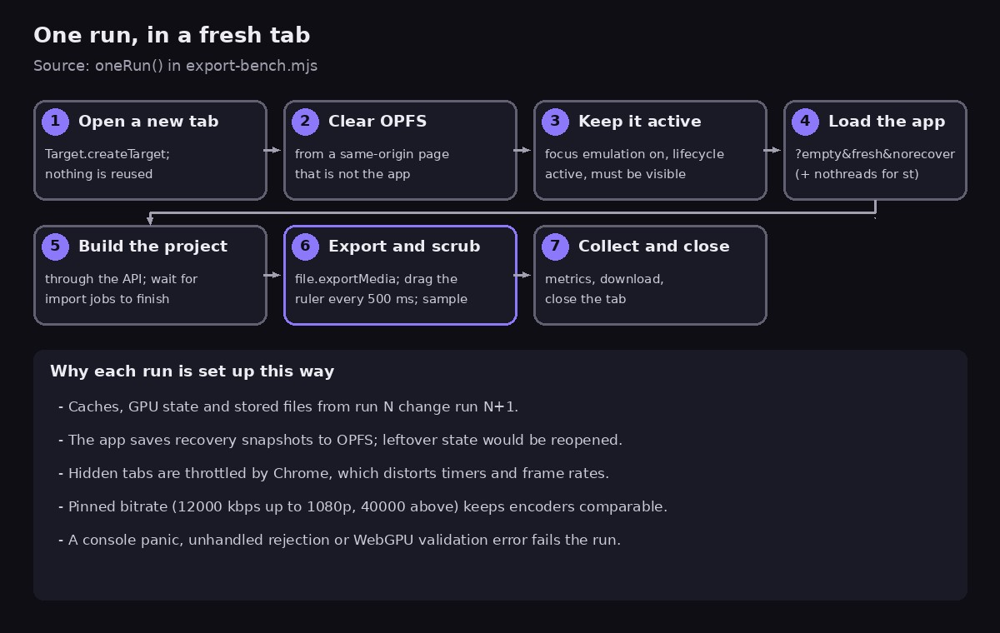
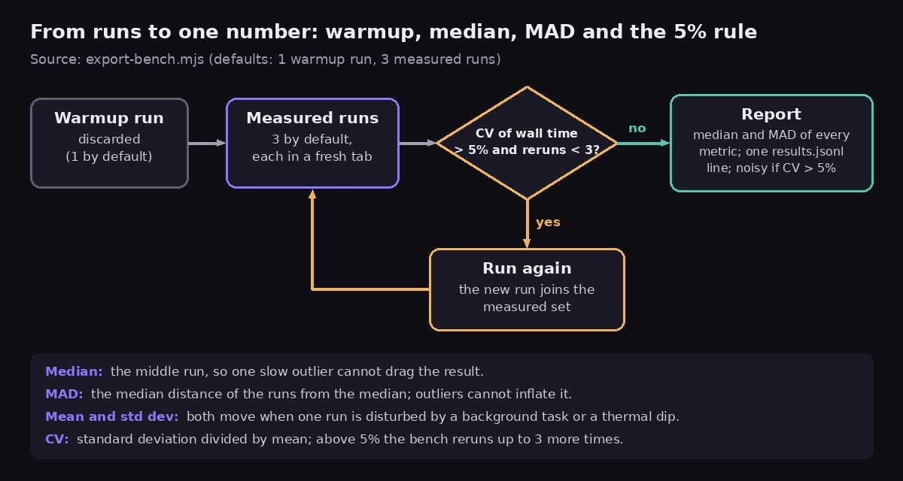
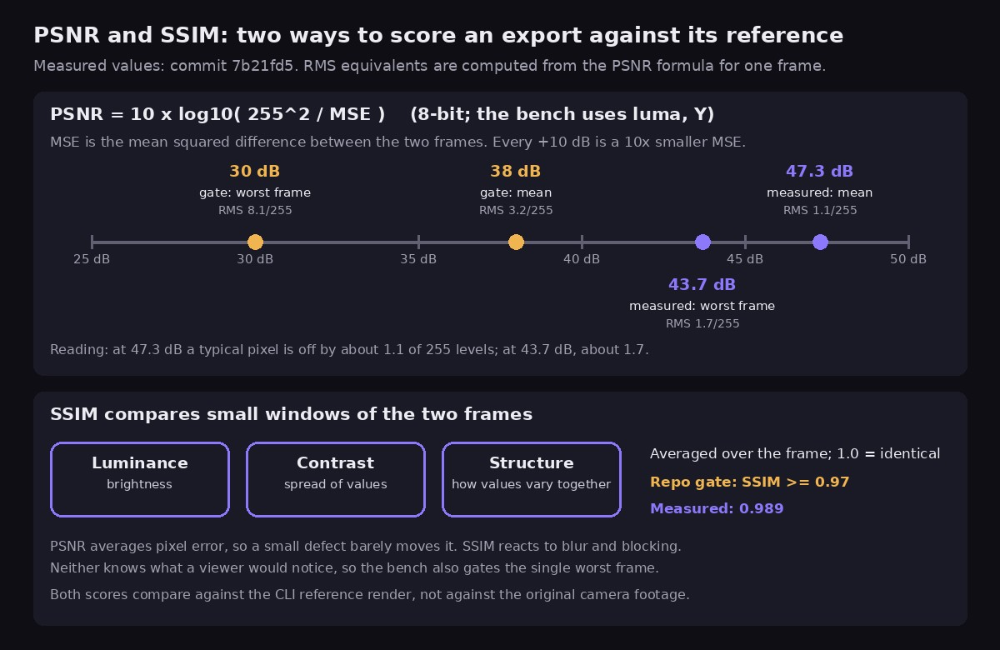
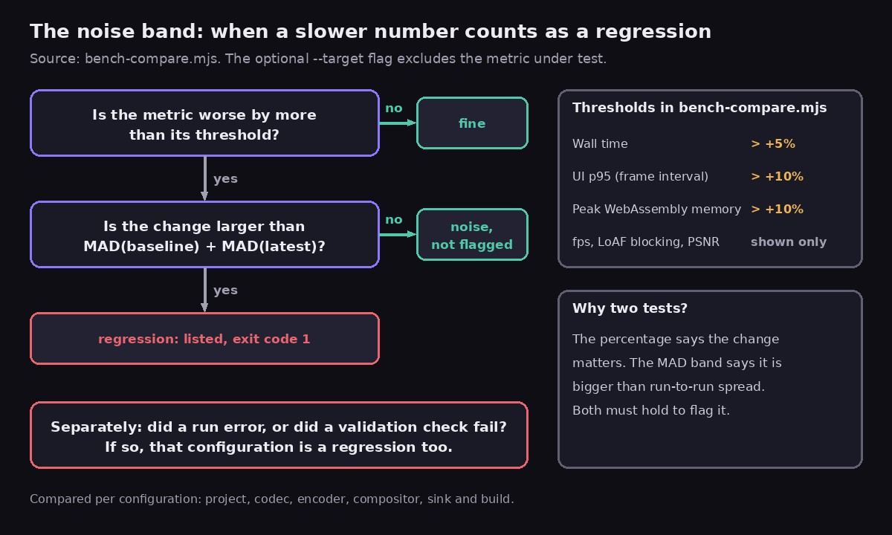

Our test for browser video export was green. The browser build of [filmcraft](https://github.com/yishengjiang99/filmcraft), the video editor behind [FinalCap](https://grepawk.com/), loaded a clip, put it on a timeline, exported H.264 and got a file back. That is a useful test. It is also not the same as knowing the export is right, in sync and fast, or that the editor stays usable while it runs.

This post is the story of the bench we built to answer those questions: a real, visible Chrome driven from a script, a clip with a flash and a beep, an export, and a comparison against a reference rendered by the command-line editor. It explains the technology at each step and what we traded away. If you want the same material as a checklist with a file link per step, there is a [step-by-step companion guide](https://grepawk.com/blog/how-to-build-a-chrome-test-bench-for-a-webassembly-app). You can try the app itself at [grepawk.com/filmcraft](https://grepawk.com/filmcraft/).

One honest note first. The bench landed in the repo on October 15, 2026, as the first step of a [plan to speed up export in the browser](https://github.com/yishengjiang99/filmcraft/blob/4a494576a6e42f15109142c7f12559ef6e6d0e8c/docs/export-optimize-gpu.md). It has produced one measured result so far, a quality score. There are no export timings yet, and the last section says why.

## What a green test says about browser video export

The existing browser smoke test, [`smoke.mjs`](https://github.com/yishengjiang99/filmcraft/blob/53d0def186f3f29c5e884b6ba0028cb08c7f7f98/apps/filmcraft-web/tests/smoke.mjs), drives the app over the Chrome DevTools Protocol. It loads the page, plays a demo project, imports a clip, exports H.264 and records the size of the downloaded file. It fails on any Rust panic or uncaught exception. It runs in headless Chrome unless you pass `--headed`.

It answers one question well: does the app still work? It does not look at the picture, listen to the sound, time the export, watch memory or check whether the interface froze while the export ran. Those questions matter more once you start changing how export works.

According to the plan's reading of the code, the web export is a chain of stages: decode with WebCodecs, convert each frame to RGBA through a 2D canvas, composite on the CPU, encode with a software H.264 encoder compiled to WebAssembly that runs on one thread, and pump the whole export from the UI thread. The output is buffered in WebAssembly memory before it is downloaded. Faster paths exist in the browser, such as hardware encoders and the GPU, and the plan is to use them. To know whether any change helps, and whether it breaks anything, we needed a way to measure the whole chain.

## Why headless Chrome was not enough

Three browser technologies decide how fast that chain can run:

- **[WebCodecs](https://www.w3.org/TR/webcodecs/)** gives a page direct access to the browser's video and audio encoders and decoders. A page can ask for hardware or software with the `hardwareAcceleration` hint, but the spec says a browser may ignore the hint. It also warns that hardware is not simply faster: it often has higher startup latency but steadier throughput, and at low resolutions its overhead can make it slower.
- **[WebGPU](https://www.w3.org/TR/webgpu/)** exposes the GPU for graphics and general computation. An export that composites on the GPU and hands frames to a hardware encoder skips copies that a CPU path pays for.
- **The scheduler.** Chrome throttles hidden tabs. [Chained timers in hidden pages are throttled heavily](https://developer.chrome.com/blog/timer-throttling-in-chrome-88), and animation frames are typically paused, so a minimized benchmark window measures the throttle, not the app.

We had already run into the first problem. Our earlier browser numbers, such as the ones in [What our filmcraft fork gains in WebAssembly](https://grepawk.com/blog/filmcraft-fork-webassembly-speedups), came from headless Chromium with software rendering on a shared virtual machine. The fork's [jank notes](https://github.com/yishengjiang99/filmcraft/blob/53d0def186f3f29c5e884b6ba0028cb08c7f7f98/docs/benchmarks/jank.md) say it plainly: no GPU, no hardware video decode, and real browsers on real hardware will look very different. That setup is fine for comparing two builds against each other. It cannot say anything about a hardware encoder or a GPU compositor, because it has neither.

So the rule became: headless is for correctness runs, and benchmarks run in a headed Chrome on real hardware. The cost is that a real browser on a real machine is noisier than a container. Most of the rest of the bench exists to win back the repeatability that a container gives for free.

## Driving a real Chrome from a script

A script controls Chrome through the [Chrome DevTools Protocol](https://chromedevtools.github.io/devtools-protocol/) (CDP), a JSON-based protocol that connects automation tools to browser targets such as tabs and workers. The script opens one [WebSocket](https://www.rfc-editor.org/rfc/rfc6455) to Chrome and exchanges JSON messages. A command carries an `id`, a `method` such as `Page.navigate`, and `params`. Chrome answers with the same `id` and either a `result` or an `error`. Events, such as a finished download, arrive without an `id`.

Methods are grouped into domains: [`Target`](https://chromedevtools.github.io/devtools-protocol/tot/Target/) manages tabs, [`Runtime`](https://chromedevtools.github.io/devtools-protocol/tot/Runtime/) evaluates JavaScript, [`Input`](https://chromedevtools.github.io/devtools-protocol/tot/Input/) sends mouse and key events, and `Performance` reads browser metrics.

The client, [`cdp.mjs`](https://github.com/yishengjiang99/filmcraft/blob/dc2095381f75d5877905a143428e84b4c8c1289e/apps/filmcraft-web/tests/cdp.mjs), is 187 lines with no packages. It reads the socket address from `/json/version`, opens one browser-level WebSocket and keeps a table of commands waiting for their `id`. For each tab it calls `Target.attachToTarget` with `flatten: true`, which gives the tab its own `sessionId` on the same socket, so tabs can be driven and closed independently. Its `page.js(expr)` helper wraps `Runtime.evaluate`, so the bench can run an async expression inside the app and get plain JSON back.

It can `attach` to a Chrome you started yourself, which is the benchmark mode, or `launch` a headless one for correctness runs. One practical detail: since Chrome 136, [Chrome refuses remote debugging on the default profile](https://developer.chrome.com/blog/remote-debugging-port), so the bench Chrome needs its own `--user-data-dir`.

**What we traded away.** Libraries such as Puppeteer speak this protocol for you. We chose a small client matching our existing smoke test, so nothing needs installing or version pinning and every CDP command is visible in one file. The cost is that the basics are ours to maintain.

## Writing down what this Chrome can do

Before measuring anything, the bench asks what the machine can do. A result like "hardware encoding is four times faster" is meaningless on a computer with no hardware encoder, and a number from one Chrome version is not comparable with another. [`probe-env.mjs`](https://github.com/yishengjiang99/filmcraft/blob/dc2095381f75d5877905a143428e84b4c8c1289e/apps/filmcraft-web/tests/probe-env.mjs) writes an `env.json` with:

- the Chrome version, the text of `chrome://gpu`, and the GPU and driver from `SystemInfo.getInfo`;
- the WebGPU adapter features and limits, including whether timestamp queries exist;
- a WebCodecs matrix of 16 video configurations (H.264 in three profiles at 1080p and 4K, HEVC, AV1 and VP9) and 3 audio codecs;
- which web APIs exist, such as OPFS sync handles, JSPI, `memory64` and the long animation frame observer.

**What a support matrix tells you.** For each codec the probe calls `VideoEncoder.isConfigSupported` with `prefer-hardware` and with `prefer-software`, and tests three bitrate modes on the hardware path. It probes decoders with both preferences too. Each answer says whether this browser can configure that codec at that size with that preference. Because the spec lets a browser ignore the hint, a `true` for `prefer-hardware` is evidence that a hardware path exists, not proof. The bench closes the loop in each run, which records which backend actually did the work.

The matrix also gates the rest of the bench. The runner skips encoder and codec combinations that `env.json` marks unsupported, and the export bench warns when the running Chrome differs from the one recorded.

**What we traded away.** Chrome has no stable API that says whether video encode is hardware accelerated, so the probe reads the text of `chrome://gpu`. That is brittle if the page layout changes, but it matches what a person would read, and `SystemInfo.getInfo` adds structured data next to it.

## A clip you can check by eye and by ear

If the input changes between runs, a speedup and a different clip look the same. [`fixtures.mjs`](https://github.com/yishengjiang99/filmcraft/blob/dc2095381f75d5877905a143428e84b4c8c1289e/apps/filmcraft-web/tests/fixtures.mjs) generates four clips with ffmpeg: 1080p H.264 (60 s), 4K HEVC (20 s), 720p60 VP9 with Opus (30 s) and a 10-bit PQ ProRes clip (10 s).

ffmpeg runs single-threaded with bit-exact flags, so the same ffmpeg build gives the same bytes. The picture is ffmpeg's `testsrc2` pattern blended with a moving gradient built from a `geq` expression, because ffmpeg's own gradient source is not deterministic even with a seed. A `manifest.json` stores each file's sha256 and the ffmpeg version. Nothing is committed: the clips are hard-linked into the served `bench/` folder after each build.

**The flash and the beep.** Every clip carries a marker every 5 seconds: one full-white video frame and, at the same instant, a 1/30 second 2 kHz beep at high level over a quiet 440 Hz and 1 kHz tone bed. That gives the validator an event it can find in both streams and a known moment when they should coincide.

To measure sync, [`validate-export.mjs`](https://github.com/yishengjiang99/filmcraft/blob/dc2095381f75d5877905a143428e84b4c8c1289e/apps/filmcraft-web/tests/validate-export.mjs) shrinks every video frame to a 32 by 18 grey thumbnail and flags frames whose mean brightness jumps above their neighbours. In the audio it computes a 1 ms peak envelope and finds where it crosses a threshold well above the quiet bed. It pairs each flash with the nearest beep and reports the offset. The gate is 1024 samples at 48 kHz, which is 21.3 ms, one AAC frame. Markers every 5 seconds also reveal drift: an offset that grows over the file shows at the later markers, which a single marker at the start would miss.

**What we traded away.** Synthetic clips are reproducible and easy to describe, but a test pattern does not compress like real footage, and encoder speed depends on content. The numbers compare builds. They are not predictions for your own videos.

## The same project, every time

Clicking through a UI is slow and depends on layout and timing, so two runs rarely do exactly the same thing. [`bench-projects.mjs`](https://github.com/yishengjiang99/filmcraft/blob/7b21fd5658be055dcaf24de272ca39dbc88eb21a/apps/filmcraft-web/tests/bench-projects.mjs) builds every project from commands only. The app exposes its commands as `window.filmcraft`, and the bench calls `filmcraft.execute(id, params)` and `filmcraft.importUrl`.

There are four projects:

- **P1:** one 1080p30 clip, 20 s, no effects.
- **P2:** 1080p30, 60 s, with 2 video tracks, 3 cuts, a cross-dissolve, a basic color effect on every segment, a title, and dialogue plus music with fades.
- **P3:** 4K30, 20 s, with blur, a LUT, a vignette, a picture-in-picture with a scale keyframe, and 3 titles.
- **P4:** the P1 clip looped to 60 minutes, for memory and streaming tests.

Together they span a plain copy, a typical edit, a heavy composite and a long timeline. The builders check their own work, for example that 3 cuts in P2 give exactly 4 segments, and edits keep clips at their source time so the sync markers stay paired in the export.

The same commands run in the command-line version of the editor over MCP, so one project definition builds in both the browser and the CLI. That is what makes the next step possible.

**What we traded away.** Building through the API skips the editor's UI code for those steps, so the bench does not measure how fast a person could assemble a project. The timeline scrub during the export puts some UI load back.

## Ground truth from the command line

A fast export is only good if it is also right, and to score that you need an answer to compare with. [`make-ref.mjs`](https://github.com/yishengjiang99/filmcraft/blob/7b21fd5658be055dcaf24de272ca39dbc88eb21a/apps/filmcraft-web/tests/make-ref.mjs) builds each project headlessly in `filmcraft-cli` and exports it with the CPU compositor to ProRes 422 HQ. ProRes is an intra-frame format, so each frame is stored on its own at a high bitrate and the reference is not a heavily compressed copy.

Now the validator can measure the web export against the reference, frame by frame. A new GPU compositor or hardware encoder can change pixels in ways no container check would notice, and the reference catches that.

**The limit.** The CLI and the web app share one editing engine, so the reference is a different render path, not an independent implementation. It can catch faults in the new compositor or encoder paths. It cannot catch a mistake in the shared editing logic, because both sides would make it.

**Alternatives.** Storing golden image hashes breaks on any harmless change. Re-rendering the edit in another tool would give an independent answer but means re-creating every effect there. The bench pairs the reference with a sha256 check for paths that must stay byte-identical, such as the software encoder.

## One run, one fresh tab

[`export-bench.mjs`](https://github.com/yishengjiang99/filmcraft/blob/fa06ed15e5eb97a1703f08787077ffa23f61f7c4/apps/filmcraft-web/tests/export-bench.mjs) is the center of the bench. Each run follows one recipe, and each step guards against a specific kind of contamination.

**Fresh tab, cleared storage.** Caches, GPU state and stored files from one run would change the next, so every run opens a new tab and closes it afterwards. Before loading the app it clears the origin's [OPFS](https://developer.mozilla.org/en-US/docs/Web/API/File_System_API/Origin_private_file_system) storage, from a same-origin page that is not the app so nothing writes to OPFS at the same time. The app saves recovery snapshots there and would reopen leftovers. The URL flags `?empty&fresh&norecover` start the app with no recovery, and `nothreads` selects the single-threaded build.

**Visible and active.** The run turns on focus emulation, sets the page lifecycle to active and fails if `document.visibilityState` is not `visible`, because background throttling would distort it.

**Cross-origin isolation.** The app is served with COOP and COEP headers, which makes the page [cross-origin isolated](https://web.dev/articles/coop-coep). That enables `SharedArrayBuffer`, which the threaded build needs, and `performance.measureUserAgentSpecificMemory()`, which the bench samples.

**A pinned bitrate.** Encoders pick different file sizes at the same quality setting, which would blur speed and quality together. The bench exports at 12000 kbps up to 1080p and 40000 kbps above, so every encoder path is compared at equal rate.

**A scrub during the export.** The export runs on the UI thread, so the question is not only how fast it finishes but whether the editor stays usable. Every 500 ms the bench presses, drags and releases the mouse on the timeline ruler with CDP input events while the export runs.

**What it measures:**

- wall time, frames per second, a real-time factor and time to first frame;
- frame intervals from `requestAnimationFrame`, with a 95th percentile, as a measure of UI smoothness;
- [long tasks](https://www.w3.org/TR/longtasks/) (main-thread tasks of 50 ms or more) and [long animation frames](https://developer.chrome.com/docs/web-platform/long-animation-frames), which catch many small tasks that together block rendering;
- the WebAssembly heap and the JavaScript heap. The WebAssembly side needed a small app change in the same commit, `filmcraft.info().memory.wasmBytes`, because linear memory only grows, so the latest size is the peak.

Any Rust panic, unhandled rejection or WebGPU validation error in the console fails the run.

**What we traded away.** The long animation frame observer and the memory API are Chromium features, and CDP is Chrome's protocol. The bench measures Chrome. It says nothing about Firefox or Safari.

## Turning noisy runs into numbers

One run is an anecdote. The bench runs each configuration several times, with statistics chosen for a noisy machine.

**Warmup.** The first run in a browser profile can pay for cold caches. The bench discards one warmup run by default and measures three after it.

**Median and MAD.** The median is the middle run, so one run slowed by a background task or a thermal dip cannot drag it. The MAD, the median absolute deviation, is the median distance of the runs from the median, a spread measure that one outlier cannot inflate. A mean and a standard deviation both move when one run is disturbed, which is the situation a shared desktop creates all the time.

**The 5% rule.** The bench computes the coefficient of variation of the wall time, the standard deviation divided by the mean. If it is above 5%, it adds a run and checks again, up to three more times. If the spread is still above 5%, the result is flagged noisy instead of being trusted. Each configuration then appends one line to `results.jsonl` with the git sha, Chrome version, GPU, OS and flags, so a number always arrives with its context.

**What we traded away.** Three runs is a small sample, and a MAD from three values is crude. More runs give steadier numbers but cost minutes per configuration, and the plan's quick loop is meant to take 3 to 5 minutes. The bench takes the cheap option and is honest about noise by flagging it.

## Is the export right? PSNR and SSIM

Speed numbers mean nothing if the file is wrong, so the validator checks each output after the timed runs. That order matters: ffmpeg's CPU use never overlaps a measurement. ffmpeg and ffprobe act only as an outside oracle.

The structural checks cover stream layout, size, frame rate and color tags, an exact frame count and a duration within one frame, a clean decode with `-xerror`, the sync gate described above, and a sha256 for paths that must stay byte-identical. The last check scores the export against the reference with two standard measures, both from [ffmpeg's filters](https://ffmpeg.org/ffmpeg-filters.html).

[PSNR](https://en.wikipedia.org/wiki/Peak_signal-to-noise_ratio), peak signal-to-noise ratio, is `10 x log10(255^2 / MSE)` for 8-bit video, where MSE is the mean squared difference between the two frames. Every 10 dB is a tenfold drop in MSE. The bench scores the luma plane and averages the per-frame values. At 47.3 dB, a single frame would have an MSE of about 1.2, which is a typical pixel error of about 1.1 out of 255 levels. At 43.7 dB it is about 1.7 levels.

[SSIM](https://en.wikipedia.org/wiki/Structural_similarity_index_measure), the structural similarity index, compares small windows of the two frames on brightness, contrast and structure, and averages the result. A score of 1.0 means identical.

**Why both, and what they miss.** PSNR averages pixel error, so a small defect in one corner barely moves it. SSIM reacts more to blur and blocking. Neither knows what a viewer would notice. The gates are at least 38 dB on average, at least 30 dB for the worst single frame, and at least 0.97 SSIM, and the file says the thresholds must never be loosened to make a run pass. Both scores compare against the CLI reference, not against the original camera footage, so they measure agreement between two render paths.

The first measured result is in the [commit that added the reference renders](https://github.com/yishengjiang99/filmcraft/commit/7b21fd5658be055dcaf24de272ca39dbc88eb21a): the web export of P1 against the CLI reference scored 47.3 dB Y-PSNR, 43.7 dB for the worst frame, and an SSIM of 0.989. All three clear their gates with room to spare.

## Not crying wolf

A benchmark that cries wolf gets ignored, and one that ignores noise hides real losses. [`bench-compare.mjs`](https://github.com/yishengjiang99/filmcraft/blob/fa06ed15e5eb97a1703f08787077ffa23f61f7c4/apps/filmcraft-web/tests/bench-compare.mjs) prints the latest label against a baseline label or git sha for each configuration, with wall time, fps, UI p95, long-animation-frame blocking, peak WebAssembly memory and PSNR, and a delta for each.

**The two-part rule.** A metric counts as a regression only when both tests hold. First, it is worse than its threshold: wall time more than 5%, UI p95 more than 10%, peak memory more than 10%. Second, the change is larger than the sum of the two runs' MADs, the noise band. A slowdown past the threshold that sits inside the run-to-run spread is not flagged. One that is clearly outside it is listed and makes the script exit with an error. A failed validation or a run that errored is a regression on its own. With the `--target` option, the metric a change is meant to improve is left out of the check.

**What we traded away.** Two tests mean a real but small loss hiding inside a wide noise band can pass. A single fixed percentage would fail at random on a noisy machine, and people would stop trusting it. We chose fewer false alarms and rely on the noisy flag and extra runs to show when a result needs more work.

[`bench-matrix.mjs`](https://github.com/yishengjiang99/filmcraft/blob/7a02034cc8cd5f47e513a234c38d361a53e9d46d/apps/filmcraft-web/tests/bench-matrix.mjs) runs configurations one after another and never in parallel, so runs do not share the machine. The quick matrix is project P2 with H.264 on the software and hardware encoders. The full matrix has 19 configurations across projects, encoders, compositors, sinks and the single-threaded and threaded builds. A `--legacy` flag lets the same bench run older code that predates the encoder and sink options.

## Where this stands

The bench is the first step: it came with no product changes, and the plan says to run the full matrix on unmodified code first and record it as the baseline. That baseline is not published yet, so this post has no export timings. The one measured result is the quality figure above. It comes from a commit message and not from a results file, and it does not say which encoder path produced the export.

The plan sets targets for later steps, such as a hardware-encoded 1080p H.264 export that is at least 4 times faster and a UI p95 of 20 ms or less during export. Those are goals, not results.

Two limits to remember. A real GPU and a visible window are part of the method, so numbers from one machine do not transfer to another, which is why the environment is recorded. And the bench measures one app in Chrome, so compare runs only when the Chrome version in `env.json` matches.

## What to take away

- A passing test tells you the export finished. Decide what else you need to know: right, in sync, fast, and smooth while it runs.
- Benchmark in a real, visible Chrome on real hardware. Use headless for correctness only.
- Record the machine first. A support matrix shows which paths exist, and the version shows which results are comparable.
- Put a flash and a beep in your test clip so audio and video sync becomes a number.
- Render a reference with another path of your own tool, and score against it with PSNR and SSIM, knowing they measure agreement and not beauty.
- Use fresh tabs, a warmup, medians and MAD, a 5% spread rule and a noise band, so only real losses fail a comparison.

The code is in the [filmcraft repo](https://github.com/yishengjiang99/filmcraft). For the same material as numbered steps with a file link for each, read the [companion guide](https://grepawk.com/blog/how-to-build-a-chrome-test-bench-for-a-webassembly-app).
