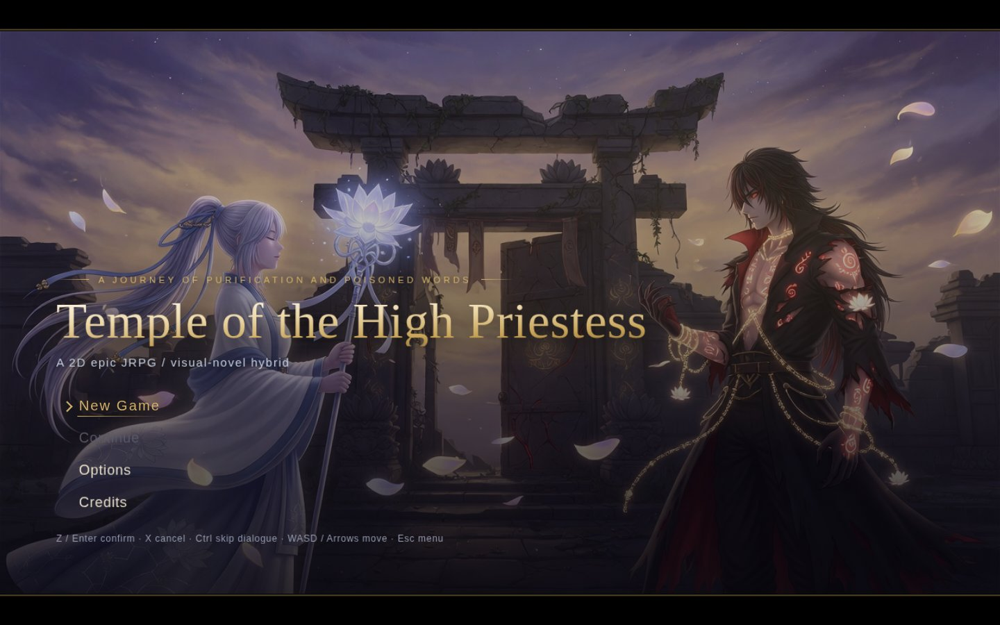
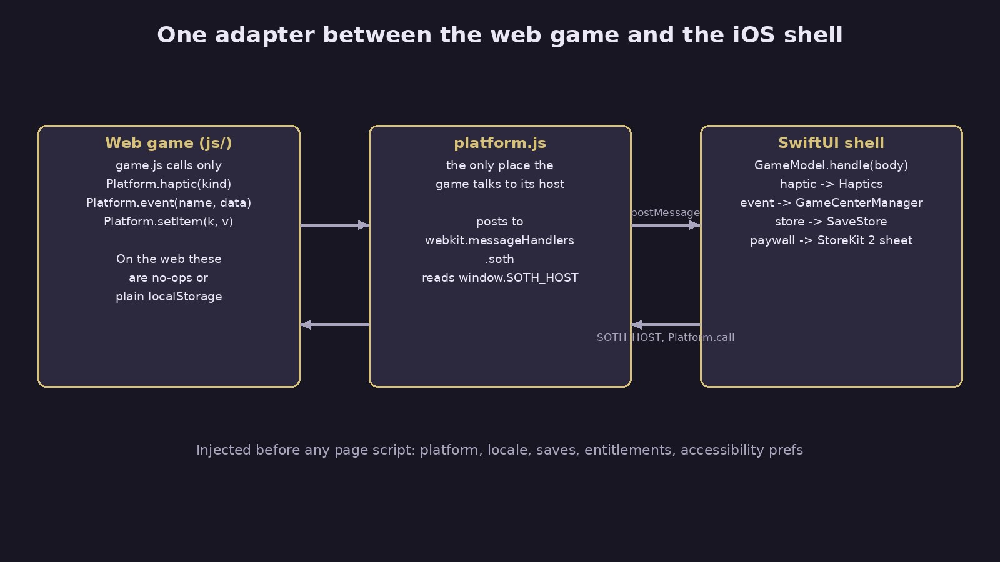
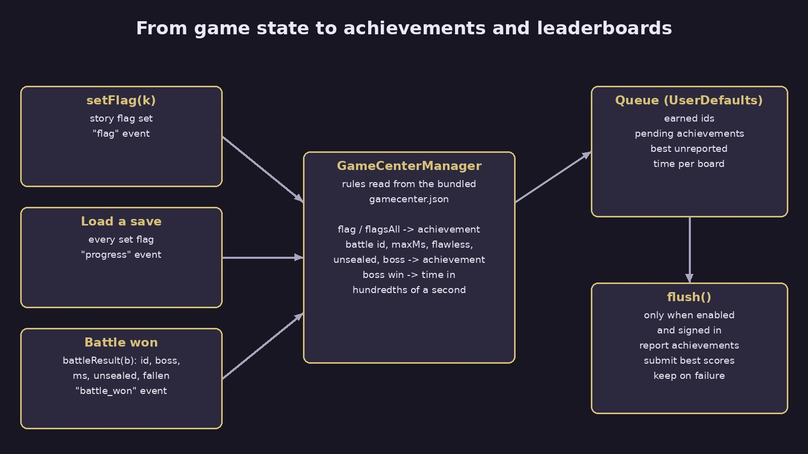
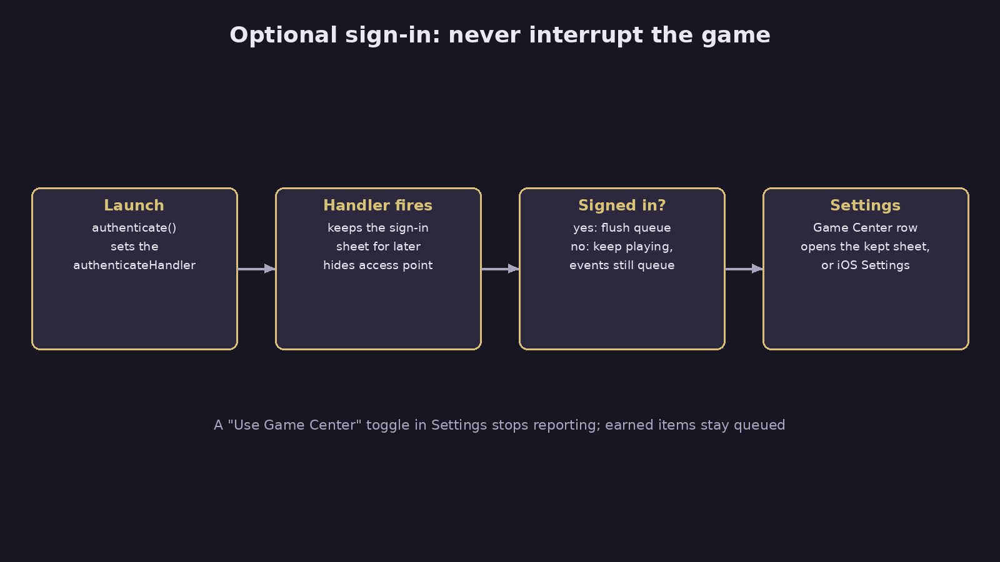

Temple of the High Priestess started as a browser JRPG with no engine, no CDN and no build step: open `index.html` on any static host and play. Then it needed an iPhone version that feels native, and Apple asks a wrapped web app to offer more than a website does. This guide shows how to integrate Game Center into a web game, plus haptics, game controllers, iCloud Keychain and StoreKit 2, using the game's own code as the worked example.

The code is public in [yishengjiang99/seal-of-the-high-priestess](https://github.com/yishengjiang99/seal-of-the-high-priestess) (the game's working title was Seal of the High Priestess). References are to main at `7c9afef`. The iOS app is built and in testing, not on the App Store yet, so everything below describes code that exists, not a released feature. You can [play the web version](https://grepawk.com/high-priestess/) today.

## Step 1: put one adapter between the game and its host

Before any native feature, the game needs exactly one place where it talks to the outside. In this repo that is `js/platform.js`. The rest of the game calls `Platform.haptic(kind)`, `Platform.event(name, data)` and `Platform.setItem(k, v)` and never checks what it runs on.

On the web those calls are plain `localStorage` or do nothing. In the iOS app, the shell injects `window.SOTH_HOST` before any page script runs, and `platform.js` posts messages to `webkit.messageHandlers.soth`. In the other direction, the shell calls `Platform.call(name, arg)` to push in things like purchases and accessibility settings.

Why it matters: every later step is just a new message type. The web build keeps working with no flags or forks, and the game logic never imports anything iOS specific.

Design choices from the repo:

- The game is bundled in the app and served offline from a custom `app://game/` scheme, with byte ranges so voice clips stream (`ios/README.md`). The decision log records this as SwiftUI plus WKWebView, chosen on 2026-10-06.
- The injected `SOTH_HOST` carries the platform, locale, app version, cached purchases and accessibility preferences, and the native saves are written into `localStorage` before the game starts. The game sees its saves on first read, with no async handshake.

## Step 2: send game state as events, not as Game Center calls

This is the core of the Game Center work. The game does not know Game Center exists. It reports three things it already tracks:

- `setFlag(k, v)` in `game.js` sends a `flag` event each time a story flag is set.
- Loading a save sends a `progress` event with every flag that is set, because a loaded save never replays its `setFlag` calls.
- Winning a battle sends `battle_won` with `battleResult(b)`: the battle id, the boss (if any), the time in milliseconds, whether Kael was unsealed and how many party members fell.

The boss time is measured from the start of the battle, minus the intro and minus any time the page was hidden. A `visibilitychange` listener adds up hidden time, so a player who gets a phone call mid-fight is not punished on the leaderboard.

Why it matters: the mapping from "what happened" to "what Apple should hear" lives in one native file you can test, and the same events can feed any other platform later.

## Step 3: integrate Game Center as data

All Game Center definitions live in one file, `ios/GameCenter/gamecenter.json`. Per the decision log it holds 14 achievements worth 630 points, 2 of them hidden, and 5 leaderboards, one per boss, for the fastest kill.

Each achievement has a trigger instead of code:

| Trigger | Example from the file |
| --- | --- |
| `flag` | "First Light": the tutorial battle flag is set |
| `flagsAll` | "Keeper of Promises": all eight side quest flags are set |
| `battle` + `maxMs` | "Swift Purification": beat the Heartwood Hollow in under 3 minutes |
| `battle: "*"` + `unsealed` | "Break the Seal": win any battle with Kael unsealed |
| `battle: "*"` + `boss` + `flawless` | "Untouched": beat a boss with nobody fallen |

The leaderboards use elapsed time in hundredths of a second, sorted ascending, keeping each player's best score, with a range of 10 seconds to 60 minutes.

Why it matters: the app bundles this file, and a script pushes the same file to Apple's side, so the identifiers in the app and the ones Apple knows cannot drift apart. That was the stated reason in the decision log. A bundling mistake once left a resource out of builds, so a unit test now checks that the file is in the app bundle.

## Step 4: keep the rules pure and test them

`GameCenterManager.swift` splits into pure static functions and stateful code. The pure part is three functions:

- `earned(byFlags:config:)` returns achievement ids whose `flag` is set or whose `flagsAll` list is a subset of the set flags.
- `earned(byBattle:config:)` checks the battle id (or `*`), then `boss`, `flawless`, `unsealed` and `maxMs`.
- `score(for:config:)` finds the leaderboard for the boss, converts milliseconds to hundredths with `ms / 10`, and drops any time outside the configured range.

`GameCenterAndSaveTests.swift` covers each of these, plus decoding a battle result from the bridge's dictionary. Nothing in the tests needs a signed in player or a network.

## Step 5: queue everything, then flush when signed in

The stateful half stores four things in `UserDefaults`: the set flags, the ids already earned, the achievements not yet reported, and the best unreported time per leaderboard. When a battle beats the stored time, it keeps the lower one.

`flush()` runs only if Game Center is enabled and the local player is authenticated. It reports pending achievements at 100 percent with the completion banner on, then calls `GKLeaderboard.submitScore` for each queued time. On success it removes those items. On failure it keeps them, and they go out on the next event or launch. The shell also flushes each time the app becomes active.

Why it matters: a player can earn "First Light" offline, or before ever signing in, and still get it later. Nothing is lost, and the game never waits on the network.

## Step 6: make sign-in optional and quiet

At launch the shell calls `authenticate()`, which sets `GKLocalPlayer.local.authenticateHandler`. If iOS hands back a sign-in view controller, the manager keeps it instead of presenting it. The sheet only opens when the player taps Game Center in the app's Settings. If there is no sheet to show and the player is still signed out, that row opens the iOS Settings app. The Game Center access point is turned off, and a "Use Game Center" toggle sits in Settings.

Why it matters: a story game opening on a system login sheet is a bad first minute. This way a signed in player gets everything automatically, and everyone else is asked only when they go looking.

## Step 7: map game sounds to haptics

The game already plays a sound effect for each kind of moment, so `Platform.haptic(kind)` reuses those names. `Haptics.swift` maps them to the Taptic Engine:

- `ui` gives a selection tick, limited to one every 0.06 seconds so scrolling a menu does not buzz.
- `hit` and `flame` are heavy impacts at 0.8, and `unseal` is a heavy impact at full strength.
- `hurt` is a warning notification, `save` and `victory` are success notifications.

A Haptics toggle in Settings turns it all off, and controller rumble follows the same toggle.

## Step 8: let controllers and keyboards drive the same keys

Controllers are handled in the native shell and turned into the keys the game already reads, so no movement or renderer code changed. The stick uses hysteresis (on at 0.55, off at 0.35) so it does not flicker at the edge. Held keys are released when the app goes inactive, a native sheet opens or the controller disconnects, which prevents a character walking forever. The shell also tells the game which input is active, and `platform.js` sets an `input-touch`, `input-gamepad` or `input-keyboard` class on the page so prompts can match the device.

## Step 9: keep identity and purchases native

Two more features follow the same pattern of "native owns it, the game is told":

- Cloud saves use an anonymous identity whose install id and secret are stored in the iCloud Keychain as synchronizable items, so a new iPhone on the same Apple ID reaches the same saves (`Identity.swift`). The native save store is the source of truth and seeds `localStorage`.
- Purchases use StoreKit 2. The shell computes entitlements as the union of verified on-device transactions and the server's records for the player, caches them, and injects them as `SOTH_HOST.entitlements`. The game only asks `Platform.entitled(name)` and never stores purchase state. The displayed price always comes from StoreKit, and the web build never gates anything.

## What to copy

If you are wrapping your own web game for iOS, the order that worked here is: one adapter file, events that describe what happened, Game Center rules kept as data with pure tests, a local queue that flushes when signed in, and sign-in that waits to be asked. Each native feature after that is one more message type.

For other build notes, see [how we learned to trust our browser video export](https://grepawk.com/blog/how-we-learned-to-trust-our-browser-video-export).
