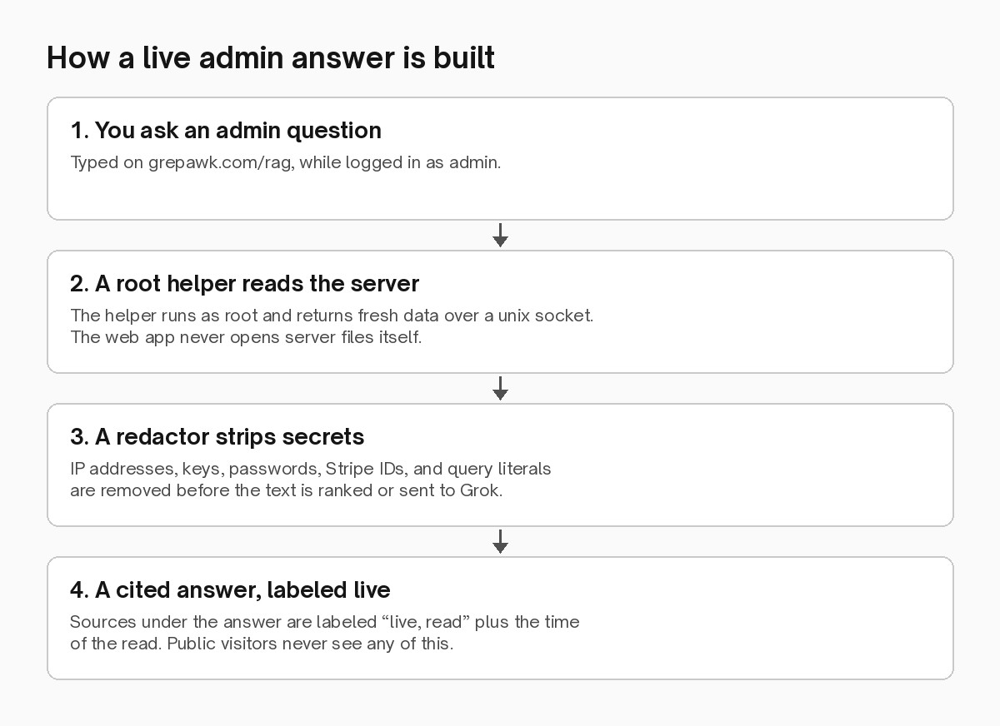

[Linux RAG](https://grepawk.com/rag/) answers Linux questions from kernel docs, man pages and source, as described in the [earlier post](https://grepawk.com/blog/linux-rag). When you are logged in as admin, each question also reads live server data at the moment you ask. Public visitors never see any of it. The [code](https://github.com/yishengjiang99/linux-rag) is public.

## What the live server data covers

Each admin question can pull a fresh copy of:

- nginx configs, plus access and error log tails with 5xx and upstream summaries
- read-only MySQL status: global status, processlist, InnoDB, and table sizes
- server health: load, memory, disk, failed units, OOM kills, and certificate expiry
- journal warnings from the last hour

Paths and limits are set in the public `sample.env` in the repo.

A small root helper does the reads over a unix socket, so the web app never opens server files itself. Everything goes through a redactor first: IP addresses, keys, passwords, Stripe IDs, and query literals are stripped before the text is ranked or sent to Grok. Sources under the answer are labeled `live, read` plus the time of the read. If the helper is down, the hourly admin index is used instead.

## Three admin questions

I asked: "Is MySQL slow right now?" The answer found one active query and only idle sleepers.

I asked: "Why is nginx returning 502?" It traced one 502 on a health-check route to a connect() refused from the upstream.

I asked: "What does nginx proxy /rag/ to?" It quoted the location block.

## Try it

Open [Linux RAG](https://grepawk.com/rag/). Public questions still use the same docs, man pages and source as before. Live server reads stay on the admin path. The source is at [yishengjiang99/linux-rag](https://github.com/yishengjiang99/linux-rag).
