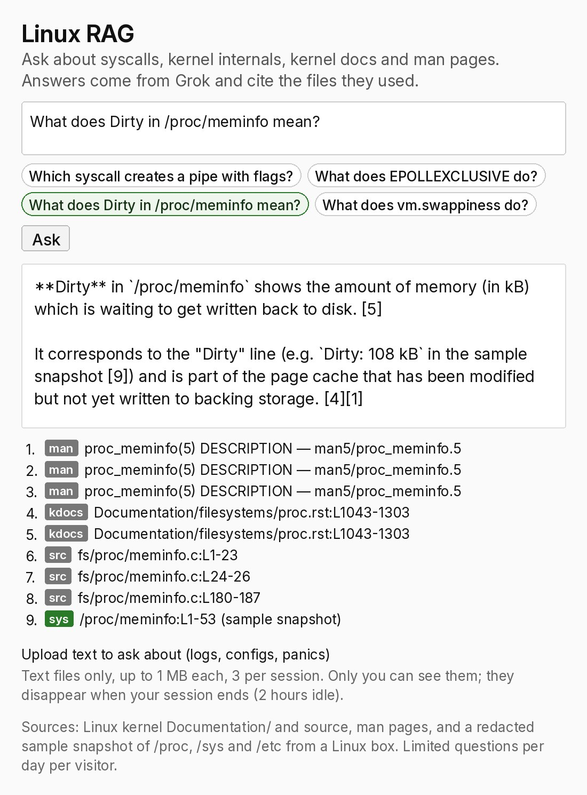
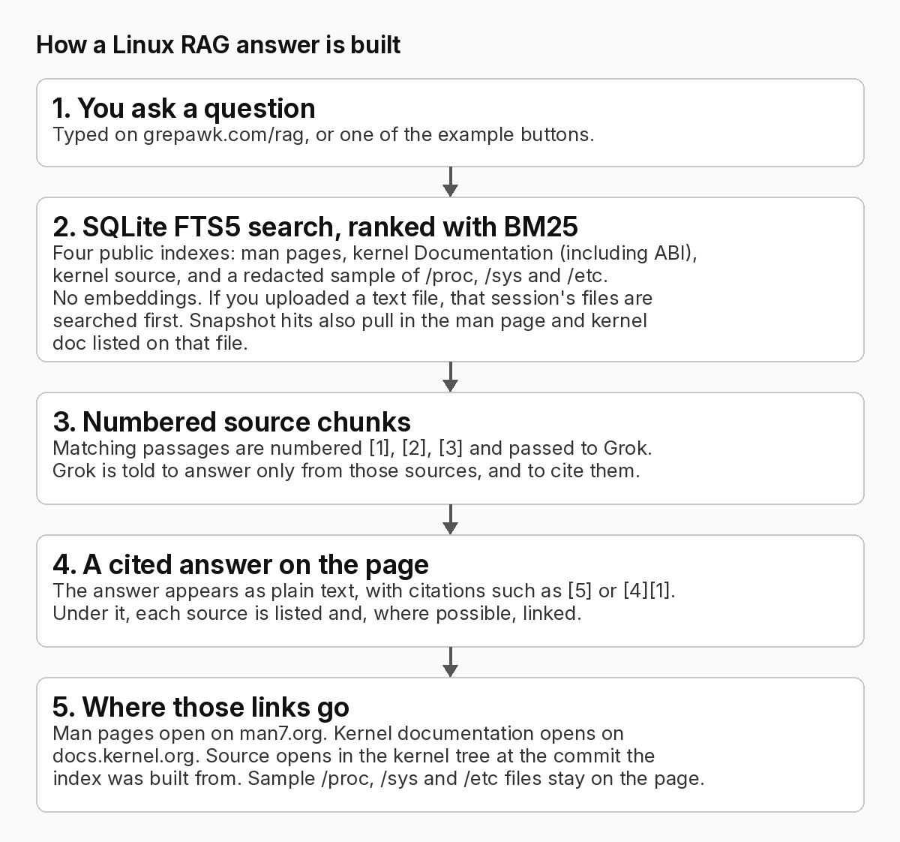

[Linux RAG](https://grepawk.com/rag/) is a small site where you ask questions about Linux and get answers that cite the files they came from. Grok writes each answer, and only from the passages the search found. The [code](https://github.com/yishengjiang99/linux-rag) is public.



## What Linux RAG searches

The public indexes are:

- Man pages from the man-pages project, in sections 2, 3, 4, 5, 7 and 8, plus the const, type and head pages that go with them.
- Kernel Documentation, including ABI and sysfs attribute docs.
- Kernel source: `include/uapi`, `kernel/`, `mm/`, `net/core`, the top-level files under `fs/` (such as `fs/pipe.c`), a few `fs` subdirectories including `fs/proc`, the x86 syscall tables, and `include/linux/syscalls.h`.
- A redacted sample of 50 `/proc`, `/sys` and `/etc` files from a Linux 6.12 box. The public sample lives in the repo. One line from it is `Dirty:               108 kB`.

Search is SQLite FTS5, ranked with BM25. There are no embeddings. The service itself is Python's standard library only: an HTTP server and SQLite, with no extra Python packages.

## A question about /proc/meminfo

I asked the live site: "What does Dirty in /proc/meminfo mean?" It answered:

```
**Dirty** in `/proc/meminfo` shows the amount of memory (in kB) which is waiting to get written back to disk. [5]

It corresponds to the "Dirty" line (e.g. `Dirty: 108 kB` in the sample snapshot [9]) and is part of the page cache that has been modified but not yet written to backing storage. [4][1]
```

The sources under that answer were `proc_meminfo(5)`, `Documentation/filesystems/proc.rst`, `fs/proc/meminfo.c`, and the sample `/proc/meminfo` snapshot. The 108 kB figure matches the public sample. When a snapshot file matches the question, the search also adds the man page and kernel doc listed on that snapshot, which is how the `proc_meminfo(5)` page and the proc.rst section sit next to the sample line.

## A question about pipe2

I also asked: "Which syscall creates a pipe with flags?" The answer named `pipe2`, the variant of `pipe()` that accepts flags such as `O_CLOEXEC`. It pointed to the kernel functions `do_pipe2()` and `__do_pipe_flags()` in `fs/pipe.c`, and to the `pipe(2)` man page (SYNOPSIS, ERRORS and VERSIONS). The listed sources also included slices of the x86 syscall tables.

## How a Linux RAG answer is built



You type a question, or press one of the example buttons. The site searches the indexes, numbers the matching chunks, and asks Grok to answer only from those sources, with inline citations like [1] or [2][4]. The page then lists the sources under the answer. Man pages link to man7.org, kernel docs link to docs.kernel.org, and source links open in the kernel tree at the commit the index was built from. Sample `/proc`, `/sys` and `/etc` files stay on the page.

## Your own files, and an admin index

You can upload text files (logs, configs, panics) to ask about: text only, up to 1 MB each, three per session. Only you can see them, and they disappear when the session ends after two hours idle.

Admins can also search this server's redacted nginx configs and logs, plus a snapshot of its own `/proc`, `/sys` and `/etc`. That text is redacted (IP addresses, emails, keys, tokens and phone numbers) before it is stored, and it is searchable only after an admin login. The admin index is refreshed hourly. Questions are limited per day per visitor.

## Try it

Open [Linux RAG](https://grepawk.com/rag/) and ask one of the example questions, or your own. The source is at [yishengjiang99/linux-rag](https://github.com/yishengjiang99/linux-rag).
