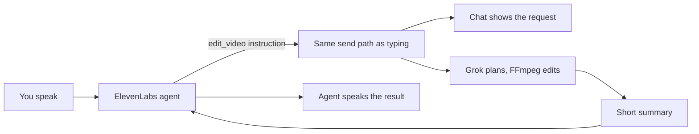

[FinalCap](https://grepawk.com/) is a chat video editor in the browser: you attach a clip, type what you want, and Grok plans the edit while FFmpeg does the work. We just added voice video editing. There is now a mic button in the chat composer, and you can say the edit instead of typing it. This post explains how it is built and how it is meant to behave.

## Where the mic lives

The composer row now reads, left to right: the paperclip to attach a file, the message box, the mic, and Send. Tap the mic to start a voice session. Tap it again to stop. While it connects the button shows three dots.

## Voice video editing with one agent and one tool

Voice runs on an ElevenLabs Conversational AI agent. We gave it a short prompt and exactly one tool, `edit_video(instruction)`. The agent listens, turns what you said into a plain instruction, keeps any times or formats you gave, and calls the tool.

The tool runs in the page. It hands the instruction to the same send function the Send button uses. So nothing about the edit is special for voice: the request appears in the chat as if you had typed it, and it goes through the usual Grok and FFmpeg flow.

## What it says back

When the edit finishes, the page takes the last reply from the assistant, strips the formatting, caps it at about 400 characters, and returns it to the agent. The agent is told to sum that up in one or two short sentences.

A few cases get a fixed answer:

- If an edit is already running, it says one is in progress and asks you to wait.
- If the edit was cancelled, it says so.
- If no file is attached, the agent is told to ask you to tap the paperclip first.

## The key stays on the server

The browser never sees the ElevenLabs key. When you tap the mic, the page asks our server for a session, and the server returns a signed session URL from ElevenLabs. The page opens the conversation with that URL. Voice is set up on the live site and the mic is there for everyone, with no sign up or setting to turn on. If the voice service is unavailable, the button shows a short notice instead.

## Also in FilmCraft

[FilmCraft](https://grepawk.com/filmcraft/), our fork of the open-source editor, now has a floating assistant panel you can drag, resize and collapse, and the mic sits in that panel's header. It is built the same way. Its agent also has one `edit_video` tool that runs the same steps as typing. The earlier post covers that editor: [FilmCraft with a plain English prompt bar](https://grepawk.com/blog/filmcraft-plain-english-agent).

## A note on testing

Voice is live, and the summary logic has tests, but we have not yet tested a spoken edit end to end. Treat this post as how voice is designed to work, and expect some changes once more people use it.

## Try it

Open [FinalCap](https://grepawk.com/), attach a clip, tap the mic and say "trim to the first 10 seconds". The request should show up in the chat and run like any typed edit.
