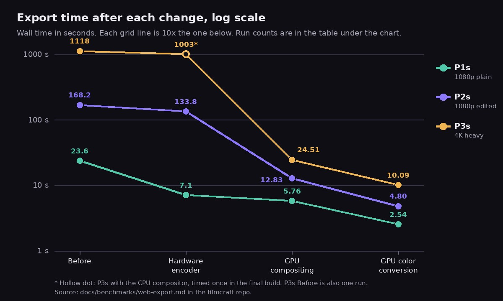
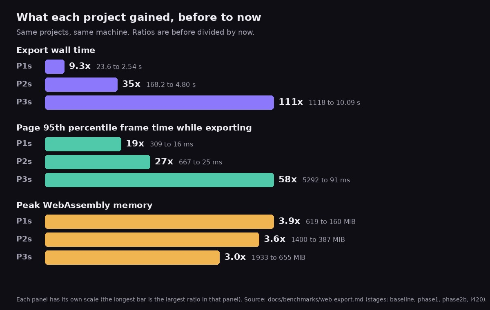

Exporting a finished video in the browser used to take about 18 minutes for 6 seconds of 4K. It now takes about 10 seconds. This post explains the WebAssembly video export work behind that change, one step at a time: what the technology is, what we built in [filmcraft](https://github.com/yishengjiang99/filmcraft), a Rust video editor that also runs in a web page, and what the benchmark measured. You can try the editor at [grepawk.com/filmcraft](https://grepawk.com/filmcraft/).

The headline numbers, from the [benchmark log](https://github.com/yishengjiang99/filmcraft/blob/b8a11a9525494deed9611ea20acfa4a8d5acccd1/docs/benchmarks/web-export.md):

| Project | Before | Now | Speedup |
| --- | --- | --- | --- |
| P1s: 6 s of 1080p, plain clip | 23.6 s | 2.54 s | 9.3x |
| P2s: 12 s of 1080p, edited | 168.2 s | 4.80 s | 35x |
| P3s: 6 s of 4K, heavy effects | 1118 s | 10.09 s | 111x |

These are export wall times on an Apple M4 Pro in headed Chrome 155, using the threaded WebAssembly build. Most rows are the median of 3 timed runs after a warmup run, and every output was checked against a reference render. A few points are one or two runs, and the [results section](#results-stage-by-stage) says which. The projects are short cuts, measured on one machine.

This post is the performance and architecture story. For how the benchmark itself works, read [how we learned to trust our browser video export](https://grepawk.com/blog/how-we-learned-to-trust-our-browser-video-export) and the [step-by-step guide to building a Chrome test bench](https://grepawk.com/blog/how-to-build-a-chrome-test-bench-for-a-webassembly-app). For an earlier explainer of the same work, see [filmcraft optimization: how browser export got fast](https://grepawk.com/blog/filmcraft-optimization-results).

## How a WebAssembly video export works

Exporting renders every frame of the timeline and writes it into a video file. Each frame goes through the same five steps:

1. Decode the source clips' compressed frames into pictures.
2. Composite: stack the layers and apply effects (blur, color grading, vignette), titles and transitions into one picture.
3. Convert that picture from RGB, which the compositor works in, to YUV, which video encoders take.
4. Encode it as H.264, which finds what changed from nearby frames and stores only that.
5. Mux and write: interleave the video and audio packets into an MP4 or MOV container and save it.

In the browser build, the export steps ran on the page's main thread, in WebAssembly, on the CPU. The same thread also draws the editor's interface, so a long export step freezes the page. The [baseline measurements](https://github.com/yishengjiang99/filmcraft/blob/b8a11a9525494deed9611ea20acfa4a8d5acccd1/docs/benchmarks/web-export.md) show it: while exporting, the page's 95th percentile frame took 0.3 to 0.7 seconds at 1080p and 5.3 seconds at 4K.

The work below moved each stage to the part of the machine built for it. Decode was the exception: the browser build already decoded with the browser's WebCodecs decoder, with filmcraft's own decoders as the fallback ([added on 2026-10-01](https://github.com/yishengjiang99/filmcraft/commit/5f613aff2526f9b83408aa49a81aa91d66980b69)).


After the changes, the CPU mostly hands out work: it plans each frame, submits GPU passes, reads back 1.5 bytes per pixel and gives the result to the encoder.

## Where the time went

The baseline run recorded how long each stage took, per frame. On P2s, the 1080p edit, CPU rendering took 361 ms a frame (77 percent of the time), H.264 encoding 102 ms (22 percent). On P3s, the 4K project, rendering was 93 percent of the time, at 5.8 seconds a frame. On the plain clip, P1, the built-in encoder was 78 percent, at about 105 ms a frame.

That is why the order of work mattered. Encoding came first because it dominated plain clips. Compositing came second because it dominated everything with effects.

The baseline also showed that threads did not make export faster: the threaded and single-threaded builds took the same time on P2s (168.2 and 168.8 s), because the export ran cooperatively on the UI thread in both. The threaded build matters for memory, as change 3 explains.

## Change 1: hardware encoding with WebCodecs

Commit [`bd13e6c`](https://github.com/yishengjiang99/filmcraft/commit/bd13e6c81335751c97f3324150c91598390b3c7d), file [`webcodecs_encode.rs`](https://github.com/yishengjiang99/filmcraft/blob/bd13e6c81335751c97f3324150c91598390b3c7d/apps/filmcraft-web/src/webcodecs_encode.rs).

**The technology.** An H.264 encoder searches each 16x16 block of a frame for the best match in earlier frames (motion estimation), transforms the difference into frequencies, rounds the small ones away (quantization) and packs what is left with an entropy coder. It is the most expensive step in video. Many laptops and phones have a fixed-function chip for it.

WebCodecs is the browser API that exposes the platform's codecs to a page. A `VideoEncoder` takes `VideoFrame` objects and returns encoded chunks through a callback. With `hardwareAcceleration: "prefer-hardware"`, the browser may use that chip. On the benchmark machine, `chrome://gpu` reported hardware video encode, and the probe found hardware H.264 up to 4K.

**What we built.**

- A `VideoEncoder` implementation for the exporter on top of WebCodecs, with `latencyMode: "quality"` and the `avc` bitstream format, so packets arrive ready for MP4. The container's codec record (`avcC`) comes from the first output's `decoderConfig.description`.
- Frames go in as I420 tagged BT.709 limited range, so players show the same colors as the built-in encoder's output.
- WebCodecs is asynchronous: packets come back later, on the event loop. The exporter became a stepped state machine. Each step does a slice of work and reports progress, pending (the encoder is busy or still owes packets) or done. The page's event loop runs between steps, so the callbacks fire.
- The encoder queue is capped at 8 frames, so a slow encoder slows the export instead of filling memory.
- A start-up probe checks which codecs and sizes the hardware accepts. If the hardware path cannot be used, the built-in software encoder remains the fallback, and errors name the fix (`encoder: software`).

**What it measured.** Encoding one 1080p frame went from 99 ms to 9 ms. P1s went from 23.6 s to 7.1 s (3.3x), and the page's 95th percentile frame time during export dropped from 309 ms to 42 ms. P2s improved only 1.26x (168.2 s to 133.8 s), because with encoding gone, CPU compositing was 96 percent of its time. The hardware encoder's output scored 0.6 to 0.7 dB higher PSNR at the same bitrate.

## Change 2: streaming the file out

Commit [`bd13e6c`](https://github.com/yishengjiang99/filmcraft/commit/bd13e6c81335751c97f3324150c91598390b3c7d), files [`export_sink.rs`](https://github.com/yishengjiang99/filmcraft/blob/bd13e6c81335751c97f3324150c91598390b3c7d/apps/filmcraft-web/src/export_sink.rs) and [`export-sink.js`](https://github.com/yishengjiang99/filmcraft/blob/bd13e6c81335751c97f3324150c91598390b3c7d/apps/filmcraft-web/web/export-sink.js).

**The technology.** WebAssembly memory is one flat array of bytes with a fixed maximum. Keeping the whole encoded file there, then copying it into a JavaScript `Blob` to download it, needs the file's size twice. The Origin Private File System (OPFS) is a disk area private to the site. Its `createWritable()` returns a stream that accepts writes at a given byte position.

**What we built.** The exporter writes positioned 4 MiB chunks to a stream target instead of a buffer. Positioned writes matter because an MP4's index (`moov`) and the size of its media box are patched after the media is written. On the web the target is an OPFS file, or JavaScript-side chunks when OPFS is not available. The finished OPFS file is handed to the download without passing through WebAssembly again.

**What it measured.** Together with the hardware encoder, peak WebAssembly memory on P2s went from 1400 MiB to 981 MiB, down 30 percent. A test checks that a streamed export is byte-identical to a buffered one, including hostile seek positions.

## Change 3: lean caches and a 4 GiB heap

Commit [`16eec44`](https://github.com/yishengjiang99/filmcraft/commit/16eec44e40f72734b37552c9882ef762d26e7404), file [`lean.rs`](https://github.com/yishengjiang99/filmcraft/blob/16eec44e40f72734b37552c9882ef762d26e7404/crates/media/src/lean.rs).

**The technology.** The editor keeps decoded frames in three caches: a shared decode pool, a WebCodecs cache per source, and the monitors' frame cache. They are sized for scrubbing, where the same frames are shown again and again. A 4K frame in the compositor's half-float format is about 66 MB, so those caches fill the heap quickly. The threaded build uses shared memory, whose maximum size is fixed when the module is linked.

**What we built.** An export reads each frame once, in order. While an export runs, it holds a guard object (`filmcraft_media::lean`). While a guard exists the caches shrink: the decode pool to 256 MiB (128 MiB or 12 frames per source), WebCodecs to 16 frames per source, and the monitors' frame cache to 128 MiB. When the export ends, by finishing, failing or being cancelled, the guard drops and the caches grow back. The threaded build's maximum memory went from 2 GiB to 4 GiB, the most a 32-bit WebAssembly module can address. A browser that cannot reserve it falls back to the single-threaded build.

**What it measured.** With a 2 GiB heap, the 4K project ran out of memory. With lean caches and the larger heap, it ran, at 1.6 to 1.7 GB in the first runs ([handoff notes](https://github.com/yishengjiang99/filmcraft/blob/b8a11a9525494deed9611ea20acfa4a8d5acccd1/docs/export-optimize-gpu-handoff.md)). Peak WebAssembly memory in the final build was 160 MiB on P1s (619 before), 387 MiB on P2s (1400 before) and 655 MiB on P3s (1933 before).

## Change 4: GPU compositing with asynchronous read-back

Commits [`b40586f`](https://github.com/yishengjiang99/filmcraft/commit/b40586f3f8499cacfe3c011a7a34c2e5d163ca1e) and [`2ffd57e`](https://github.com/yishengjiang99/filmcraft/commit/2ffd57eba06e8dde369919f3bb771c6a4a8004aa), files [`async_export.rs`](https://github.com/yishengjiang99/filmcraft/blob/32baa127c0e0fa26626184cd45f6044f20172b88/crates/gpu/src/async_export.rs) and [`gpu_export.rs`](https://github.com/yishengjiang99/filmcraft/blob/2ffd57eba06e8dde369919f3bb771c6a4a8004aa/apps/filmcraft-web/src/gpu_export.rs).

**The technology.** On a CPU, compositing is a loop over every pixel of every layer: a 4K frame is 8.3 million pixels, times each layer, times each effect. A GPU runs the same small program, a shader, on thousands of pixels at once. WebGPU is the browser's modern GPU API. filmcraft's desktop app already had a GPU compositor built on wgpu, the Rust library that also compiles to WebGPU.

The catch is getting the picture back. `buffer.mapAsync()`, which makes a GPU buffer readable, completes only after the page's event loop has run. The main thread is not allowed to block waiting for it.

**What we built.**

- Frame renderers can now answer Ready, Pending or Declined. The GPU renderer composites into a linear-light float texture, copies it into one buffer of a ring of staging buffers, requests the mapping and answers Pending. The export step yields, and a later step collects the frame.
- The ring has a 512 MiB budget and at most 16 staging buffers. The exporter prefetches the next batch before collecting the current one, so the GPU draws batch k+1 while the CPU encodes batch k.
- A mapped buffer is converted in bands of 64 rows, because WebGPU copies every mapped range into WebAssembly memory first.
- The renderer runs on the WebGPU device the editor's interface already has. Frames the GPU path cannot draw are declined and rendered on the CPU: transitions other than dissolves, adjustment layers, and HDR or wide-gamut sequences. After a GPU error or a lost device, the rest of the export runs on the CPU instead of hanging.

**What it measured.** P2s went from 133.8 s to 12.83 s. In the same build, the GPU compositor is 10.5x faster than the CPU one on P2s. P3s ran at 24.51 s, 45.6x faster than the original 1118 s, which needed changes 5 and 6 first. The page's slowest frames were still 102 to 357 ms, because each step works on a batch of frames.

## Change 5: the Look LUT as a GPU pass

Commit [`6fe735d`](https://github.com/yishengjiang99/filmcraft/commit/6fe735d521783e03121a434c4b6b0a100a26913a), files [`fx.wgsl`](https://github.com/yishengjiang99/filmcraft/blob/6fe735d521783e03121a434c4b6b0a100a26913a/crates/gpu/src/fx.wgsl) and [`gpufx.rs`](https://github.com/yishengjiang99/filmcraft/blob/6fe735d521783e03121a434c4b6b0a100a26913a/crates/render/src/gpufx.rs).

**The technology.** A 3D LUT (look-up table) is a cube of colors, often 33 entries per side. A pixel's red, green and blue pick a point in the cube, and the table returns the graded color. A pixel rarely lands exactly on an entry, so the result is blended from neighbors. filmcraft uses tetrahedral interpolation: it splits the cell around the point into tetrahedra and blends the four corners of the one the point is in. Colorists' "looks" are usually shipped as LUTs.

The exporter plans each frame layer by layer. If any effect on a layer cannot run on the GPU, the whole layer is drawn on the CPU.

**What we built.** The Look LUT inside the Lumetri color effect used to count as CPU-only, so the 4K project's background layer, with its blur, Lumetri grade and vignette, ran on the CPU. It now has its own pass in the GPU effect stage. The table sits in a storage buffer, and the shader runs the same tetrahedral math as the CPU's `Lut3d::apply`. Only plain tables qualify: no 1D shaper, 2 to 65 entries per side, finite values and a usable domain. Anything else still uses the CPU.

**What it measured.** Before this change, the 4K project took about 19 seconds a frame, with 20 to 25 second main-thread stalls, because each step planned three CPU-rendered frames. After it, every frame of P3s composited on the GPU. GPU and CPU results differ by at most 3e-7 (maximum relative difference), floating-point rounding. The commit message gives a different, narrower figure for the CPU-rendered layer alone, about 6 to 8 seconds a frame.

## Change 6: starting decode at the right key frame, and pinning the cache

Commits [`34cab1f`](https://github.com/yishengjiang99/filmcraft/commit/34cab1fc641bcceae90e44ceb0343e81c92a69f3) and [`61362d2`](https://github.com/yishengjiang99/filmcraft/commit/61362d266d7e6f4ce44bcf512826a931676b9787), files [`webcodecs.rs`](https://github.com/yishengjiang99/filmcraft/blob/34cab1fc641bcceae90e44ceb0343e81c92a69f3/apps/filmcraft-web/src/webcodecs.rs) and [`cache.rs`](https://github.com/yishengjiang99/filmcraft/blob/61362d266d7e6f4ce44bcf512826a931676b9787/crates/media/src/cache.rs).

**The technology.** Most video frames are stored as changes from other frames, so a decoder has to start at a key frame, which is stored whole. Frames are stored in decode order and shown in display order. In an open GOP (group of pictures), which x265 and iPhone HEVC use, a key frame (a CRA picture) is followed in the file by a few leading pictures (RASL) that are shown before it and predicted from the previous group:

```
decode order:   K0 A1 A2 A3 K1 L1 L2 L3 B1 B2 B3
display order:  K0 A1 A2 A3 L1 L2 L3 K1 B1 B2 B3
```

A decoder that starts at K1 has nothing to predict L1 to L3 from, so it drops them.

**What we built.**

- The WebCodecs source used to restart at the key frame at or before the frame it needed. For a leading picture, that is K1, and the frame never came out. Now, if the requested frame is shown before its key frame, the decoder starts one key frame earlier, as filmcraft's own decoders already did.
- The frame cache evicts the frames farthest from the latest request. An export and a scrubbed monitor ask for frames far apart on the same source, so they evicted each other's frames. Recently requested frames are now pinned (`evict_far`, bounded), and so is the decoder's run-ahead past the newest request (`run_ahead_pins`).

**What it measured.** The 4K project has such key frames: sample 116 is a CRA that shows frame 120. Before the earlier start, that export stalled at frame 116 while WebCodecs restarted about 185 times a second. With the earlier start it completes. Pinning the run-ahead keeps decode work in line with the export: on P1s with the CPU compositor, 248 frames were decoded to export 180, where 3061 had been. That run is back to 7.14 s.

## Change 7: RGB to YUV on the GPU

Commit [`32baa12`](https://github.com/yishengjiang99/filmcraft/commit/32baa127c0e0fa26626184cd45f6044f20172b88), files [`i420.wgsl`](https://github.com/yishengjiang99/filmcraft/blob/32baa127c0e0fa26626184cd45f6044f20172b88/crates/gpu/src/i420.wgsl) and [`i420.rs`](https://github.com/yishengjiang99/filmcraft/blob/32baa127c0e0fa26626184cd45f6044f20172b88/crates/gpu/src/i420.rs).

**The technology.** The compositor works in RGB, stored as 16-bit floats in linear light (proportional to physical brightness, the form blending math needs). That is 8 bytes per pixel. Encoders take YUV: Y is brightness, U and V say how blue or red a pixel is. Eyes resolve color less sharply than brightness, so the I420 layout (4:2:0) keeps one U and one V for each 2x2 block. That is 1.5 bytes per pixel.

The conversion, per pixel:

```
1. drop alpha against black    (premultiplied, so: ignore it)
2. linear to sRGB curve        (4096-entry table), 8-bit R'G'B'
3. Y  = 0.2126 R' + 0.7152 G' + 0.0722 B'      (BT.709 weights)
   Cb = (B' - Y) / 1.8556
   Cr = (R' - Y) / 1.5748
4. limited range: Y 16-235, U/V 16-240 around 128
   U, V = mean of each 2x2 block
```

**What we built.** Before, the GPU read back the full float frame and the CPU did all four steps. A WGSL compute shader now converts the compositor's texture into I420 on the GPU, straight into the staging buffer. Details that keep it exact:

- Each invocation writes one 32-bit word, four output bytes. No two invocations share a word, so no atomics are needed and any frame size works. The grid wraps into a second dimension past 65,535 workgroups.
- It uses the CPU's own 4096-entry sRGB table, uploaded as a storage buffer.
- It rounds halves away from zero (`floor(x + 0.5)`) like Rust's `round`, not to even like WGSL's.
- The WebCodecs encoder accepts the bytes as they are, so they go straight into a `VideoFrame`.
- It turns on only when nothing changes a picture after compositing: no resize or placement, overlay, video limiter, alpha or HDR. Frames the GPU declines are converted on the CPU, so an export never mixes forms.

**What it measured.** The unit test compares the GPU's bytes with the CPU path: 0 of 259,200 differ. The read-back is 5.3x smaller (8 bytes to 1.5 bytes a pixel), and the CPU convert stage on P3s went from 6.3 s to nearly nothing. Export wall time: P1s 5.76 to 2.54 s (2.27x), P2s 12.83 to 4.80 s (2.68x), P3s 24.51 to 10.09 s (2.43x). The page's 95th percentile frame time went from 116, 102 and 357 ms to 16, 25 and 91 ms. Both 1080p projects now export more than twice as fast as they play: 2.36 and 2.5 times real time.

## Change 8: SIMD in the software encoder

Commits [`5a5e4e7`](https://github.com/yishengjiang99/filmcraft/commit/5a5e4e7987d53ce01c68d037f9e71af58cc938e9) and [`6434822`](https://github.com/yishengjiang99/filmcraft/commit/643482287ca3edad3378205ebab055f7a117f6b0), files [`kernels.rs`](https://github.com/yishengjiang99/filmcraft/blob/5a5e4e7987d53ce01c68d037f9e71af58cc938e9/crates/h264enc/src/kernels.rs) and the [h264enc README](https://github.com/yishengjiang99/filmcraft/blob/643482287ca3edad3378205ebab055f7a117f6b0/crates/h264enc/README.md).

**The technology.** Not every browser or machine has a hardware H.264 encoder, so filmcraft's own encoder, written in Rust, remains the fallback. SIMD (single instruction, multiple data) runs one operation on several values at once. WebAssembly's `simd128` works on 128-bit vectors: sixteen 8-bit pixels, or eight 16-bit values. The `wide` crate gives one portable, safe API that compiles to `simd128`, ARM NEON or x86 SSE2.

**What we built.** The hot kernels were rewritten with `wide`, each bit-identical to the scalar code it replaces:

| Kernel | What it does | WebAssembly, ns (scalar to SIMD) |
| --- | --- | --- |
| SATD 8x8 | Cost of a prediction: Hadamard transform of the difference | 49 to 8 |
| SATD 16x16 | The same, for a whole macroblock | 58 to 31 |
| SAD 16x16 | Sum of absolute differences, for motion search | 27 to 14 |
| SSD 16x16 | Sum of squared differences, for rate-distortion | 32 to 18 |
| 4x4 residual, 16 blocks | Difference, transform, quantize, inverse, reconstruct | 453 to 294 |
| 8x8 residual, 4 blocks | The same with the 8x8 transform | 693 to 375 |

The transforms keep four blocks per vector, one block per lane, so the scalar butterflies run on four blocks at once. Output-identical savings came on top: the 4x4 or 8x8 decision keeps both coded results instead of coding the winner a third time, and sub-pixel search remembers costs it has already computed.

**What it measured.** For the whole encoder, single thread, 1080p, it went from 109 to 117 ms down to 58 to 61 ms a frame on WebAssembly (1.9x), and from 79.8 to 45.7 ms natively (1.75x). The bytes it writes are unchanged, checked against golden hashes recorded before the work. These timings come from running the module under Node, not from a Chrome export, so none of the export numbers above include this change.

## Results, stage by stage

Export wall time in seconds. "Before" is the export path before any of this work: the built-in software encoder, the CPU compositor, and the file buffered in WebAssembly memory.



| Stage | Changes | P1s | P2s | P3s |
| --- | --- | --- | --- | --- |
| Before | none | 23.6 | 168.2 | 1118.0 (1 run) |
| Hardware encoder | 1, 2 | 7.1 | 133.8 (2 runs) | 1003.4 (1 run, CPU compositor, final build)* |
| GPU compositing | 3 to 6 | 5.76 | 12.83 | 24.51 |
| GPU color conversion | 7 | 2.54 | 4.80 | 10.09 |

Unmarked cells are the median of 3 timed runs after a warmup. The P2s color-conversion cell took 6 timed runs because its first runs varied by up to 22 percent (4.6 to 6.7 s) before settling at 4.7 to 4.9 s. The 4K baseline is one run at about 18.6 minutes, with no warmup.

\* The 1003.4 s point is the CPU compositor, timed once in the final build. The 4K project had no completed timing at the hardware-encoder stage itself: with the 2 GiB heap it ran out of memory. So that point shows the cost of CPU compositing at 4K in the final build, not an earlier build.

Page responsiveness and memory, same stages:

| Stage | UI p95 ms (P1s / P2s / P3s) | Peak memory MiB (P1s / P2s / P3s) |
| --- | --- | --- |
| Before | 309 / 667 / 5292 | 619 / 1400 / 1933 |
| Hardware encoder | 42 / 658 / 4050* | 533 / 981 / 1440* |
| GPU compositing | 116 / 102 / 357 | 237 / 472 / 813 |
| GPU color conversion | 16 / 25 / 91 | 160 / 387 / 655 |

"UI p95" is the 95th percentile time between frames the page drew while exporting, with the timeline ruler scrubbed every 500 ms. A smooth 60 fps is 16.7 ms.



Quality held. Y-PSNR against a reference render made by filmcraft's command-line export was 48.05, 46.41 and 51.31 dB on the final build, with the worst single frame at 43.78, 43.18 and 48.65 dB. The baseline outputs had SSIM of at least 0.98, and a single 4K run during the work measured 0.997. Every output passed the checks for frame count, stream errors and audio sync.

## Method and caveats

- **Projects.** They are built through the editor's scripting API, never by clicking, so every run is identical. P1s is 6 s of one 1080p30 clip. P2s is 12 s of a 1080p edit with two video tracks, cuts, a cross dissolve, Lumetri color, a title, and dialogue and music with fades. P3s is 6 s of 4K30 with Gaussian blur, a Lumetri look, vignette, a picture in picture with a scale keyframe, and titles. The media are generated deterministically, with a white flash and a beep every 5 seconds to measure audio sync. The [project builders](https://github.com/yishengjiang99/filmcraft/blob/b8a11a9525494deed9611ea20acfa4a8d5acccd1/apps/filmcraft-web/tests/bench-projects.mjs) are in the repo.
- **Runs.** A release build with wasm-opt, a fresh tab per run, OPFS cleared, H.264 at 12 Mb/s (1080p) or 40 Mb/s (4K). One warmup run is discarded, the median of the measured runs is reported, and a configuration is rerun when its wall-time variation exceeds 5 percent. Nothing compiles during a timed run.
- **Validation.** Every output is checked with ffprobe and ffmpeg, used only as an external test tool, for frame count, stream errors, audio sync and PSNR and SSIM against the reference render.
- **Hardware.** Apple M4 Pro, headed Chrome 155 with its own profile, the threaded WebAssembly build.
- **What the threaded build means here.** The numbers come from the threaded build, which also has the 4 GiB heap that the 4K project needs. The baseline shows threads did not speed up export by themselves.
- **Caveats.** These are short cuts of the projects, on one machine. The last stage was timed on Chrome 155.0.8059.84 and the earlier ones on 155.0.8059.40, because the browser updated itself in between. The numbers are not strictly comparable across that boundary, though the change is far larger than a patch release moves.

## What comes next

The [handoff notes](https://github.com/yishengjiang99/filmcraft/blob/b8a11a9525494deed9611ea20acfa4a8d5acccd1/docs/export-optimize-gpu-handoff.md) and the [plan](https://github.com/yishengjiang99/filmcraft/blob/b8a11a9525494deed9611ea20acfa4a8d5acccd1/docs/export-optimize-gpu.md) list what is left:

- **Responsiveness on heavy projects.** Each export step still works on a batch of frames, so on the 4K project the page's slow frames are 91 ms. The plan sizes batches by measured step time, then runs the export cooperatively with `scheduler.yield()`, then moves it into a worker with its own WebAssembly instance and GPU device.
- **More effects on the GPU.** Lumetri's input LUT, curves, color wheels, HSL secondary and Sharpen still send a layer to the CPU, and so do some transitions.
- **Streaming with backpressure**, and fragmented MP4 for destinations that cannot seek.
- **Full-length projects.** The plan includes a 60 s edit, a 20 s 4K project and an hour-long export to test streaming and memory.
- **Zero-copy frames** (`new VideoFrame(webgpuCanvas)`): to be measured, not assumed. With 1.5 bytes per pixel read back, the read-back is no longer the obvious cost.

## What to take away

- The speedup came from moving each stage to the hardware built for it, in the order the measurements pointed: encode first, then compositing, then color conversion.
- Memory was a gate, not a footnote. The 4K project needed lean caches and a 4 GiB heap before any GPU work could show up in its timings.
- Every GPU stage has a CPU path with the same output, so an export never depends on the GPU being available.
- Measure each change on its own. Most of the gain on edited projects came from GPU compositing, and most of the gain on plain clips came from hardware encoding.

The code is in the [filmcraft repository](https://github.com/yishengjiang99/filmcraft), every run is recorded in [docs/benchmarks/web-export.md](https://github.com/yishengjiang99/filmcraft/blob/b8a11a9525494deed9611ea20acfa4a8d5acccd1/docs/benchmarks/web-export.md), and you can try the live editor at [grepawk.com/filmcraft](https://grepawk.com/filmcraft/).
